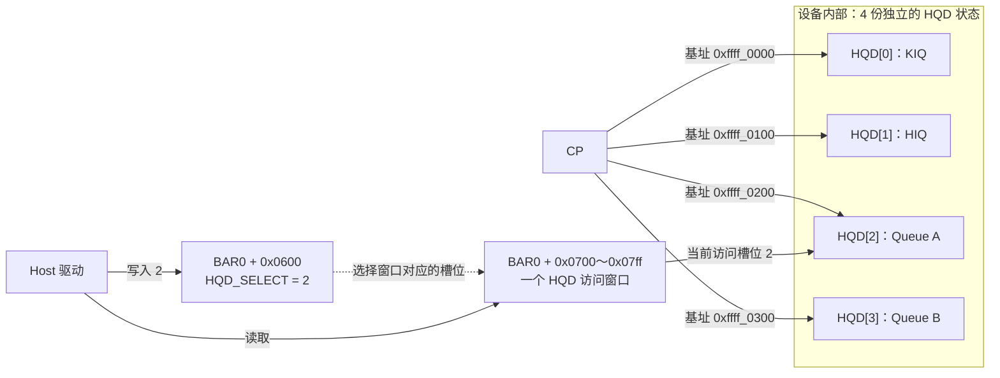

# CP/MEC 软件实现、参考与扩展

| 缩写  | 英文全称                                               | 中文含义                                                                       |
| ----- | ------------------------------------------------------ | ------------------------------------------------------------------------------ |
| CP    | Command Processor                                      | 命令处理器                                                                     |
| CPU   | Central Processing Unit                                | 中央处理器                                                                     |
| PCIe  | Peripheral Component Interconnect Express              | 高速外设互连总线                                                               |
| PCI   | Peripheral Component Interconnect                      | 外设互连总线                                                                   |
| BAR   | Base Address Register                                  | PCIe 基址寄存器；用于描述设备资源窗口                                          |
| DMA   | Direct Memory Access                                   | 直接内存访问                                                                   |
| IOVA  | I/O Virtual Address                                    | 设备访存使用的虚拟地址                                                         |
| IOMMU | Input/Output Memory Management Unit                    | 设备访存的地址翻译与权限检查单元                                               |
| SMMUv3 | System Memory Management Unit version 3              | Arm 系统内存管理单元第三版                                                    |
| BH    | Bottom Half                                            | QEMU 主循环中延后执行的回调                                                    |
| FD    | File Descriptor                                        | 文件描述符                                                                     |
| EOP   | End Of Pipe                                            | 管线结束；本文指执行结束相关处理                                               |
| MEC   | Micro Engine Compute                                   | 计算命令处理微引擎                                                             |
| IH    | Interrupt Handler                                      | 中断记录与分发模块                                                             |
| IRQ   | Interrupt Request                                      | 中断请求                                                                       |
| ACK   | Acknowledgment                                         | 确认；本版用于确认已经读取执行结果                                             |
| HQD   | Hardware Queue Descriptor                              | 硬件队列描述；用于保存队列驻留状态                                             |
| MQD   | Memory Queue Descriptor                                | 内存中的队列描述对象                                                           |
| IB    | Indirect Buffer                                        | 间接命令缓冲区；保存由 Ring 命令引用的一段 CP 命令，第一版不引入               |
| IQ    | 未核实                                                 | AMD 寄存器中的内部对象缩写；与定时、重试处理有关，完整流程待核实，第一版不引入 |
| RPTR  | Read Pointer                                           | 读指针；表示队列的消费进度                                                     |
| WPTR  | Write Pointer                                          | 写指针；表示队列的写入进度                                                     |
| GPU   | Graphics Processing Unit                               | 图形处理器                                                                     |
| KIQ   | Kernel Interface Queue                                 | 内核接口队列；第一版由 Host 配置的首个管理入口                                 |
| HIQ   | HSA Interface Queue                                    | HSA 接口队列；第一版由 KIQ 建立，用于管理用户队列                               |
| HSA   | Heterogeneous System Architecture                      | 异构系统架构                                                                   |
| HSAKMT | HSA Kernel Mode Thunk                                 | HSA 用户态与 KFD 内核接口之间的调用封装                                        |
| RV32  | 32-bit RISC-V                                          | 本实验计算解释器使用的 32 位 RISC-V 模型                                      |
| RV64  | 64-bit RISC-V                                          | 第一版 CP 使用的原生 64 位 RISC-V 模型                                         |
| M-mode | Machine Mode                                         | RISC-V 机器特权级；CP 裸机固件的运行模式                                      |
| QEMU  | Quick Emulator                                         | 本实验使用的设备与 CP 仿真平台                                                 |
| PMU   | Platform Management Unit                               | 平台管理单元；本文参考 ZynqMP PMU Firmware 的裸机调度实现                      |
| PM4   | AMD PM4                                                | AMD GPU 的一类底层命令包协议；用于说明计算 Ring 的 IB 引用及 KIQ 管理命令      |
| GC    | Graphics and Compute                                   | AMD 图形与计算模块；本文参考 GC 9.4.3 驱动                                     |
| VM    | Virtual Memory                                         | 虚拟内存；VM 上下文保存地址翻译所需的配置                                      |
| VMID  | Virtual Memory Identifier                              | 虚拟地址空间标识，用于选择 VM 上下文                                           |
| MMU   | Memory Management Unit                                 | 内存管理单元，执行地址翻译和权限检查                                           |
| TLB   | Translation Lookaside Buffer                           | 地址翻译缓存                                                                   |
| AQL   | Architected Queuing Language                           | 用户计算队列采用的命令包格式与提交协议                                         |
| KFD   | Kernel Fusion Driver                                   | AMD GPU 计算相关内核驱动组件                                                   |
| XCC   | Accelerator Core Complex                               | 驱动管理的计算核心复合体；本模型中对应一个 XCD                                 |
| XCD   | Accelerator Complex Die                                | 物理计算芯粒                                                                   |
| CU    | Compute Unit                                           | 执行 Kernel 指令的计算单元                                                     |
| PC    | Program Counter                                        | 程序计数器；记录指令执行位置                                                   |
| SGPR  | Scalar General Purpose Register                        | 标量通用寄存器                                                                 |
| VGPR  | Vector General Purpose Register                        | 向量通用寄存器                                                                 |
| EXEC  | Execution Mask                                         | 线程执行掩码；标识 wave 中参与执行的线程                                       |
| LDS   | Local Data Share                                       | 工作组使用的片上共享存储                                                       |
| GDS   | Global Data Share                                      | 全局数据共享；GC 9.4.3 已移除其内部数据存储                                    |
| GWS   | Global Wave Sync                                       | 全局 wave 同步；用于工作组之间的专用同步操作                                   |
| OA    | Ordered Append                                         | 有序追加；本文涉及相关资源需求和获取状态字段                                   |
| AMD   | Advanced Micro Devices                                 | 超威半导体公司；本文分析的 GPU 厂商                                            |
| GPGPU | General-Purpose Computing on Graphics Processing Units | 利用 GPU 进行通用计算                                                          |
| CDNA  | Compute DNA                                            | AMD 数据中心计算 GPU 架构系列                                                  |
| ROCm  | Radeon Open Compute                                    | AMD GPU 计算软件平台                                                           |
| ROCr  | ROCm Runtime                                           | AMD 的 HSA 用户态运行时                                                        |
| HWS   | Hardware Scheduling                                    | KFD 使用硬件／固件进行队列调度的模式                                           |
| ISA   | Instruction Set Architecture                           | 指令集架构                                                                     |
| ID    | Identifier                                             | 标识符；Packet ID 用于标识队列中的包                                           |
| LLVM  | LLVM（项目名称，源自 Low Level Virtual Machine）       | 编译器基础设施项目；本文引用其 AMDGPU 后端文档                                 |
| VRAM  | Video RAM                                              | 设备显存；本实验由 QEMU 提供后备存储                                           |
| wptr  | Write Pointer                                          | 队列写索引；本版用户 AQL 记录预留进度，管理 Ring 记录已发布范围               |
| MMIO  | Memory-Mapped Input/Output                             | 内存映射输入输出                                                               |
| RAM   | Random Access Memory                                   | 随机存取存储器；本文分别说明 Host RAM 与设备 VRAM                              |
| TCG   | Tiny Code Generator                                    | QEMU 的动态代码生成基础设施                                                    |
| TTM   | Translation Table Manager                              | Linux 内核中管理显存等存储资源的框架                                           |
| DRM   | Direct Rendering Manager                               | Linux 图形设备内核框架                                                         |
| KCQ   | Kernel Compute Queue                                   | 驱动管理的内核计算队列                                                         |
| PSP   | Platform Security Processor                            | AMD 平台安全处理器，参与固件加载                                               |
| MES   | Micro Engine Scheduler                                 | AMD 的微引擎调度器；本文的 AMD 启动参考不采用此路径                            |
| DWORD | Double Word                                            | 本文为 32 位、4 字节的数据单位                                                 |
| UAPI  | User-space Application Programming Interface           | 内核向用户态提供的接口                                                         |
| API   | Application Programming Interface                      | 应用编程接口                                                                   |
| ioctl | Input/Output Control                                   | 用户态向驱动发送控制请求的系统调用                                             |

[第一版规格](<./CP_MEC 第一版规格.md>)规定本实验的软件与设备接口；[实验大纲](<./QEMU GPGPU 实验大纲.md>)记录推进顺序。本文沿“启动、建立队列、提交任务、执行与完成、卸载”解释这些接口为何需要、软件怎样配合，并保存 AMD 和 gem5 的参考依据。完整的 AMD 寄存器取舍清单在[第 8 章](#amd-registers)。

**[BOUNDARY]** AMD 参考采用外部 Host CPU 与 MI300X 独立 GPU（CDNA 3）。AMD 事实、源码推断和实验设计分别标为 `[SPEC]`／`[SOURCE]`、`[INFERENCE]` 和 `[DESIGN]`。已有 QEMU 代码能力与第一版目标分别说明；解释一个接口的实现方案，不表示该功能已经接入。

<a id="implementation"></a>

## 1. 现有实现与 CP 接入位置

当前代码保留 Host 直接启动计算的同步路径，并已接入“用户发布 AQL → RV64 CP 取包 → RV32 执行器计算 → Signal 与事件通知”的队列路径。CP QTest 已通过 16/16；Linux 新内核下的驱动装载、五组队列端到端测试和四种同步组合回归均通过。具体运行结果与后续安排统一见[大纲当前实现记录](<./QEMU GPGPU 实验大纲.md#stage-two-implementation-results>)。

<a id="cp-executor-widths"></a>

### 1.1 Host、原生 CP 与计算解释器

```text
进程 A：A57 Linux
  应用与驱动在 A57 上运行
    → vfio-user-pci 代理：转发设备访问、处理消息 DMA、接收中断
       → 进程 B：gpgpu-cp
            ├─ gpu0：设备寄存器、VRAM、DMA、中断
            ├─ 原生 RV64 CP：执行独立固件，保存自己的 PC 与寄存器
            └─ RV32 计算解释器：执行应用 Kernel，保存各 lane 的执行状态
```

A57 的指令由对应 QEMU 目标的 TCG 推进。原生 CP 的 RV64 固件指令由设备进程中的 TCG 推进，构建和启动入口使用 `riscv64-softmmu`、`qemu-system-riscv64`。计算解释器则通过 C 代码读取 Kernel 的 RV32 指令，修改模拟的 lane 寄存器与 PC。三者各自保存取指位置与执行状态。

2026-10-18 按子仓库固定提交 `57543dd54b6b046b888277272fa84af81746b1ac` 核对：原生 CP 的默认及允许 CPU 类型均为 `TYPE_RISCV_CPU_BASE64`；计算执行器的 `GPGPULane.gpr[]` 和 `pc` 仍为 `uint32_t`。该基线的同步路径把参数块的 VRAM 偏移写入 lane 的 `gpr[10]`，即 `a0`；CP 固件使用自己的 64 位寄存器。当前新增的队列路径已由 CP 交付完整 Host 参数地址，计算线程的 `a0` 保存只读参数窗口起点，访问方式见[参数访问说明](#kernel-argument-access)。

例如两个源寄存器分别保存 3 和 5，计算解释器执行加法时，由 C 代码算出 8，再写入目标 lane 的模拟寄存器。TCG 则执行翻译后的指令块。各自保存执行状态，并不意味着每个设备或 lane 都有独立的执行线程；还要看由哪个调用或事件推进执行。

原生 CP 属于 PCIe 设备的内部控制核。Linux 调度器把应用线程、内核线程安排到 A57；GPGPU 驱动通过设备寄存器管理 CP 的固件、入口与复位，Linux 不把普通线程调度到 CP。

当前 CP 在 M-mode 执行裸机固件，不启用页表。本地地址空间仍采用原有 4 GiB 布局，地址 `0～vram_size-1` 映射到同一份 VRAM。Host 经 BAR2 写入固件，CP 按 VRAM 偏移取指。原生 CP 与计算解释器使用 RISC-V 代码，不说明 AMD MEC 使用 RISC-V，也不提供 AMD 固件二进制兼容性。

原有独立 CP 用例把测试固件放在 VRAM 偏移 `0x4000`：Host 写入 `BAR2 基址 + 0x4000`，CP 的入口填写 `0x4000`。这是独立用例使用的测试地址。历史同步驱动的分配池只排除首个 Host 页；当前队列驱动及真实队列固件使用下述固定保留区。

**[DESIGN]** 第二阶段已确认在 64 MiB VRAM 的末尾保留 4 MiB，即 `0x03c0_0000～0x03ff_ffff`，固件入口固定为 `0x03c0_0000`。最后 64 KiB 用作栈，其余 4032 KiB 保存代码、常量、全局变量和静态工作区，完整图示见[规格 3.1 节](<./CP_MEC 第一版规格.md#spec-firmware-layout>)。前 60 MiB 从偏移 0 开始，由 Linux 内核驱动按设备统一管理实际区间的分配与回收，首个页作为范围内的保留项登记。当前队列驱动已接入[通用伙伴分配器](#vram-buddy-allocator) `gpu_buddy`，固件已采用固定链接布局并初始化栈与全局数据；Linux 新内核下的分配、固件装载与生命周期用例已通过端到端验收。

> **[SOURCE]** 实验子仓库固定提交 `57543dd54b6b046b888277272fa84af81746b1ac`：
>
> - RV64 CP 的默认及允许 CPU 类型：[hw/riscv/gpgpu-cp.c](https://github.com/hxfei-git/gpu-study-qemu/blob/57543dd54b6b046b888277272fa84af81746b1ac/hw/riscv/gpgpu-cp.c#L274)，[274–288 行](https://github.com/hxfei-git/gpu-study-qemu/blob/57543dd54b6b046b888277272fa84af81746b1ac/hw/riscv/gpgpu-cp.c#L274-L288)。设备进程入口：[software/gpgpu/linux/module-test.py](vscode://file/home/book/1.project/gpu_study/4.experiments/gpu-study-qemu/software/gpgpu/linux/module-test.py:30:1)，[30 行](vscode://file/home/book/1.project/gpu_study/4.experiments/gpu-study-qemu/software/gpgpu/linux/module-test.py:30:1)使用 `qemu-system-riscv64`。
> - RV32 计算线程状态：[hw/gpgpu/gpgpu_core.h](vscode://file/home/book/1.project/gpu_study/4.experiments/gpu-study-qemu/hw/gpgpu/gpgpu_core.h:72:1)，[72–80 行](vscode://file/home/book/1.project/gpu_study/4.experiments/gpu-study-qemu/hw/gpgpu/gpgpu_core.h:72:1)；启动时填写各 lane 的 `a0`：[hw/gpgpu/gpgpu_core.c](https://github.com/hxfei-git/gpu-study-qemu/blob/57543dd54b6b046b888277272fa84af81746b1ac/hw/gpgpu/gpgpu_core.c#L615)，[615–624 行](https://github.com/hxfei-git/gpu-study-qemu/blob/57543dd54b6b046b888277272fa84af81746b1ac/hw/gpgpu/gpgpu_core.c#L615-L624)。
> - 默认 VRAM 容量：[hw/gpgpu/gpgpu.h](https://github.com/hxfei-git/gpu-study-qemu/blob/57543dd54b6b046b888277272fa84af81746b1ac/hw/gpgpu/gpgpu.h#L23) 的 [23–29 行](https://github.com/hxfei-git/gpu-study-qemu/blob/57543dd54b6b046b888277272fa84af81746b1ac/hw/gpgpu/gpgpu.h#L23-L29)定义 64 MiB 默认值。
> - 独立 CP 测试地址：[tests/qtest/gpgpu-cp-test.c](vscode://file/home/book/1.project/gpu_study/4.experiments/gpu-study-qemu/tests/qtest/gpgpu-cp-test.c:15:1) 的 [15–19 行](vscode://file/home/book/1.project/gpu_study/4.experiments/gpu-study-qemu/tests/qtest/gpgpu-cp-test.c:15:1)定义固件和结果位置，[73–98 行](vscode://file/home/book/1.project/gpu_study/4.experiments/gpu-study-qemu/tests/qtest/gpgpu-cp-test.c:73:1)经 BAR2 写入固件并设置入口。
> - 该基线的同步模式分配范围：[software/gpgpu/linux/gpgpu_pci.c](https://github.com/hxfei-git/gpu-study-qemu/blob/57543dd54b6b046b888277272fa84af81746b1ac/software/gpgpu/linux/gpgpu_pci.c#L184-L191)，[184–191 行](https://github.com/hxfei-git/gpu-study-qemu/blob/57543dd54b6b046b888277272fa84af81746b1ac/software/gpgpu/linux/gpgpu_pci.c#L184-L191)建立分配池并排除首个页，尚未扣除固件空间。当前入口已改名为 `gpgpu_pci_main.c`，这里保留固定提交链接；本次队列模式另由 `gpgpu_memory.c` 管理前 60 MiB。

在同一地址替换固件时，BAR、DMA、计算解释器写入及冷复位清零需要使相关 TCG 指令翻译失效，避免继续执行旧翻译块。

<a id="cp-host-window-implementation"></a>

#### 1.1.1 CP 读取 Host RAM 的实现路径

Host 已准备好一段内存，并建立设备可用的 IOVA 映射。CP 要读取其中的 Ring 字段时，先配置窗口基址，再执行普通读取指令。窗口的地址、访问宽度和复位规则见[规格 2.1 节](<./CP_MEC 第一版规格.md#cp-host-window>)；这里沿一次读取说明代码怎样配合。

```text
CP 执行窗口地址上的 load
  → gpgpu_cp_host_read：用基址和窗口偏移计算 64 位 IOVA
  → vfu_object_dma_rw：沿 gpu0 的 PCI DMA 地址空间访存
  → libvfio-user：向进程 A 发出 VFIO_USER_DMA_READ
  → A 的 vfio-user-pci 代理：使用该设备的 PCI DMA 接口
  → SMMUv3 翻译、检查权限（启用时）→ Host RAM
  → 回复数据或错误 → CP 取得读值或进入原生访问异常
```

协议中的 `DMA_READ` 表示设备向 Host 读取内存。CP 固件只执行窗口 `load/store`，不填写 Host 的批量搬运描述符，也不改变 `DMA_STATUS` 或发送 DMA 完成中断。Host 仍可经 BAR2 读写 VRAM，也可使用原 DMA 在 Host RAM 与 VRAM 之间搬运；CP 运行期间，Host 可以继续使用这两条路径。

CP 的本地地址空间容器负责按地址选择 VRAM 或 Host 窗口。VRAM 区域是原显存的别名，窗口把访问交给上图中的回调，两者都不额外分配数据存储。Host 访问自己的 RAM 使用 CPU 映射，访问设备 VRAM 才使用 BAR2；CP 访问 Host RAM 使用 IOVA，访问 VRAM 仍使用原本的本地偏移。

**消息交错。** CP 可以主动访存，因此 Host 的 BAR 请求可能夹在访存回复前面。固定版本的 libvfio-user 原先会把下一条收到的消息当作 DMA 回复，需要增加下面的处理：

```text
B 等待 DMA 回复
  → 先收到 A 的 BAR 请求：完整暂存请求、正文与 FD
  → 收到匹配的 DMA 回复：完成本次 CP 访存
  → QEMU 调度 BH：按顺序处理暂存的 Host 请求
```

等待期间不执行暂存请求的设备回调，避免重入正在进行的访存。即使 DMA 回复后没有新字节到达 socket，BH 也会处理已经暂存的请求。依赖修正保存在 `0002-queued-dma-requests.diff`，仍使用原同步传输接口。

卸载 DMA 映射时，还要保证旧地址映射不再引用对象后才释放它。映射对象现在拥有自己的引用计数，旧 `FlatView` 持有的引用全部释放后，才销毁对应内存区域。这个修正用于消除断开连接时检测到的释放后访问。

**[BOUNDARY]** 这条线路提供普通数据读写。当前固件已按[访存上下文与错误归属](<./CP_MEC 第一版规格.md#spec-memory-access-context>)处理失败，并按[单一更新者规则](<./CP_MEC 第一版规格.md#spec-signal-single-writer>)更新 Signal；第二阶段不增加 CP 原子读改写入口。队列建立、Ring 解析、通知和完整字段读写已接入，并由设备与固件 QTest 验证。队列主线使用 DMA 直通，访问 Host RAM 时采用物理地址；按 VMID 选择 GPU 页表留到第三阶段。本节的 SMMUv3 通路与历史测试记录继续保留，Linux 队列端到端验收状态以[大纲](<./QEMU GPGPU 实验大纲.md#stage-two-implementation-results>)为准。

> **[SOURCE] 历史 CP Host 窗口实现**：实验子仓库固定提交 `57543dd54b6b046b888277272fa84af81746b1ac`。
>
> - 窗口读写与基址寄存器：[hw/riscv/gpgpu-cp.c](https://github.com/hxfei-git/gpu-study-qemu/blob/57543dd54b6b046b888277272fa84af81746b1ac/hw/riscv/gpgpu-cp.c#L44)，[44–135 行](https://github.com/hxfei-git/gpu-study-qemu/blob/57543dd54b6b046b888277272fa84af81746b1ac/hw/riscv/gpgpu-cp.c#L44-L135)；本地地址空间与 VRAM 别名：[232–251 行](https://github.com/hxfei-git/gpu-study-qemu/blob/57543dd54b6b046b888277272fa84af81746b1ac/hw/riscv/gpgpu-cp.c#L232-L251)；RV64 CPU 选择：[274–288 行](https://github.com/hxfei-git/gpu-study-qemu/blob/57543dd54b6b046b888277272fa84af81746b1ac/hw/riscv/gpgpu-cp.c#L274-L288)。
> - PCI DMA 路由与暂存请求唤醒：[hw/remote/vfio-user-obj.c](vscode://file/home/book/1.project/gpu_study/4.experiments/gpu-study-qemu/hw/remote/vfio-user-obj.c:134:1)，[134–187 行](vscode://file/home/book/1.project/gpu_study/4.experiments/gpu-study-qemu/hw/remote/vfio-user-obj.c:134:1)；映射对象的引用与释放：[407–464 行](vscode://file/home/book/1.project/gpu_study/4.experiments/gpu-study-qemu/hw/remote/vfio-user-obj.c:407:1)。
> - 消息交错修正：[0002-queued-dma-requests.diff](./gpu-study-qemu/subprojects/packagefiles/libvfio-user/0002-queued-dma-requests.diff)，应用于 libvfio-user 固定版本 `0b28d205572c80b568a1003db2c8f37ca333e4d7`，接在原 `0001` 后面。
> - 原生固件访存、异常恢复和 Host DMA 并用：[tests/qtest/gpgpu-cp-test.c](vscode://file/home/book/1.project/gpu_study/4.experiments/gpu-study-qemu/tests/qtest/gpgpu-cp-test.c:321:1)，[321–530 行](vscode://file/home/book/1.project/gpu_study/4.experiments/gpu-study-qemu/tests/qtest/gpgpu-cp-test.c:321:1)；确定性消息交错：[tests/qtest/gpgpu-vfio-user-test.h](vscode://file/home/book/1.project/gpu_study/4.experiments/gpu-study-qemu/tests/qtest/gpgpu-vfio-user-test.h:115:1)，[115–255 行](vscode://file/home/book/1.project/gpu_study/4.experiments/gpu-study-qemu/tests/qtest/gpgpu-vfio-user-test.h:115:1)。

历史验证记录（2026-10-14，当时 CP 为 RV32）：CP 用例 8/8、双进程 IOMMU 2/2、单进程 IOMMU 2/2、原有 A57 GPGPU 用例 21/21 通过。当时的 CP 用例使用真实 RV32 指令，覆盖 1/2/4 字节读写、超过 32 位的 IOVA、非恒等翻译、基址复位、访问异常与恢复，以及 CP 访存期间 Host DMA 继续工作。设备进程启用 AddressSanitizer、固定进程地址布局后，这 8 项也全部通过，未报告内存访问错误。当前 RV64 版本的验证记录见下文 2026-10-17 条目。

2026-10-14 的 libvfio-user 新增交错用例 6/6、包含这些用例的相关 Python 测试 35/35、原 C 单测 18/18 通过。该次未重跑 Linux 客体的驱动和运行时端到端测试。

2026-10-17 原生 CP 迁移至 RV64，保留裸机物理访存、现有地址编码和 RV32 计算解释器。复用原有 8 项 CP 用例，增加 `LD/SD` 读写高半部非零的 64 位值，并检查消息请求长度为 8 字节；原有 1/2/4 字节访问、复位、固件替换、异常恢复和 Host DMA 并用继续通过。CP 用例 8/8、单／双进程 IOMMU 各 2/2、AArch64／RISC-V 设备用例各 21/21，以及 RV32 汇编前端 4/4 均通过。日志沿用子仓库 `build/` 下的位置，没有增加测试脚本或独立测试用例。

同日运行 Linux 客体回归，内核为 `6.18.57-0-virt`。单／双进程分别覆盖 `none`、`smmuv3`：四组均通过三个示例的 17,953 个输出值、68/68 运行时检查、5/5 驱动装卸载检查及 2/2 软件栈卸载重载检查，退出码均为 0，无内核异常或非预期 SMMU fault。这四组回归沿用同步计算路径，双进程模式中的原生 CP 保持复位，应用 Kernel 仍由 RV32 计算解释器执行；CP 固件能力由上述 8 项 QTest 单独验证。结果保存在子仓库 `build/gpgpu-linux-module/{none,smmuv3,remote/none,remote/smmuv3}/` 下的 `test.json`、`stack-test.json` 和相应日志中。

RV64 版本在子仓库中使用同时启用 `aarch64-softmmu`、`riscv64-softmmu` 和 `vfio-user-server` 的构建。下列入口沿用 `build/arm64-qemu`；2026-10-14 的历史记录使用 `build/cp-window`：

```bash
make -f Makefile.camp test-gpgpu-cp JOBS=4
make -f Makefile.camp test-gpgpu-remote-iommu JOBS=4
make -f Makefile.camp test-gpgpu-iommu JOBS=4
QTEST_QEMU_BINARY="$PWD/build/arm64-qemu/qemu-system-aarch64" \
  build/arm64-qemu/tests/qtest/qos-test --tap \
  -p /aarch64/virt/generic-pcihost/pci-bus-generic/pci-bus/gpgpu/gpgpu-tests
```

RISC-V 设备回归将上一条命令中的 `aarch64` 换为 `riscv64`。汇编前端与四种 Linux 配置继续使用已有入口：

```bash
make -C software/gpgpu check-assembler
for remote in 0 1; do
    for iommu in none smmuv3; do
        make -C software/gpgpu/linux test REMOTE=$remote IOMMU=$iommu
        make -f Makefile.camp test-gpgpu-stack REMOTE=$remote IOMMU=$iommu
    done
done
```

### 1.2 同步计算路径与 CP 固件提交路径

现有同步调用按下面的路径执行。`LAUNCH ioctl` 返回时，驱动已经完成相应等待，运行时随后释放本次上传的参数：

```text
运行时准备并上传参数
  → LAUNCH ioctl
  → 驱动填写原 BAR0 代码、参数、grid、block 与 DISPATCH
  → 设备 DISPATCH 回调同步调用 RV32 计算解释器
  → 成功或失败更新设备状态，并发出相应通知
  → 驱动等待结束，返回运行时
  → 运行时释放本次参数
```

当前队列路径由调用方发布 AQL Packet、通知对应队列，CP 固件取包并提交计算。QEMU 保存配置快照，分段执行 Kernel，再向 CP 发布完成或失败状态。CP 仍等待整个 Dispatch 结束后才处理后续队列命令；执行器每段返回 QEMU 主循环，Host 可继续准备和发布任务。

在实验子仓库固定提交 `fd2719636bb903ee2815e359dc9af5af7f0202a4` 中，CP 复位和入口已经实现；BAR4 Doorbell 的写处理仍为空，BAR0 尚无 HQD 选择与窗口路由，UAPI 也尚无 Queue／Signal 接口。这是当时的实现状态；当前队列路径已接入 HQD、Doorbell、取包和计算派发，历史证据继续保留如下。

> **[SOURCE] 可选源码索引** 实验子仓库 `fd2719636bb903ee2815e359dc9af5af7f0202a4`：
>
> - 参数准备、同步 Launch 与释放：[software/gpgpu/runtime/gpgpu.c，287–347 行](https://github.com/hxfei-git/gpu-study-qemu/blob/fd2719636bb903ee2815e359dc9af5af7f0202a4/software/gpgpu/runtime/gpgpu.c#L287-L347)。
> - 驱动启动并等待：[software/gpgpu/linux/gpgpu_pci.c，396–422 行](https://github.com/hxfei-git/gpu-study-qemu/blob/fd2719636bb903ee2815e359dc9af5af7f0202a4/software/gpgpu/linux/gpgpu_pci.c#L396-L422)。
> - 同步派发、忙碌状态与完成／失败通知：[hw/gpgpu/gpgpu_dispatch.c，14–114 行](https://github.com/hxfei-git/gpu-study-qemu/blob/fd2719636bb903ee2815e359dc9af5af7f0202a4/hw/gpgpu/gpgpu_dispatch.c#L14-L114)。
> - CP 复位与入口：[hw/gpgpu/gpgpu_cp.c，9–74 行](https://github.com/hxfei-git/gpu-study-qemu/blob/fd2719636bb903ee2815e359dc9af5af7f0202a4/hw/gpgpu/gpgpu_cp.c#L9-L74)；设备与 CP 共用 VRAM：[hw/riscv/gpgpu-cp.c，102–140 行](https://github.com/hxfei-git/gpu-study-qemu/blob/fd2719636bb903ee2815e359dc9af5af7f0202a4/hw/riscv/gpgpu-cp.c#L102-L140)。
> - 设备状态与 lane 执行状态分别保存：[hw/gpgpu/gpgpu.h，74–102 行](https://github.com/hxfei-git/gpu-study-qemu/blob/fd2719636bb903ee2815e359dc9af5af7f0202a4/hw/gpgpu/gpgpu.h#L74-L102)、[hw/gpgpu/gpgpu_core.h，72–94 行](https://github.com/hxfei-git/gpu-study-qemu/blob/fd2719636bb903ee2815e359dc9af5af7f0202a4/hw/gpgpu/gpgpu_core.h#L72-L94)；TCG 翻译块执行入口：[accel/tcg/cpu-exec.c，428–439 行](https://github.com/hxfei-git/gpu-study-qemu/blob/fd2719636bb903ee2815e359dc9af5af7f0202a4/accel/tcg/cpu-exec.c#L428-L439)。
> - 该基线的 BAR0 路由：[hw/gpgpu/gpgpu_regs.c，25–101 行](https://github.com/hxfei-git/gpu-study-qemu/blob/fd2719636bb903ee2815e359dc9af5af7f0202a4/hw/gpgpu/gpgpu_regs.c#L25-L101)；Doorbell 占位：[hw/gpgpu/gpgpu_doorbell.c，10–23 行](https://github.com/hxfei-git/gpu-study-qemu/blob/fd2719636bb903ee2815e359dc9af5af7f0202a4/hw/gpgpu/gpgpu_doorbell.c#L10-L23)；该基线的 UAPI：[software/gpgpu/include/gpgpu_uapi.h，17–73 行](https://github.com/hxfei-git/gpu-study-qemu/blob/fd2719636bb903ee2815e359dc9af5af7f0202a4/software/gpgpu/include/gpgpu_uapi.h#L17-L73)。

构建、运行与软件栈使用方式见[子仓库软件栈说明](./gpu-study-qemu/software/gpgpu/README.md)和[设备源码规格](./gpu-study-qemu/docs/specs/gpgpu.rst)。

> **[SOURCE] 当前队列实现入口**（实验子仓库 `6325a87e4c500f4930c4e0b502a1ec241f83bf26`，2026-10-19；与上述历史同步基线区分）：
>
> - 固件检查管理与用户槽位的顺序：[software/gpgpu/firmware/main.c](https://github.com/hxfei-git/gpu-study-qemu/blob/6325a87e4c500f4930c4e0b502a1ec241f83bf26/software/gpgpu/firmware/main.c#L132) 的 [132–164 行](https://github.com/hxfei-git/gpu-study-qemu/blob/6325a87e4c500f4930c4e0b502a1ec241f83bf26/software/gpgpu/firmware/main.c#L132)；Dispatch 执行确认、Signal、通知和槽位归还：[software/gpgpu/firmware/aql.c](https://github.com/hxfei-git/gpu-study-qemu/blob/6325a87e4c500f4930c4e0b502a1ec241f83bf26/software/gpgpu/firmware/aql.c#L72) 的 [72–173 行](https://github.com/hxfei-git/gpu-study-qemu/blob/6325a87e4c500f4930c4e0b502a1ec241f83bf26/software/gpgpu/firmware/aql.c#L72)。
> - 执行器提交与终态确认：[hw/gpgpu/gpgpu_dispatch.c](https://github.com/hxfei-git/gpu-study-qemu/blob/6325a87e4c500f4930c4e0b502a1ec241f83bf26/hw/gpgpu/gpgpu_dispatch.c#L216) 的 [216–260 行](https://github.com/hxfei-git/gpu-study-qemu/blob/6325a87e4c500f4930c4e0b502a1ec241f83bf26/hw/gpgpu/gpgpu_dispatch.c#L216)；Host 参数窗口读取：[hw/gpgpu/gpgpu_params.c](https://github.com/hxfei-git/gpu-study-qemu/blob/6325a87e4c500f4930c4e0b502a1ec241f83bf26/hw/gpgpu/gpgpu_params.c#L12) 的 [12–30 行](https://github.com/hxfei-git/gpu-study-qemu/blob/6325a87e4c500f4930c4e0b502a1ec241f83bf26/hw/gpgpu/gpgpu_params.c#L12)。
> - 驱动加载固件并建立管理入口：[software/gpgpu/linux/gpgpu_queue.c](https://github.com/hxfei-git/gpu-study-qemu/blob/6325a87e4c500f4930c4e0b502a1ec241f83bf26/software/gpgpu/linux/gpgpu_queue.c#L303) 的 [303–363 行](https://github.com/hxfei-git/gpu-study-qemu/blob/6325a87e4c500f4930c4e0b502a1ec241f83bf26/software/gpgpu/linux/gpgpu_queue.c#L303)；显存分配器与首个保留页：[software/gpgpu/linux/gpgpu_memory.c](https://github.com/hxfei-git/gpu-study-qemu/blob/6325a87e4c500f4930c4e0b502a1ec241f83bf26/software/gpgpu/linux/gpgpu_memory.c#L13) 的 [13–27 行](https://github.com/hxfei-git/gpu-study-qemu/blob/6325a87e4c500f4930c4e0b502a1ec241f83bf26/software/gpgpu/linux/gpgpu_memory.c#L13)。
> - 驱动保存通知与故障：[software/gpgpu/linux/gpgpu_event.c](https://github.com/hxfei-git/gpu-study-qemu/blob/6325a87e4c500f4930c4e0b502a1ec241f83bf26/software/gpgpu/linux/gpgpu_event.c#L60) 的 [60–117 行](https://github.com/hxfei-git/gpu-study-qemu/blob/6325a87e4c500f4930c4e0b502a1ec241f83bf26/software/gpgpu/linux/gpgpu_event.c#L60)；四组 HSAKMT 风格接口声明：[software/gpgpu/hsakmt/gpgpu_kmt.h](https://github.com/hxfei-git/gpu-study-qemu/blob/6325a87e4c500f4930c4e0b502a1ec241f83bf26/software/gpgpu/hsakmt/gpgpu_kmt.h#L103) 的 [103–152 行](https://github.com/hxfei-git/gpu-study-qemu/blob/6325a87e4c500f4930c4e0b502a1ec241f83bf26/software/gpgpu/hsakmt/gpgpu_kmt.h#L103)。

<a id="host-software-flow"></a>

### 1.3 Host 软件从创建队列到回收任务

接入队列后，应用希望连续提交计算，再分别等待结果。第二阶段的用户态向上实现到 HSAKMT 风格接口库，封装设备连接、内存、队列和事件管理。参数组织、AQL 发布与 Signal 判断由调用方承担，当前可以是实验程序，以后再评估运行时。

以下以驱动已通过 KIQ 建立 HIQ、设备仍有空闲用户队列名额为前提，说明调用方、接口库与驱动怎样配合。Queue A 只是本次申请所得队列的示例名称；输入输出和释放接口已按[规格 9.7](<./CP_MEC 第一版规格.md#spec-host-api-scope>)接入 HSAKMT 风格库与队列驱动，Linux 五组端到端测试已通过。

```text
调用方经接口库申请 Ring、进度和任务存储，准备代码与输入数据
  → 驱动分配内存，接口库建立所需 CPU 映射
  → 调用方请求创建 Queue A，驱动准备 MQD 与本次管理结果区
  → 驱动向 HIQ 提交 MAP_QUEUES，指定 USER_AQL 和 MQD_A 地址
  → CP 选择空闲用户槽位，装载队列；驱动按管理完成协议确认可用
  → 接口库交付队列标识及 Doorbell 入口
  → 调用方准备描述对象、参数与 Signal，经接口库创建内核事件
  → 调用方写包、发布并通知设备，然后可以继续提交
  → 调用方检查 Signal，必要时经接口库等待事件，唤醒后复查
  → 完成协议允许后，调用方释放不再使用的任务对象
  → 调用方停止提交，完成正常排空，再请求销毁队列
  → 驱动确认卸载完成，再按映射引用和资源使用情况释放对象
```

**[DESIGN]** 全设备最多同时存在两条用户 Queue，所有应用共享两个名额，KIQ、HIQ 不计入。驱动为每次申请准备 Ring、MQD 和进度区，CP 根据映射请求从 HQD 槽位 2、3 中选择空闲槽位；两个名额都已占用时，CP 报告失败，由驱动向应用返回。成功销毁并完成清理、归还名额后，后续申请可以创建新的队列，完整例子见[规格中的用户队列数量与名额](<./CP_MEC 第一版规格.md#spec-user-queue-capacity>)。

**[DESIGN]** 正常逐任务提交由调用方直接发布包并写 Doorbell，驱动负责资源与队列管理，阻塞等待通过事件接口进入驱动。发布完成后，任务可能仍在执行；参数、描述对象、代码和完成对象继续保留到各自允许回收的时机。接口库不接管每个任务的参数复制和 Signal 分配，也不增加逐 Dispatch 的 `LAUNCH` ioctl。

用户队列进度区和所属应用上下文的 Signal 区映射给调用方。Signal 区独立于具体队列，调用方按需布置完成对象；管理完成标记由驱动在独立管理区中按请求使用。分配与映射规则见[规格第 2.2 节](<./CP_MEC 第一版规格.md#spec-shared-state-storage>)。本文其余实验流程中的“运行时”泛指这些用户态调用方，不表示第二阶段需要实现 ROCr/HSA 运行时。

Kernel 描述对象、代码和输入输出数组放在 VRAM，由调用方经接口库向驱动申请，驱动从设备统一管理的前 60 MiB 中分配实际区间并记录占用。参数块使用驱动分配并映射给所属应用的 Host RAM 一致性内存。调用方在参数块中填写数组的 VRAM 偏移和标量参数，再把参数块物理地址写入 Dispatch。完整关系图见[规格第 2.3 节](<./CP_MEC 第一版规格.md#spec-kernel-data-storage>)；执行器的 Host 参数访问仍需接入。

<a id="vram-buddy-allocator"></a>

AMD 参考采用相同的职责划分：内核 amdgpu 驱动通过 TTM 管理显存对象，设备的 VRAM 管理器负责实际区间的分配与回收。仓库固定版本在 VRAM 管理器中调用 `gpu_buddy_init()`、`gpu_buddy_alloc_blocks()` 和 `gpu_buddy_free_list()`，由通用伙伴分配器完成区间分配与回收。

> **[SOURCE]** Linux 固定版本 `248951ddc14de84de3910f9b13f51491a8cd91df`：[drivers/gpu/drm/amd/amdgpu/amdgpu_vram_mgr.c](vscode://file/home/book/1.project/gpu_study/2.%E6%BA%90%E7%A0%81/linux/drivers/gpu/drm/amd/amdgpu/amdgpu_vram_mgr.c:900:1) 的 [900–940 行](vscode://file/home/book/1.project/gpu_study/2.%E6%BA%90%E7%A0%81/linux/drivers/gpu/drm/amd/amdgpu/amdgpu_vram_mgr.c:900:1)注册分配、释放操作，并按设备实际 VRAM 容量建立管理器；[442–567 行](vscode://file/home/book/1.project/gpu_study/2.%E6%BA%90%E7%A0%81/linux/drivers/gpu/drm/amd/amdgpu/amdgpu_vram_mgr.c:442:1)分配区间，[635–660 行](vscode://file/home/book/1.project/gpu_study/2.%E6%BA%90%E7%A0%81/linux/drivers/gpu/drm/amd/amdgpu/amdgpu_vram_mgr.c:635:1)回收区间。这说明 MI300X 独立 GPU 路径由内核驱动调用通用伙伴分配器管理实际显存。

**[DESIGN]** 本实验参考上述做法，驱动复用目标内核的通用伙伴分配器：提供 `gpu_buddy` 时使用该接口；仍提供 `drm_buddy` 时使用对应实现。驱动按设备维护一个分配器实例，并处理请求校验、锁、对象归属和设备访问结束后的释放。普通显存对象申请连续区间，沿用当前阶段的 VRAM 偏移访问方式。

`gpu_buddy` 源自 `drm_buddy`。上游迁移把分配核心从 `drivers/gpu/drm/drm_buddy.c` 移到 `drivers/gpu/buddy.c`，将相关接口、结构体和标志改为 `gpu_buddy`／`GPU_BUDDY` 命名，并调整头文件和构建配置，使分配核心能供 DRM 之外的 GPU 驱动使用。DRM 专用打印辅助代码仍留在原目录。该次迁移以保持分配行为为目标；跨内核版本仍需核对接口和后续修复，不能仅替换函数名前缀就认定接入完成。

> **[SOURCE]** 上游迁移提交 [`ba110db8e1bc206c13fd7d985e79b033f53bfdea`](https://github.com/torvalds/linux/commit/ba110db8e1bc206c13fd7d985e79b033f53bfdea)，标题为“gpu: Move DRM buddy allocator one level up (part two)”（将 DRM 伙伴分配器上移一层，第二部分）。提交说明明确以不改变功能为目标，同时修改接口、结构体、配置和调用者。仓库固定版本中的分离结果见下列源码。
>
> - 分配核心与初始化：[drivers/gpu/buddy.c](vscode://file/home/book/1.project/gpu_study/2.%E6%BA%90%E7%A0%81/linux/drivers/gpu/buddy.c:351:1) 的 [351–455 行](vscode://file/home/book/1.project/gpu_study/2.%E6%BA%90%E7%A0%81/linux/drivers/gpu/buddy.c:351:1)。
> - 由调用方负责锁：[include/linux/gpu_buddy.h](vscode://file/home/book/1.project/gpu_study/2.%E6%BA%90%E7%A0%81/linux/include/linux/gpu_buddy.h:139:1) 的 [139–148 行](vscode://file/home/book/1.project/gpu_study/2.%E6%BA%90%E7%A0%81/linux/include/linux/gpu_buddy.h:139:1)；连续分配标志见同文件 [34–41 行](vscode://file/home/book/1.project/gpu_study/2.%E6%BA%90%E7%A0%81/linux/include/linux/gpu_buddy.h:34:1)。
> - 通用核心的配置：[drivers/gpu/Kconfig](vscode://file/home/book/1.project/gpu_study/2.%E6%BA%90%E7%A0%81/linux/drivers/gpu/Kconfig:3:1) 的 [3–6 行](vscode://file/home/book/1.project/gpu_study/2.%E6%BA%90%E7%A0%81/linux/drivers/gpu/Kconfig:3:1)；DRM 配置关联：[drivers/gpu/drm/Kconfig](vscode://file/home/book/1.project/gpu_study/2.%E6%BA%90%E7%A0%81/linux/drivers/gpu/drm/Kconfig:237:1) 的 [237–242 行](vscode://file/home/book/1.project/gpu_study/2.%E6%BA%90%E7%A0%81/linux/drivers/gpu/drm/Kconfig:237:1)。
> - 保留的 DRM 打印辅助函数：[drivers/gpu/drm/drm_buddy.c](vscode://file/home/book/1.project/gpu_study/2.%E6%BA%90%E7%A0%81/linux/drivers/gpu/drm/drm_buddy.c:17:1) 的 [17–78 行](vscode://file/home/book/1.project/gpu_study/2.%E6%BA%90%E7%A0%81/linux/drivers/gpu/drm/drm_buddy.c:17:1)。

**[BOUNDARY]** 队列模式已使用 `gpu_buddy` 管理前 60 MiB，原同步模式继续使用 `gen_pool`。驱动已在 Linux `6.18.57-0-gpgpu-virt` 上完成编译和运行验收，覆盖分配、回收、保留区及并发提交，状态见[大纲](<./QEMU GPGPU 实验大纲.md#stage-two-implementation-results>)。

接口方案参考仓库固定版本的 libhsakmt，分成四组。实现边界、参数含义、返回状态及资源释放行为已按[规格 9.7](<./CP_MEC 第一版规格.md#spec-host-api-scope>)统一确认。四组实验接口已接入；下图保留各组用途及对应的 AMD 参考入口：

```text
设备连接与查询  → hsaKmtOpenKFD / CloseKFD / GetVersion / GetNodeProperties
内存申请与释放  → hsaKmtAllocMemory / FreeMemory
队列创建与销毁  → hsaKmtCreateQueue / DestroyQueue
事件创建与等待  → hsaKmtCreateEvent / QueryEventState / WaitOnEvent / DestroyEvent
```

上述接口的源码位置和实验取舍集中在规格中。内存接口分别交付软件句柄、CPU 映射资料、Host 物理地址或 VRAM 偏移，见[9.7.2](<./CP_MEC 第一版规格.md#spec-hsakmt-memory>)；队列创建使用调用方预先申请的 Ring 和进度对象，见[9.7.3](<./CP_MEC 第一版规格.md#spec-hsakmt-queue>)。仍采用实验设备的地址和队列约定，不能据此认定原版 libhsakmt 或 ROCr 可以直接运行。

Ring 槽、任务参数和 Signal 的可复用时机分别判断。例如任务已经完成、原 Ring 槽也已归还，但调用方仍可能持有 Signal 查询结果，此时不能把同一个完成对象分给新任务。设备访问、旧通知和驱动引用结束的条件已确认，内核事件的创建、故障交付和释放接口见[9.7.4](<./CP_MEC 第一版规格.md#spec-hsakmt-event>)。调用方继续完成约 `200 μs` 主动检查后转入事件等待的流程，接口库不另加一轮主动检查。

现有 libgpgpu 的同步计算路径继续用于独立回归，既有上传和读回可以供新路径复用；新接口的分层不再以高层 `gpgpuLaunchKernel()` 为中心。ROCr/HSA 运行时及高层任务接口留待[后续单独评估](<./QEMU GPGPU 实验大纲.md#rocr-runtime-extension>)。创建失败、映射引用与退出时的资源保护见[资源释放与软件清理](#host-resource-lifetime)。

> **[SOURCE]** 子仓库固定版本 `57543dd54b6b046b888277272fa84af81746b1ac`：[software/gpgpu/runtime/gpgpu.h](vscode://file/home/book/1.project/gpu_study/4.experiments/gpu-study-qemu/software/gpgpu/runtime/gpgpu.h:9:1) 的 [9–43 行](vscode://file/home/book/1.project/gpu_study/4.experiments/gpu-study-qemu/software/gpgpu/runtime/gpgpu.h:9:1)定义现有上下文、Kernel、三维尺寸和返回值；[gpgpu.c](vscode://file/home/book/1.project/gpu_study/4.experiments/gpu-study-qemu/software/gpgpu/runtime/gpgpu.c:268:1) 的 [268–348 行](vscode://file/home/book/1.project/gpu_study/4.experiments/gpu-study-qemu/software/gpgpu/runtime/gpgpu.c:268:1)给出现有尺寸校验、参数复制、同步提交和等待。这里记录历史同步实现；当前队列接口保存在独立的 HSAKMT 风格库中。

## 2. 队列对象与地址空间

驱动要建立 Queue A，先准备保存命令的 Ring 和描述队列的 MQD；CP 将 MQD 装入一个 HQD 槽位后，才能根据这份状态读取 Ring。第二阶段按物理地址与 VRAM 偏移访问，所有队列的 VMID 固定为 0。本章依次说明 Ring 与 MQD 的分配、队列状态的装载与保存、寄存器窗口和 VMID；AMD 的地址翻译及多 XCC 案例作为参考，与当前实验方案分开说明。

<a id="mqd"></a>

### 2.1 MQD 保存可恢复状态，HQD 保存驻留状态

<a id="ring-mqd-storage"></a>

#### 2.1.1 Ring 与 MQD 的分配和访问

**[DESIGN]** 本实验的用户 Ring、KIQ/HIQ Ring 和所有 MQD 均放在 Host RAM，由驱动分配；约定见[规格第 2 节](<./CP_MEC 第一版规格.md#spec-ring-mqd-storage>)。以创建 Queue A、提交一次计算为例，当前主线按 Host DMA 直通配置说明，驱动已配置首次 KIQ，并通过 KIQ 建立 HIQ。下图展示这些对象的访问顺序：

```text
驱动填写 Host RAM 中的 MQD_A
  └─ 保存 Ring_A 的地址、容量、队列上下文等配置

驱动向 Host RAM 中的 HIQ Ring 写入 MAP_QUEUES
  └─ 命令携带 queue_kind = USER_AQL、MQD_A 的 Host RAM 物理地址
       ↓ CP 通过 Host 访存窗口读取
CP 选择空闲用户槽位，找到 MQD_A，读取配置
       ↓ 装入
设备内的 HQD_A：保存 Queue A 的活动状态
       ↓ CP 根据其中的 Ring 地址寻找命令
Host RAM 中的 Ring_A
  ↑ 运行时通过用户映射填写 AQL Dispatch
  └─ CP 通过 Host 访存窗口取包，随后组织计算
```

用户 Ring 由运行时请求创建，驱动使用 `dma_alloc_coherent()` 分配设备可访问的一致性内存，再用 `dma_mmap_coherent()` 映射给所属应用。运行时通过映射直接填写包，驱动负责内存和映射的生命周期。KIQ、HIQ Ring 由驱动分配并填写管理命令；所有 MQD 由驱动分配、初始化，供 CP 装载和卸载保存。这些管理对象不映射给普通应用。

这种安排使 Host 能通过自己的内存映射准备命令和队列配置，CP 则沿已有 Host 访存窗口读取。Ring 保存任务描述；Kernel 代码、描述对象和数组放在 VRAM，参数块放在 Host RAM，具体访问关系见[规格第 2.3 节](<./CP_MEC 第一版规格.md#spec-kernel-data-storage>)。

同一块 Ring 内存有不同的访问入口。驱动和运行时通过各自的 CPU 映射访问；在本例直通配置中，CP 的 DMA 请求携带 Host RAM 物理地址：

```text
驱动的 CPU 映射 ──→ 同一块 Host RAM ←── 应用的 CPU 映射
                           ↑
               Host RAM 物理地址，DMA 直通
                           ↑
                    CP 的 Host 访存窗口
```

`dma_alloc_coherent()` 返回驱动可用的 CPU 地址和设备 DMA 地址；用户映射提供应用填写 Ring 的入口。本例的设备 DMA 地址按 Host RAM 物理地址使用，驱动仍取 DMA 分配接口返回的值，不能把 CPU 映射指针填给设备。物理地址字段保留完整的 64 位，低、高位直接拆分，具体例子见[规格第 2.4 节](<./CP_MEC 第一版规格.md#spec-address-values>)；Ring、MQD 等共享对象中的多字节字段统一按[小端格式](<./CP_MEC 第一版规格.md#spec-shared-endian>)编码。Ring 基址按 64 字节、MQD 至少按 8 字节对齐，完整约定见[地址位宽、对象对齐与访问校验](<./CP_MEC 第一版规格.md#spec-address-validation>)。

一致性内存允许 CPU 与设备看到彼此的更新，无需显式刷新缓存；包内容、有效 Header、生产进度与 Doorbell 的发布仍须遵守顺序。具体屏障和发布协议留在规格 9.4 确认。Signal 采用[单一更新者规则](<./CP_MEC 第一版规格.md#spec-signal-single-writer>)，仍须保证完整的 64 位读写及结果先于完成值发布。

> **[SOURCE]** Linux 固定版本 `248951ddc14de84de3910f9b13f51491a8cd91df`，[Documentation/core-api/dma-api-howto.rst](https://github.com/torvalds/linux/blob/248951ddc14de84de3910f9b13f51491a8cd91df/Documentation/core-api/dma-api-howto.rst#L348-L390)：[348–390 行](https://github.com/torvalds/linux/blob/248951ddc14de84de3910f9b13f51491a8cd91df/Documentation/core-api/dma-api-howto.rst#L348-L390)区分一致性映射与内存屏障要求；[420–449 行](https://github.com/torvalds/linux/blob/248951ddc14de84de3910f9b13f51491a8cd91df/Documentation/core-api/dma-api-howto.rst#L420-L449)说明一致性内存分配及 CPU、设备各自使用的地址。

第一阶段已经用这两个分配与映射接口提供 DMA 暂存缓冲区，CP Host 窗口也已接入。队列使用同样的方法另行分配内存，按队列生命周期保留；原搬运暂存区仍供数据传输使用。

> **[SOURCE]** 实验子仓库固定提交 `a49cd28e70e640b1d23a0651c74c029bc2dac4cf`：
>
> - 第一阶段暂存缓冲区的分配：[software/gpgpu/linux/gpgpu_pci.c](https://github.com/hxfei-git/gpu-study-qemu/blob/a49cd28e70e640b1d23a0651c74c029bc2dac4cf/software/gpgpu/linux/gpgpu_pci.c#L195-L203)，[195–203 行](https://github.com/hxfei-git/gpu-study-qemu/blob/a49cd28e70e640b1d23a0651c74c029bc2dac4cf/software/gpgpu/linux/gpgpu_pci.c#L195-L203)；用户映射：[246–268 行](https://github.com/hxfei-git/gpu-study-qemu/blob/a49cd28e70e640b1d23a0651c74c029bc2dac4cf/software/gpgpu/linux/gpgpu_pci.c#L246-L268)。
> - CP 使用设备 DMA 地址访问 Host RAM：[hw/riscv/gpgpu-cp.c](https://github.com/hxfei-git/gpu-study-qemu/blob/a49cd28e70e640b1d23a0651c74c029bc2dac4cf/hw/riscv/gpgpu-cp.c#L44-L84)，[44–84 行](https://github.com/hxfei-git/gpu-study-qemu/blob/a49cd28e70e640b1d23a0651c74c029bc2dac4cf/hw/riscv/gpgpu-cp.c#L44-L84)。

**[BOUNDARY]** 本节的存储、分配和映射方式已接入队列驱动，Linux 运行验证见[大纲](<./QEMU GPGPU 实验大纲.md#stage-two-implementation-results>)。第二阶段管理队列与用户队列的 VMID 均为 0；用户 Ring 仍由 Host 软件记录所属上下文，MQD 仍由驱动管理。当前阶段不按 VMID 选择页表。既有 SMMUv3 翻译配置见[窗口实现说明](#cp-host-window-implementation)，其中的 DMA 地址不能普遍当作 Host RAM 物理地址。

#### 2.1.2 MQD 的装载与状态保存

本节对应 `CP_MQD_BASE_ADDR` 和 `CP_MQD_BASE_ADDR_HI`，两行共用这一份说明。

**[DESIGN]** 第一版采用这两个寄存器，共同保存当前队列的 MQD 地址。

MQD 中对应的字段装入 HQD 后，CP 在 HQD 中维护活动队列的状态。第一版采用[规格第 2.6 节的 64 字节布局](<./CP_MEC 第一版规格.md#spec-mqd-format>)：KIQ、HIQ 和用户队列共用，最低按 8 字节对齐，多字节字段采用小端格式。正常卸载停止取包并确认相关访问结束后，CP 只写回消费位置 `saved_rptr` 和错误快照 `saved_error`，配置字段保持原值；下一次装载从保存位置恢复，生产进度另从共享内存读取。

`saved_rptr` 零扩展保存 32 位消费包编号，装载时检查高 32 位为零；进度与保存字段的关系见[规格 5.2.1 节](<./CP_MEC 第一版规格.md#spec-ring-progress>)。

MQD 装载后仍须保留。基址寄存器使设备能够找到当前队列的 MQD，后续按保存协议写回状态。

第一版利用 MQD 保存卸载时的消费位置和错误快照，供以后恢复或诊断。用户 Queue 的创建名额仍是全设备两个，不创建更多逻辑队列等待 HQD。利用内存中的 MQD 保留更多未驻留队列、轮换装入有限 HQD，属于后续扩展。

先用 Queue A 看这个过程。下面只画队列状态的装载和保存关系：

```text
内存中的 MQD_A
保存 Queue A 的配置、可恢复状态
        │
        │ 装载对应字段
        ▼
HQD 槽位 2
保存 Queue A 当前的活动状态
        │
        ├─ 根据 Ring 地址、读位置等信息读取 Queue A 的命令
        │
        └─ 换出时，将需要保留的队列状态保存回 MQD_A

卸载并保存完成后：
MQD_A 继续保留所需状态，供 Queue A 后续恢复或诊断
若要销毁 Queue A，则按资源回收协议处理 MQD 和创建名额
```

在下列 AMD 参考实现中，`CP_MQD_BASE_ADDR` 保存 MQD 的 GPU 地址低 32 位，`CP_MQD_BASE_ADDR_HI` 保存地址高位。驱动初始化 MQD 时，将 MQD 自身的 GPU 地址拆分后填入对应字段；装入 HQD 后，设备侧仍能找到这条队列对应的 MQD。实验采用同名寄存器，按[规格第 2.4 节](<./CP_MEC 第一版规格.md#spec-address-values>)保存 Host RAM 物理字节地址的低、高 32 位。实验的 MQD 地址来自 `MAP_QUEUES`，CP 据此填写这两个寄存器，64 字节 MQD 内不重复保存自身地址；首次 KIQ 由 Host 配置。

**[DESIGN]** 第一版所有 MQD 均由驱动管理，其中的队列 VMID 字段固定为 0，包括用户 AQL 队列的 MQD。当前直通方案中，MQD 基址保存 Host RAM 物理地址，CP 据此访问；本阶段不按 VMID 选择页表，也不采用可配置的 `CP_MQD_CONTROL`。具体流程见[管理地址空间](#mqd-vmid)。

> **[SOURCE]** 以下资料来自仓库固定 Linux 版本 `248951ddc14de84de3910f9b13f51491a8cd91df`：
>
> - MQD 与 HQD 之间的装载、状态保存关系：[Documentation/gpu/amdgpu/driver-core.rst](https://github.com/torvalds/linux/blob/248951ddc14de84de3910f9b13f51491a8cd91df/Documentation/gpu/amdgpu/driver-core.rst#L145-L160) 的 [145–160 行](https://github.com/torvalds/linux/blob/248951ddc14de84de3910f9b13f51491a8cd91df/Documentation/gpu/amdgpu/driver-core.rst#L145-L160)。这里采用通用的队列状态关系，图中的槽位编号用于举例。
> - MQD 自身地址的填写：[drivers/gpu/drm/amd/amdkfd/kfd_mqd_manager_v9.c](https://github.com/torvalds/linux/blob/248951ddc14de84de3910f9b13f51491a8cd91df/drivers/gpu/drm/amd/amdkfd/kfd_mqd_manager_v9.c#L184-L216) 的 [184–216 行](https://github.com/torvalds/linux/blob/248951ddc14de84de3910f9b13f51491a8cd91df/drivers/gpu/drm/amd/amdkfd/kfd_mqd_manager_v9.c#L184-L216)；对应字段装入 HQD 的直接装载路径：[drivers/gpu/drm/amd/amdgpu/amdgpu_amdkfd_gc_9_4_3.c](https://github.com/torvalds/linux/blob/248951ddc14de84de3910f9b13f51491a8cd91df/drivers/gpu/drm/amd/amdgpu/amdgpu_amdkfd_gc_9_4_3.c#L284-L303) 的 [284–303 行](https://github.com/torvalds/linux/blob/248951ddc14de84de3910f9b13f51491a8cd91df/drivers/gpu/drm/amd/amdgpu/amdgpu_amdkfd_gc_9_4_3.c#L284-L303)。

<a id="hqd-window"></a>

### 2.2 Host 选择窗口，CP 按槽位直接访问

**[DESIGN]** 每个 HQD 槽位都有独立状态，Host 和 CP 通过两个入口访问同一份状态。Host 首次配置 KIQ，启动后经 KIQ 建立 HIQ，再经 HIQ 配置用户队列；具体启动与管理顺序见[第 3 章](#firmware-start)。

以下逻辑访问图假设 CP 已将两条动态创建的队列 A、B 分配到槽位 2、3，Host 当前选择槽位 2，访问本例的 Queue A。Host 共用一个 HQD 窗口，CP 按固定地址直接访问四份状态；箭头表示访问目标或窗口选择关系，A、B 不代表固定队列身份：



Host 将 `HQD_SELECT` 从 2 改为 3 后，同一窗口改为访问 Queue B，Queue A 的状态仍然保留；CP 对槽位 2 的直接访问也仍指向 Queue A。QEMU 将两个入口转到同一份 HQD 状态，Host 窗口不另外保存一份副本。驱动用锁保护选槽、回读确认和窗口访问，CP 不依赖这把锁选择队列。

CP 的访问地址为 `0xffff_0000 + 槽位编号 × 0x100 + 字段偏移`。例如读取 Queue A 的 `CP_HQD_PQ_BASE` 时，Host 先选择槽位 2，再读 `BAR0 + 0x0720`；CP 直接读 `0xffff_0220`，两条路径返回同一个字段的值。完整地址范围、字段值示例与无效选槽行为见[规格 8.3 节](<./CP_MEC 第一版规格.md#spec-hqd-address-map>)。

Host 若要读取 CP 正在配置的槽位并使用其中的地址，应等待该次配置完成；完成确认采用[后附写完成标记命令](#completion-marker)，读到预期序号后还须同步并检查本次结果码，失败与回报故障按[管理结果协议](<./CP_MEC 第一版规格.md#spec-management-result>)处理。单次 32 位寄存器读取返回完整值，跨多个寄存器读取不保证同一时刻的快照。运行期间的进度值已确定为 32 位；共享进度与 64 位完成值按[规格 2.2.1 节](<./CP_MEC 第一版规格.md#spec-shared-value-integrity>)完整访问，发布同步已在完整字段访问、队列连续提交和并发用例中验证；选槽锁只保护选槽窗口的使用顺序。

**[DESIGN]** HQD 的复位和访问规则已在[规格 8.2 节](<./CP_MEC 第一版规格.md#spec-hqd-access-rules>)确定：设备冷复位或整体复位清零 HQD 与 `HQD_SELECT`，CP 单独复位保留 HQD。两个 HQD 入口都采用对齐的 32 位小端访问；运行后 Host 对 HQD 只读，但仍可写选择寄存器查看不同槽位。非法寄存器访问记录到全局 `ERROR_STATUS.INVALID_CMD`，不覆盖队列执行错误。无效选槽保留原选择并报告该全局错误；CP 访问 `0xffff_0400` 这样的未映射地址时交给访存异常处理。这些 HQD 规则已接入设备与固件，并纳入 CP QTest。

**AMD 窗口参考。** `GRBM_GFX_CNTL` 的选择字段包含 `MEID`、`PIPEID`、`QUEUEID`，并有 `VMID` 字段。驱动先按目标实例选择寄存器段，再选择引擎、管线与队列；用锁保护“选择窗口 → 读写寄存器 → 恢复选择”。选择窗口用于访问一份 HQD，不会因此改变其他槽位的内容或决定设备接下来只能执行这个队列。

AMD 驱动还保留受控装载、卸载和恢复所需的直接寄存器路径。MEC 运行后，并非所有 HQD 接口都自动变成 Host 只读；每次可写的条件要看对应协议。本实验选择“首次 KIQ 之后统一由 CP 配置”，是明确的软件分工。

> **[SOURCE]** Linux `248951ddc14de84de3910f9b13f51491a8cd91df`：
>
> - [drivers/gpu/drm/amd/amdgpu/soc15.c](https://github.com/torvalds/linux/blob/248951ddc14de84de3910f9b13f51491a8cd91df/drivers/gpu/drm/amd/amdgpu/soc15.c#L363-L372)（[363–372 行](https://github.com/torvalds/linux/blob/248951ddc14de84de3910f9b13f51491a8cd91df/drivers/gpu/drm/amd/amdgpu/soc15.c#L363-L372)）将选择字段写入 `GRBM_GFX_CNTL`
> - [drivers/gpu/drm/amd/amdgpu/amdgpu_amdkfd_gfx_v9.c](https://github.com/torvalds/linux/blob/248951ddc14de84de3910f9b13f51491a8cd91df/drivers/gpu/drm/amd/amdgpu/amdgpu_amdkfd_gfx_v9.c#L50-L70)（[50–70 行](https://github.com/torvalds/linux/blob/248951ddc14de84de3910f9b13f51491a8cd91df/drivers/gpu/drm/amd/amdgpu/amdgpu_amdkfd_gfx_v9.c#L50-L70)）在锁保护下选择和释放队列窗口
> - [drivers/gpu/drm/amd/include/asic_reg/gc/gc_9_4_3_sh_mask.h](https://github.com/torvalds/linux/blob/248951ddc14de84de3910f9b13f51491a8cd91df/drivers/gpu/drm/amd/include/asic_reg/gc/gc_9_4_3_sh_mask.h#L384-L391)（[384–391 行](https://github.com/torvalds/linux/blob/248951ddc14de84de3910f9b13f51491a8cd91df/drivers/gpu/drm/amd/include/asic_reg/gc/gc_9_4_3_sh_mask.h#L384-L391)）定义窗口选择字段。

<a id="vmid"></a>

### 2.3 VMID 选择地址翻译上下文

本节对应 `CP_HQD_VMID`，先说明第二阶段固定为 0 的用法，再保留 AMD 地址翻译流程作为第三阶段扩展的参考。

**[DESIGN]** 第一版保留 `CP_HQD_VMID`，第二阶段所有队列均填写 0，MQD 中保留的队列 VMID 字段也填写 0。当前不建立 VMID 分配池，不引入设备虚拟地址和 GPU 页表。以下假设当前创建的两条用户队列 A、B 分别分配到槽位 2、3，四个槽位保存各自的 Ring 地址，CP 据此读取对应队列；HQD 槽位编号不决定 VMID：

```text
HQD 槽位 0：KIQ
  Ring 物理地址 = R_KIQ，VMID = 0
  → 读取 Host RAM 中的 KIQ Ring

HQD 槽位 1：HIQ
  Ring 物理地址 = R_HIQ，VMID = 0
  → 读取 Host RAM 中的 HIQ Ring

HQD 槽位 2：用户 Queue A
  Ring 地址 = Ring_A 的物理地址，VMID = 0
  → 读取 Host RAM 中的 Ring_A

HQD 槽位 3：用户 Queue B
  Ring 地址 = Ring_B 的物理地址，VMID = 0
  → 读取 Host RAM 中的 Ring_B
```

驱动继续用 Host 侧软件对象记录队列、Signal 和内存的所属上下文；固定为 0 的 VMID 不用于区分这些上下文。已确认范围见[规格 9.1.5](<./CP_MEC 第一版规格.md#spec-vmid-scope>)，非零 VMID 的数量、分配、传递与隔离列入[第三阶段扩展](#multi-vmid-extension)。

**根据队列的 VMID 选择地址翻译上下文**

以 AMD 的 Queue B 使用 VMID 9 为例：驱动已经建立页表 B，接下来要让 CP 按这套映射读取 Queue B 的 Ring。下面展示准备和访问过程；访问部分假设 TLB 未命中，需要遍历页表。编号 9 用于说明 AMD 的寄存器关系，属于第三阶段扩展的参考；第二阶段实验只使用 VMID 0。

```text
驱动提前准备：
  建立内存中的页表 B
    → 将页表 B 的根地址写入 VM_CONTEXT9 的页表基址寄存器
    → 配置 VM_CONTEXT9 的控制信息
    → 将 Queue B 的 HQD 中的 VMID 设置为 9

CP 读取 Queue B 的命令：
  根据 HQD 发出读取请求：虚拟地址 + VMID 9
    → 地址翻译硬件根据 VMID 9 选择 VM_CONTEXT9
    → 从对应上下文取得页表 B 的根地址
    → 根据虚拟地址遍历页表 B，完成翻译和权限检查
    → 访问实际存储位置，取回命令包
```

VMID 选择使用哪份地址翻译上下文，虚拟地址决定在对应页表中查询哪些表项。上下文寄存器保存页表根地址和控制配置，完整页表保存在内存中；TLB 命中时可以使用缓存的翻译结果。

HQD 槽位保存队列状态，VM 上下文保存地址翻译配置，两者通过 HQD 中的 VMID 关联。VMID 是上下文编号，不能据此推算 MMU 的数量。同一地址空间中的多条队列可以使用同一个 VMID。

AMD 中 MQD 与用户 Ring 使用不同访问上下文的关系，见[管理地址空间](#mqd-vmid)。当前实验中二者均按物理地址访问，VMID 固定为 0。

**AMD 的多组 VM_CONTEXT 寄存器**

AMD 使用 `VM_CONTEXTn_*` 表示按上下文编号区分的寄存器，`n` 代表编号。例如 GC 9.4.3 的公开定义中，存在下面这些寄存器：

```text
VM_CONTEXT8_CNTL
  → 上下文 8 的控制配置
VM_CONTEXT8_PAGE_TABLE_BASE_ADDR_LO32
VM_CONTEXT8_PAGE_TABLE_BASE_ADDR_HI32
  → 上下文 8 的页表根地址低位、高位

VM_CONTEXT9_CNTL
  → 上下文 9 的控制配置
VM_CONTEXT9_PAGE_TABLE_BASE_ADDR_LO32
VM_CONTEXT9_PAGE_TABLE_BASE_ADDR_HI32
  → 上下文 9 的页表根地址低位、高位

其他编号也有对应的 VM_CONTEXTn_* 寄存器组。
```

`VM_CONTEXTn_CNTL` 包括上下文使能、页表层级等控制信息。驱动根据 VMID 选择相应的寄存器组，提前写入页表根地址和配置；设备访问时再按请求所属的 VMID 使用对应上下文。

讨论中的“VMID 槽位”是便于理解的比喻，指这些可配置的上下文。AMD 寄存器名称使用 `VM_CONTEXT`，正文采用“VM 上下文”，与 HQD 队列槽位区分。

**[BOUNDARY]** 上述寄存器名称和编号用于解释 AMD 的实现。第二阶段实验只保留 VMID 0，不建立这些页表上下文寄存器；多 VMID 的数量和配置接口进入第三阶段后再确定。

> **[SOURCE]** 以下源码均为仓库固定 Linux 版本 `248951ddc14de84de3910f9b13f51491a8cd91df`：
>
> - 多组 VM 上下文控制寄存器：[drivers/gpu/drm/amd/include/asic_reg/gc/gc_9_4_3_offset.h](https://github.com/torvalds/linux/blob/248951ddc14de84de3910f9b13f51491a8cd91df/drivers/gpu/drm/amd/include/asic_reg/gc/gc_9_4_3_offset.h#L1594-L1625) 的 [1594–1625 行](https://github.com/torvalds/linux/blob/248951ddc14de84de3910f9b13f51491a8cd91df/drivers/gpu/drm/amd/include/asic_reg/gc/gc_9_4_3_offset.h#L1594-L1625)；上下文 8、9 各自的页表根地址寄存器见该文件的 [1840–1847 行](https://github.com/torvalds/linux/blob/248951ddc14de84de3910f9b13f51491a8cd91df/drivers/gpu/drm/amd/include/asic_reg/gc/gc_9_4_3_offset.h#L1840-L1847)。
> - 按 VMID 配置页表根地址：[drivers/gpu/drm/amd/amdgpu/gfxhub_v1_2.c](https://github.com/torvalds/linux/blob/248951ddc14de84de3910f9b13f51491a8cd91df/drivers/gpu/drm/amd/amdgpu/gfxhub_v1_2.c#L42-L61) 的 [42–61 行](https://github.com/torvalds/linux/blob/248951ddc14de84de3910f9b13f51491a8cd91df/drivers/gpu/drm/amd/amdgpu/gfxhub_v1_2.c#L42-L61)；上下文使能与页表层级配置见该文件的 [343–350 行](https://github.com/torvalds/linux/blob/248951ddc14de84de3910f9b13f51491a8cd91df/drivers/gpu/drm/amd/amdgpu/gfxhub_v1_2.c#L343-L350)。
> - 队列 VMID 的填写：[drivers/gpu/drm/amd/amdkfd/kfd_mqd_manager_v9.c](https://github.com/torvalds/linux/blob/248951ddc14de84de3910f9b13f51491a8cd91df/drivers/gpu/drm/amd/amdkfd/kfd_mqd_manager_v9.c#L320-L322) 的 [320–322 行](https://github.com/torvalds/linux/blob/248951ddc14de84de3910f9b13f51491a8cd91df/drivers/gpu/drm/amd/amdkfd/kfd_mqd_manager_v9.c#L320-L322)；多个活动地址空间及 VMID 与页表的关系见 [drivers/gpu/drm/amd/amdgpu/amdgpu_vm.c](https://github.com/torvalds/linux/blob/248951ddc14de84de3910f9b13f51491a8cd91df/drivers/gpu/drm/amd/amdgpu/amdgpu_vm.c#L51-L85) 的 [51–85 行](https://github.com/torvalds/linux/blob/248951ddc14de84de3910f9b13f51491a8cd91df/drivers/gpu/drm/amd/amdgpu/amdgpu_vm.c#L51-L85)。

<a id="mqd-vmid"></a>

### 2.4 MQD 与用户 Ring 使用各自的地址空间

本节对应 `CP_MQD_CONTROL`，AMD 偏移为 `0x1267`，[AMD 取舍清单](#amd-registers)中的槽内偏移为 `0x088`。

**[DESIGN]** 第一版不采用这个寄存器。第二阶段管理队列、用户队列及 MQD 中保留的 VMID 字段统一使用 0；用户 Ring、Kernel 代码和应用数据的进程归属继续由 Host 软件管理。当前阶段按物理地址与 VRAM 偏移访问；下面的 AMD 地址翻译关系留作第三阶段扩展的参考。

**AMD 的 MQD 与 Ring 可以使用不同上下文**

CP 访问一条队列的 MQD 时，需要 MQD 的地址，以及解释该地址的访问上下文。`CP_MQD_BASE_ADDR / HI` 保存地址，`CP_MQD_CONTROL.VMID` 指定访问 MQD 所用的上下文。读取用户 Ring 时，则使用 `CP_HQD_PQ_BASE / HI` 和 `CP_HQD_VMID`。

假设进程 A 当前使用 VMID 9，并创建 Queue A。驱动为它分配 MQD_A，应用准备 Ring_A：

```text
驱动的 GPU 管理地址空间：VMID 0
  ├─ KIQ Ring       保存管理命令
  ├─ HIQ Ring       保存管理命令
  └─ MQD_A          保存 Queue A 的配置
       ├─ Ring 地址 = Ring_A 的地址
       └─ 队列 VMID = 9
                         │ 指定读取 Ring_A 使用的地址空间
                         ▼
进程 A 的 GPU 地址空间：VMID 9
  ├─ Ring_A         保存应用提交的计算命令
  ├─ Kernel 代码
  └─ 应用数据
```

Queue A 始终属于进程 A。MQD_A 是驱动分配、管理的内存对象，所以可以通过 VMID 0 访问；Ring_A 则通过进程 A 当前的 VMID 9 访问。这种分工不涉及其他用户进程接管 Queue A。例子中的 VMID 9 用于说明 AMD 的关系；第二阶段实验的管理队列和用户队列均使用 0，多 VMID 方案留到第三阶段。

在已核对的 AMD 驱动路径中，KIQ 和 HIQ 的队列 VMID 都设为 0，MQD 的访问 VMID 也为 0。它们共用驱动管理的 GPU 地址空间，但由不同字段分别配置；MQD 的访问上下文不能仅凭管理队列的 VMID 推定。笔记中的分配关系、源码和槽位例子见 [MQD 与用户 Ring 使用的地址空间](<../1.笔记/03_AMD GPU 队列与 AQL Dispatch（上）.md#mqd-ring-vmid>)及 [HQD 槽位编号与 VMID](<../1.笔记/03_AMD GPU 队列与 AQL Dispatch（上）.md#hqd-slot-vmid>)。

**[BOUNDARY]** “内核管理资源使用 VMID 0”说的是 GPU 访问驱动自身管理的资源，不是 Host CPU 的内核虚拟地址空间。用户队列也由内核驱动创建和配置，但用户 Ring 和应用数据仍使用进程的 GPU 地址空间。VMID 0 具有特殊映射方式，不能将它的所有访问都解释成普通用户页表遍历。

> **[SOURCE]** 仓库固定 Linux 版本 `248951ddc14de84de3910f9b13f51491a8cd91df`：
>
> - VMID 0 的用途：[drivers/gpu/drm/amd/amdgpu/amdgpu_vm.c](https://github.com/torvalds/linux/blob/248951ddc14de84de3910f9b13f51491a8cd91df/drivers/gpu/drm/amd/amdgpu/amdgpu_vm.c#L73-L85)，[73–85 行](https://github.com/torvalds/linux/blob/248951ddc14de84de3910f9b13f51491a8cd91df/drivers/gpu/drm/amd/amdgpu/amdgpu_vm.c#L73-L85)。
> - 管理队列的 VMID：[drivers/gpu/drm/amd/amdgpu/gfx_v9_4_3.c](https://github.com/torvalds/linux/blob/248951ddc14de84de3910f9b13f51491a8cd91df/drivers/gpu/drm/amd/amdgpu/gfx_v9_4_3.c#L1932-L1933)，[1932–1933 行](https://github.com/torvalds/linux/blob/248951ddc14de84de3910f9b13f51491a8cd91df/drivers/gpu/drm/amd/amdgpu/gfx_v9_4_3.c#L1932-L1933)；[drivers/gpu/drm/amd/amdkfd/kfd_kernel_queue.c](https://github.com/torvalds/linux/blob/248951ddc14de84de3910f9b13f51491a8cd91df/drivers/gpu/drm/amd/amdkfd/kfd_kernel_queue.c#L115-L142)，[115–142 行](https://github.com/torvalds/linux/blob/248951ddc14de84de3910f9b13f51491a8cd91df/drivers/gpu/drm/amd/amdkfd/kfd_kernel_queue.c#L115-L142)。
> - MQD 访问控制与队列 VMID 分别填写：[drivers/gpu/drm/amd/amdkfd/kfd_mqd_manager_v9.c](https://github.com/torvalds/linux/blob/248951ddc14de84de3910f9b13f51491a8cd91df/drivers/gpu/drm/amd/amdkfd/kfd_mqd_manager_v9.c#L213-L216)，[213–216 行](https://github.com/torvalds/linux/blob/248951ddc14de84de3910f9b13f51491a8cd91df/drivers/gpu/drm/amd/amdkfd/kfd_mqd_manager_v9.c#L213-L216)和 [322 行](https://github.com/torvalds/linux/blob/248951ddc14de84de3910f9b13f51491a8cd91df/drivers/gpu/drm/amd/amdkfd/kfd_mqd_manager_v9.c#L322)。

`CP_MQD_CONTROL` 还包含 `PRIV_STATE`、`CACHE_POLICY`、`PROCESSING_MQD`、`PROCESSING_MQD_EN` 和 `EXE_DISABLE` 等字段，涉及特权属性、缓存策略和 MQD 处理控制。当前只确认这些字段存在及驱动的初始化用法，不根据字段名称推定完整的读写协议。

> **[SOURCE]** 同一固定版本，[drivers/gpu/drm/amd/include/asic_reg/gc/gc_9_4_3_sh_mask.h](https://github.com/torvalds/linux/blob/248951ddc14de84de3910f9b13f51491a8cd91df/drivers/gpu/drm/amd/include/asic_reg/gc/gc_9_4_3_sh_mask.h#L16587-L16599) 的 [16587–16599 行](https://github.com/torvalds/linux/blob/248951ddc14de84de3910f9b13f51491a8cd91df/drivers/gpu/drm/amd/include/asic_reg/gc/gc_9_4_3_sh_mask.h#L16587-L16599)定义了上述字段；其中 VMID 占 bit 3:0。

**第一版固定 MQD 访问规则**

**[DESIGN]** 不采用 `CP_MQD_CONTROL` 后，MQD 仍由驱动管理，队列 VMID 与 `CP_HQD_VMID` 均固定为 0。当前阶段，CP 初次装载 MQD、后续保存队列状态或重新读取 MQD，都使用保存的 Host RAM 物理地址；VMID 不参与地址翻译。

```text
Host 驱动准备 MQD
  → 分配 Host RAM 一致性内存，记录设备可用的物理地址
  → 填写队列配置，队列 VMID 固定为 0
  → 保证内存初始化对 CP 可见
  → 建立 HIQ 时经 KIQ 提交；建立用户队列时经 HIQ 提交

CP 处理管理命令
  → 从命令取得 MQD 物理地址，通过 Host 窗口读取 MQD
  → 将队列配置装入目标 HQD
  → CP_MQD_BASE_ADDR / HI 继续保存该 MQD 的地址

CP 读取目标队列的 Ring
  → 根据 HQD 保存的 Ring 物理地址，通过 Host 窗口读取

后续需要保存队列状态
  → 根据已保存的 MQD 物理地址，通过 Host 窗口写回
```

KIQ 是由 Host 直接配置 HQD 的首个管理入口，启动时仍按[KIQ 启动说明](#active)的顺序准备 Ring、映射和寄存器，并填写 VMID 0。HIQ 经 KIQ 装载，用户队列经 HIQ 装载，各队列的 `CP_HQD_VMID` 都为 0。Host 软件继续管理用户资源的进程归属，HQD 槽位编号不决定 VMID。

驱动须保证 MQD 的物理地址、访问范围和存储寿命有效，CP 通过约定的 Host 访问路径读写。保留 VMID 0 归属本身不会提供页表隔离。第一版也不实现这个寄存器中的其余 AMD 控制字段；访问检查与可见性按实验协议定义，具体规则继续随访存接口细化。

[AMD 取舍清单](#amd-registers)保留该 AMD 参考项及槽内偏移 `0x088`，标记为“不采用”。第二阶段仅支持 VMID 0，非零编号及相关上下文管理属于第三阶段扩展；当前队列代码按这一 VMID 0 约定运行。

<a id="multi-xcc"></a>

### 2.5 同一份固件与多个 XCC 的本地队列状态

本节沿用 MI300X 的 8 个 XCC 组成一个逻辑 GPU 的教学配置。Host 准备 MEC 固件，并配置各 XCC 的命令处理引擎。各引擎执行同一版本的程序，根据各自的队列状态处理命令；用户 AQL 队列 Q0 在各 XCC 驻留后，再由这些 XCC 分担一次 Dispatch 的 Work-group。

**同一份固件与各 XCC 的两个 MEC**

**MEC 镜像保存的是程序代码，执行程序的是各 XCC 内的 MEC。** Host 为各 XCC 配置固件和队列，再使能这些命令处理引擎。多个 MEC 可以使用同一版代码，分别依据自己的执行上下文和所处理队列的状态推进。

下面展开“一个镜像、多个执行实例”的关系。F 表示同一份固件的代码内容，箭头表示各实例执行这份代码后处理各自配置的队列；这是一张程序与运行实例的关系图，不表示芯片的物理布局。

```text
同一份 MEC 固件镜像 F：提供共同的程序代码
    │ Host 为各 XCC 配置固件并使能 MEC
    │
    ├─ XCC 0
    │   ├─ MEC1 执行 F → 处理配置给 XCC 0 / MEC1 的队列
    │   └─ MEC2 执行 F → 处理配置给 XCC 0 / MEC2 的队列
    │
    ├─ XCC 1
    │   ├─ MEC1 执行 F → 处理配置给 XCC 1 / MEC1 的队列
    │   └─ MEC2 执行 F → 处理配置给 XCC 1 / MEC2 的队列
    │
    ├─ ……其他 XCC
    │
    └─ XCC 7
        ├─ MEC1 执行 F → 处理配置给 XCC 7 / MEC1 的队列
        └─ MEC2 执行 F → 处理配置给 XCC 7 / MEC2 的队列
```

按固定驱动的枚举关系，8 个 XCC、每个 2 个 MEC，共有 `8 × 2 = 16` 个 MEC 实例位置。这个数量描述执行引擎的范围；镜像文件可以只有一份，各实例是否正在处理命令取决于启用状态和待处理的工作。

镜像提供处理命令所需的程序，队列配置则决定当前实例从哪个 Ring 取命令、使用哪份队列状态。因此，“同一份镜像控制多个 XCC”应理解为：**多个 XCC 内的 MEC 使用同一份程序，各自处理所配置的队列。** 每个 XCC 内的 MEC1 和 MEC2 也遵循这个关系，程序相同不要求它们读取同一条队列或保持相同执行进度。

例如，Q0 的用户队列状态放在各 XCC 的 MEC1 下，各 XCC 的 KIQ 则有自己独立的 Ring 和指定的 MEC/Pipe/Queue 位置。参与 Q0 的命令处理实例读取 Q0 的 Dispatch；负责 KIQ 的实例读取该 XCC 的管理命令，例如 `MAP_QUEUES`。分工首先由队列配置确定，后续对 Q0 的 Work-group 分配才需要参与的 XCC 数量和逻辑编号。

**[INFERENCE]** 按本例固定驱动的资源分配规则，内核计算队列先占用 MEC1 的位置，KIQ 从剩余位置中倒序选择，并要求 Queue 0、排除 MEC2 的 Pipe 2/3，因而会选到 MEC2 的 Pipe 1、Queue 0。这个结果来自驱动的分配策略，不表示 MEC1、MEC2 必须采用两份不同的固件，也不表示每个 MEC 都有一条 KIQ。

AMD 的直接装载路径提供了具体证据：驱动把 MEC 固件中的微码复制到一块缓冲区，再把同一个固件地址配置到各 XCC 的指令基址寄存器。该路径的注释还说明，只有 MEC2 需要运行与 MEC1 不同的微码时，才需要另外装载 MEC2 固件。

> **[SOURCE]** 以下源码均为仓库固定 Linux 版本 `248951ddc14de84de3910f9b13f51491a8cd91df`：
>
> - 每个 XCC 的 MEC 枚举数量：[drivers/gpu/drm/amd/amdgpu/gfx_v9_4_3.c](https://github.com/torvalds/linux/blob/248951ddc14de84de3910f9b13f51491a8cd91df/drivers/gpu/drm/amd/amdgpu/gfx_v9_4_3.c#L1063-L1067) 的 [1063–1067 行](https://github.com/torvalds/linux/blob/248951ddc14de84de3910f9b13f51491a8cd91df/drivers/gpu/drm/amd/amdgpu/gfx_v9_4_3.c#L1063-L1067)配置 `num_mec = 2`，另行取得 XCC 数量；[1731–1749 行](https://github.com/torvalds/linux/blob/248951ddc14de84de3910f9b13f51491a8cd91df/drivers/gpu/drm/amd/amdgpu/gfx_v9_4_3.c#L1731-L1749)按 XCC 控制 MEC 启停，其中包含 ME1、ME2 的停止位。
> - 共用 MEC 固件及逐 XCC 初始化：同文件 [663–681 行](https://github.com/torvalds/linux/blob/248951ddc14de84de3910f9b13f51491a8cd91df/drivers/gpu/drm/amd/amdgpu/gfx_v9_4_3.c#L663-L681)准备固件缓冲区；[1752–1797 行](https://github.com/torvalds/linux/blob/248951ddc14de84de3910f9b13f51491a8cd91df/drivers/gpu/drm/amd/amdgpu/gfx_v9_4_3.c#L1752-L1797)将 `mec_fw_gpu_addr` 写入对应 XCC 的 `CP_CPC_IC_BASE_LO/HI`，并说明 MEC2 使用不同微码时才需要单独装载；[2243–2266 行](https://github.com/torvalds/linux/blob/248951ddc14de84de3910f9b13f51491a8cd91df/drivers/gpu/drm/amd/amdgpu/gfx_v9_4_3.c#L2243-L2266)区分固件装载路径并初始化 KIQ、使能 MEC；[2310–2314 行](https://github.com/torvalds/linux/blob/248951ddc14de84de3910f9b13f51491a8cd91df/drivers/gpu/drm/amd/amdgpu/gfx_v9_4_3.c#L2310-L2314)逐个恢复 XCC。
> - KIQ 所在 MEC 的分配依据：[drivers/gpu/drm/amd/amdgpu/amdgpu_gfx.c](https://github.com/torvalds/linux/blob/248951ddc14de84de3910f9b13f51491a8cd91df/drivers/gpu/drm/amd/amdgpu/amdgpu_gfx.c#L206-L239) 的 [206–239 行](https://github.com/torvalds/linux/blob/248951ddc14de84de3910f9b13f51491a8cd91df/drivers/gpu/drm/amd/amdgpu/amdgpu_gfx.c#L206-L239)为内核计算队列预留 MEC1 资源；[271–299 行](https://github.com/torvalds/linux/blob/248951ddc14de84de3910f9b13f51491a8cd91df/drivers/gpu/drm/amd/amdgpu/amdgpu_gfx.c#L271-L299)从未占用的位置选择 KIQ，源码中从 0 开始编号的 `mec == 1` 对应 MEC2；[gfx_v9_4_3.c 的 1801–1810 行](https://github.com/torvalds/linux/blob/248951ddc14de84de3910f9b13f51491a8cd91df/drivers/gpu/drm/amd/amdgpu/gfx_v9_4_3.c#L1801-L1810)将选定的 MEC、Pipe、Queue 位置配置为该 XCC 的 KIQ。

**各 XCC 的 MEC1 下保留 Q0 的队列状态**

Q0 驻留时，在每个 XCC 的 MEC1 下各占用一个 HQD 槽位。图中的箭头表示各 XCC 的命令前端根据本地 HQD 保存的 Ring 地址，访问同一个 Q0 Ring：

```text
XCC 0 的一个 HQD：保存 Q0 的配置和本地状态 ─┐
XCC 1 的一个 HQD：保存 Q0 的配置和本地状态 ─┤
……                                          ├─→ 同一个 Q0 Ring
XCC 7 的一个 HQD：保存 Q0 的配置和本地状态 ─┘
```

也就是：**一条 Q0、一个 Ring，在 8 个 XCC 上各占一个 HQD。** 各份配置中的 Ring 地址相同，但 XCC 编号等本地配置可以不同。这里的“每个 XCC”指 Q0 所属逻辑 GPU 包含的 XCC。

驱动为 Q0 准备各 XCC 对应的 MQD，保存共同的队列属性和各自的上下文配置。Q0 获得驻留资源时，相关状态分别装入对应 XCC 的硬件。HQD 保存地址、容量和进度等队列状态，Dispatch Packet 仍保存在同一个 Ring 中。

这里说的 MEC1 是固定驱动交给 KFD 的用户计算队列资源范围。KIQ 则按 XCC 分别建立，各自有独立的 Ring；不能把 Q0 的跨 XCC 驻留关系套到所有类型的 Queue 上。

> **[SOURCE]** 以下源码均为仓库固定 Linux 版本 `248951ddc14de84de3910f9b13f51491a8cd91df`：
>
> - 用户计算队列使用 MEC1 的资源范围：[drivers/gpu/drm/amd/amdgpu/amdgpu_amdkfd.c](https://github.com/torvalds/linux/blob/248951ddc14de84de3910f9b13f51491a8cd91df/drivers/gpu/drm/amd/amdgpu/amdgpu_amdkfd.c#L196-L207) 的 [196–207 行](https://github.com/torvalds/linux/blob/248951ddc14de84de3910f9b13f51491a8cd91df/drivers/gpu/drm/amd/amdgpu/amdgpu_amdkfd.c#L196-L207)清除 MEC1 范围之外的可用队列位。
> - 同一条队列在各 XCC 上的状态：[drivers/gpu/drm/amd/amdkfd/kfd_mqd_manager_v9.c](https://github.com/torvalds/linux/blob/248951ddc14de84de3910f9b13f51491a8cd91df/drivers/gpu/drm/amd/amdkfd/kfd_mqd_manager_v9.c#L727-L795) 的 [727–795 行](https://github.com/torvalds/linux/blob/248951ddc14de84de3910f9b13f51491a8cd91df/drivers/gpu/drm/amd/amdkfd/kfd_mqd_manager_v9.c#L727-L795)使用同一份队列属性初始化各 XCC 的 MQD，并设置各自的上下文保存地址和逻辑 XCC 编号；[905–930 行](https://github.com/torvalds/linux/blob/248951ddc14de84de3910f9b13f51491a8cd91df/drivers/gpu/drm/amd/amdkfd/kfd_mqd_manager_v9.c#L905-L930)给出直接装载路径中按 XCC 调用 HQD 装载接口的过程。
> - 各 XCC 独立的 KIQ：[drivers/gpu/drm/amd/amdgpu/gfx_v9_4_3.c](https://github.com/torvalds/linux/blob/248951ddc14de84de3910f9b13f51491a8cd91df/drivers/gpu/drm/amd/amdgpu/gfx_v9_4_3.c#L1108-L1145) 的 [1108–1145 行](https://github.com/torvalds/linux/blob/248951ddc14de84de3910f9b13f51491a8cd91df/drivers/gpu/drm/amd/amdgpu/gfx_v9_4_3.c#L1108-L1145)逐个初始化 XCC 的 KIQ；[drivers/gpu/drm/amd/amdgpu/amdgpu_gfx.c](https://github.com/torvalds/linux/blob/248951ddc14de84de3910f9b13f51491a8cd91df/drivers/gpu/drm/amd/amdgpu/amdgpu_gfx.c#L306-L339) 的 [306–339 行](https://github.com/torvalds/linux/blob/248951ddc14de84de3910f9b13f51491a8cd91df/drivers/gpu/drm/amd/amdgpu/amdgpu_gfx.c#L306-L339)从 `kiq[xcc_id]` 取得对应对象并创建 Ring。

**相同的 Dispatch 按逻辑 XCC 编号分配 Work-group**

现在 Q0 已驻留，Host 向它的 Ring 发布一个 Kernel Dispatch Packet。这次 Dispatch 描述 16 个 Work-group，各 XCC 的命令前端读取并解析同一个 Packet，再向本地 CU 分派自己承担的 Work-group。

下面用每个 XCC 轮流分到一组的方式说明分工。为方便阅读，本例让 XCC 0～7 的逻辑编号也分别为 0～7；实际逻辑编号由队列配置决定，不必与物理编号相同。

```text
同一个 Dispatch：共有 16 个 Work-group
    │
    │ 各 XCC 读取同一个 Packet，按各自的逻辑编号确定工作范围
    │
    ├─ XCC 0：逻辑编号 0 → 本地 CU 执行组 0、8
    ├─ XCC 1：逻辑编号 1 → 本地 CU 执行组 1、9
    ├─ XCC 2：逻辑编号 2 → 本地 CU 执行组 2、10
    ├─ XCC 3：逻辑编号 3 → 本地 CU 执行组 3、11
    ├─ XCC 4：逻辑编号 4 → 本地 CU 执行组 4、12
    ├─ XCC 5：逻辑编号 5 → 本地 CU 执行组 5、13
    ├─ XCC 6：逻辑编号 6 → 本地 CU 执行组 6、14
    └─ XCC 7：逻辑编号 7 → 本地 CU 执行组 7、15
```

各 XCC 需要知道两类信息：共同的信息是 Dispatch 描述的工作范围，以及参与执行的 XCC 数量；各自的信息是当前队列配置中的逻辑 XCC 编号。**分工算法相同，但自身编号不同，算出的工作范围就不同。** 因此，各 XCC 可以使用同一版本的处理程序，分别安排本地 CU 执行自己承担的部分。

**[DESIGN]** 如果在实验固件中表达这种分工，可以读取参与执行的 XCC 数量和当前逻辑编号，再按下面的规则分派。本例将 Work-group 编为 `0～15`；函数名和循环都是教学伪代码，用来说明输入怎样决定分工。

```c
/* 教学伪代码：本例有 8 个 XCC，共同执行 16 个 Work-group。 */
xcc_count = get_participating_xcc_count(); /* 本例为 8 */
my_xcc_id = get_queue_logical_xcc_id();   /* 本例为 0～7 中的一个 */
group_count = 16;                        /* 本次 Dispatch 的 Work-group 总数 */

for (group_id = my_xcc_id; group_id < group_count; group_id += xcc_count) {
    dispatch_to_local_cu(group_id);      /* 向本地 CU 分派该 Work-group */
}
```

这段循环只说明 Work-group 的归属。实际处理还需要各 XCC 协调进度，并在所有部分完成后通知整个 Dispatch 完成。图中的组号不规定实际分配的起点或完成顺序。

> **[SPEC]** AMD 官方文章 [Deep dive into the MI300 compute and memory partition modes](https://rocm.blogs.amd.com/software-tools-optimization/compute-memory-modes/README.html#workgroup-scheduling-behavior)（2025-02-09）“Workgroup scheduling behavior”说明：MI300X 的 8 个 XCD 作为一个逻辑设备时，Work-group 在这些 XCD 间轮转分配。AMD 作者版论文 [Realizing the AMD Exascale Heterogeneous Processor Vision](https://www.computermachines.org/joe/publications/pdfs/isca2024_exascale.pdf#page=9)（2024）§VI-A、图 13，第 9 页说明各 XCD 读取同一个 AQL Packet、分别启动一部分 Work-group，并协调完成；[§VII，第 11 页](https://www.computermachines.org/joe/publications/pdfs/isca2024_exascale.pdf#page=11)确认 MI300X 复用所述 XCD 组件。这里采用适用于 MI300X 的多 XCD 协作关系。

> **[SOURCE]** 固定 Linux 版本 `248951ddc14de84de3910f9b13f51491a8cd91df`，[drivers/gpu/drm/amd/amdkfd/kfd_mqd_manager_v9.c](https://github.com/torvalds/linux/blob/248951ddc14de84de3910f9b13f51491a8cd91df/drivers/gpu/drm/amd/amdkfd/kfd_mqd_manager_v9.c#L765-L779) 的 [765–779 行](https://github.com/torvalds/linux/blob/248951ddc14de84de3910f9b13f51491a8cd91df/drivers/gpu/drm/amd/amdkfd/kfd_mqd_manager_v9.c#L765-L779)，为 AQL 队列配置 `compute_tg_chunk_size = 1` 和各自的 `compute_current_logic_xcc_id`，后者按参与的 XCC 数量取模计算。

**[BOUNDARY]** AMD 资料和驱动源码能确认跨 XCC 分工及相关配置，但不能证明上述循环全部由 MEC 固件执行；具体实现可能涉及固件和硬件配合。本节的 8 个 XCC 是 AMD 教学案例；第一版采用单个 RV64 CP，不把多 XCC 分工纳入本版实现。

<a id="firmware-start"></a>

## 3. 固件启动与管理命令

CP 尚未运行时，必须由 Host 给它准备第一个可读取的管理入口。启动后，驱动经 KIQ 建立 HIQ，再经 HIQ 配置用户队列，由 CP 填写目标 HQD；每次管理操作都用同一管理队列中的后附写标记命令确认完成点。

<a id="active"></a>

### 3.1 准备 KIQ、激活队列，再启动 CP

本节对应 `CP_HQD_ACTIVE`。以下 `ACTIVE` 指该寄存器中的队列激活位。

**[DESIGN]** 第一版采用此项。Host 完成 KIQ 的 HQD 配置后，最后设置 `ACTIVE = 1`，再解除 CP 复位。CP 固件根据 `ACTIVE` 判断是否可以处理该槽位中的队列。

Host 已装载固件并设置入口后，在 CP 保持复位期间完成 KIQ 配置。固件装载与复位控制见[启动规格](<./CP_MEC 第一版规格.md#spec-boot>)。

**[DESIGN]** 启动顺序如下：

```text
Host：让 CP 保持复位
  │
  ├─ 准备 KIQ Ring、MQD 和相关内存
  ├─ 保持 KIQ 槽位 ACTIVE = 0
  ├─ 填写 HQD：Ring 地址、容量、指针、MQD 地址等
  ├─ 保证前面的配置和内存初始化对 CP 可见
  ├─ 最后设置 KIQ 槽位 ACTIVE = 1
  │
  └─ 解除 CP 复位，让 CP 开始执行固件
          │
          ▼
      CP 固件检查 KIQ 槽位
          │
          ├─ ACTIVE = 0：暂不处理这个队列
          │
          └─ ACTIVE = 1：检查有没有可处理的命令
                  │
                  ├─ 没有：等待后续提交
                  └─ 有：读取并处理，例如 MAP_QUEUES
```

激活表示这个槽位中的队列已经启用，可以被 CP 处理。`ACTIVE = 1` 时，Ring 仍可能为空，或者队列暂时没有获得处理机会；不能据此判断某个 Kernel 正在执行。一个任务处理完后，队列可以继续保持激活，等待下一个任务。

设置 `ACTIVE` 和启动 CP 是两个动作：前者启用队列，后者让处理器开始执行固件。`ACTIVE` 属于 HQD 槽位；槽位改装另一条队列后，它表示新队列的激活状态。

**AMD 参考。** 以下采用 MI300X、GC 9.4.3、首次正常初始化、PSP 加载固件、未启用 MES 的路径。它与实验共同采用“先建立管理入口，再运行固件”的组织方式，但固件格式、加载途径和启动寄存器分别定义。

```text
Host 驱动请求并准备 MEC 固件
  → PSP 固件加载流程
  → 进入该实例的 CP 恢复流程
      ① 写 CP_MEC_CNTL，使 MEC 停止
      ② Host 直接配置 KIQ 的 HQD，置 ACTIVE = 1
      ③ 写 CP_MEC_CNTL = 0，允许 MEC 运行
      ④ 准备 KCQ 的 MQD，通过 KIQ 发 MAP_QUEUES
           → MEC 处理管理命令，建立目标队列状态
      ⑤ 执行队列测试

之后 KFD 建立 HIQ 和用户队列
  → 通过管理命令与调度固件使用户队列驻留
  → 应用写 AQL Packet 和 Doorbell，提交计算任务
```

这里必须保留源码中的顺序：`kcq_resume()` 先允许 MEC 运行，再初始化 KCQ 的内存 MQD 并通过 KIQ 映射。不能写成“所有队列都直接配好寄存器，再统一启动 MEC”。

就 KIQ 的 HQD 配置而言，设置 `ACTIVE` 是最后的激活动作；但整个初始化函数在它后面还有一次可选的 `CP_PQ_STATUS.DOORBELL_ENABLE` 写入。公开驱动源码能证明上述调用顺序，不能证明 MEC 固件启动后的第一条检查就是读取 `ACTIVE`。KIQ 启动顺序明确要求 CP 固件检查该位，这是本实验的设计约定。

AMD 的直接寄存器卸载路径先写 `CP_HQD_DEQUEUE_REQUEST`，再等待 `ACTIVE` 清零。卸载请求可以选择排空、保存或复位执行状态，因此 `ACTIVE = 0` 不能单独证明所有 Kernel 都成功完成，也不能单独作为释放全部队列内存的依据。AMD 也支持通过 `UNMAP_QUEUES` 管理命令发起卸载，两种入口的关系见[卸载入口说明](#unmap)。

**[BOUNDARY]** 本节确认寄存器采用、激活含义和首次 KIQ 启动顺序。管理操作采用[后附写完成标记命令](#completion-marker)确认；实验中的停止请求、`ACTIVE` 清零时机及失败处理，按第一版规格中的对应接口确定。

> **[SOURCE]** 以下源码均为仓库固定 Linux 版本 `248951ddc14de84de3910f9b13f51491a8cd91df`：
>
> - KIQ 初始化及 MEC 使能顺序：[drivers/gpu/drm/amd/amdgpu/gfx_v9_4_3.c](https://github.com/torvalds/linux/blob/248951ddc14de84de3910f9b13f51491a8cd91df/drivers/gpu/drm/amd/amdgpu/gfx_v9_4_3.c#L1952-L1956) 的 [1952–1956 行](https://github.com/torvalds/linux/blob/248951ddc14de84de3910f9b13f51491a8cd91df/drivers/gpu/drm/amd/amdgpu/gfx_v9_4_3.c#L1952-L1956)设置 MQD 中的激活值；[1961–2072 行](https://github.com/torvalds/linux/blob/248951ddc14de84de3910f9b13f51491a8cd91df/drivers/gpu/drm/amd/amdgpu/gfx_v9_4_3.c#L1961-L2072)配置并激活 KIQ；[2220–2266 行](https://github.com/torvalds/linux/blob/248951ddc14de84de3910f9b13f51491a8cd91df/drivers/gpu/drm/amd/amdgpu/gfx_v9_4_3.c#L2220-L2266)先初始化 KIQ，再使能 MEC；[1731–1749 行](https://github.com/torvalds/linux/blob/248951ddc14de84de3910f9b13f51491a8cd91df/drivers/gpu/drm/amd/amdgpu/gfx_v9_4_3.c#L1731-L1749)给出使能与停止 MEC 的寄存器操作。
> - 卸载请求与激活位检查：[drivers/gpu/drm/amd/amdgpu/amdgpu_amdkfd_gfx_v9.c](https://github.com/torvalds/linux/blob/248951ddc14de84de3910f9b13f51491a8cd91df/drivers/gpu/drm/amd/amdgpu/amdgpu_amdkfd_gfx_v9.c#L524-L573) 的 [524–573 行](https://github.com/torvalds/linux/blob/248951ddc14de84de3910f9b13f51491a8cd91df/drivers/gpu/drm/amd/amdgpu/amdgpu_amdkfd_gfx_v9.c#L524-L573)；GC 9.4.3 使用该卸载实现的接口绑定见 [drivers/gpu/drm/amd/amdgpu/amdgpu_amdkfd_gc_9_4_3.c](https://github.com/torvalds/linux/blob/248951ddc14de84de3910f9b13f51491a8cd91df/drivers/gpu/drm/amd/amdgpu/amdgpu_amdkfd_gc_9_4_3.c#L533-L544) 的 [533–544 行](https://github.com/torvalds/linux/blob/248951ddc14de84de3910f9b13f51491a8cd91df/drivers/gpu/drm/amd/amdgpu/amdgpu_amdkfd_gc_9_4_3.c#L533-L544)。

**AMD 的 KIQ 配置内容。** 在首次正常初始化路径中，驱动准备 KIQ 的 MQD，再将字段装入选中的 HQD。下图按用途列出写入内容；箭头表示 Host 写入，具体顺序在图后说明。

```text
CP_MQD_BASE_ADDR / HI
    ← KIQ 的 MQD 地址

CP_MQD_CONTROL
    ← MQD 访问配置，本路径 VMID 为 0

CP_HQD_PQ_BASE / HI
    ← KIQ Ring 地址右移 8 位后的编码

CP_HQD_PQ_CONTROL
    ← Ring 容量、内核队列模式等配置

CP_HQD_PQ_RPTR_REPORT_ADDR / HI
    ← 读指针回报到哪块内存

CP_HQD_PQ_WPTR_POLL_ADDR / HI
    ← 如启用轮询，从哪块内存读取写指针

CP_MEC_DOORBELL_RANGE_LOWER / UPPER
    ← MEC 接收的 Doorbell 范围；这是 MEC 范围配置

CP_HQD_PQ_DOORBELL_CONTROL
    ← KIQ 的 Doorbell 编号、使能等配置

CP_HQD_PQ_WPTR_LO / HI
    ← 初始写指针

CP_HQD_VMID
    ← 0，供这条驱动内部队列使用

CP_HQD_ACTIVE
    ← 1，激活所选 KIQ 硬件队列槽位
```

这些地址的编码不能一概右移 8 位。Ring 基址按该寄存器要求编码；MQD 基址和索引回报地址使用各自的地址字段。写指针轮询地址即使已经配置，也要在轮询使能时才按该方式使用。

实际函数先关闭写指针轮询，设置 EOP 缓冲和 Doorbell 配置；发现原槽位仍 ACTIVE 时，才发卸载请求并等待清理。随后写入本次 MQD、Ring、指针地址、Doorbell、VMID 等状态，最后激活队列。在使用 Doorbell 时，还设置对应使能。外围代码通过 `GRBM_GFX_CNTL` 选择 KIQ 槽位，并在锁保护下完成配置。

> **[SOURCE]** Linux `248951ddc14de84de3910f9b13f51491a8cd91df`：
>
> - [drivers/gpu/drm/amd/amdgpu/gfx_v9_4_3.c](https://github.com/torvalds/linux/blob/248951ddc14de84de3910f9b13f51491a8cd91df/drivers/gpu/drm/amd/amdgpu/gfx_v9_4_3.c#L1961-L2072)（[1961–2072 行](https://github.com/torvalds/linux/blob/248951ddc14de84de3910f9b13f51491a8cd91df/drivers/gpu/drm/amd/amdgpu/gfx_v9_4_3.c#L1961-L2072)）是完整的 KIQ 寄存器初始化函数
> - [drivers/gpu/drm/amd/amdgpu/gfx_v9_4_3.c](https://github.com/torvalds/linux/blob/248951ddc14de84de3910f9b13f51491a8cd91df/drivers/gpu/drm/amd/amdgpu/gfx_v9_4_3.c#L2115-L2159)（[2115–2159 行](https://github.com/torvalds/linux/blob/248951ddc14de84de3910f9b13f51491a8cd91df/drivers/gpu/drm/amd/amdgpu/gfx_v9_4_3.c#L2115-L2159)）说明正常初始化时准备 MQD、选择窗口和调用该函数的顺序。

### 3.2 AMD 的固件装载与控制核状态

MI300X 本文主线采用 PSP 固件加载路径。驱动请求 `gc_9_4_3_mec.bin`，通过 PSP 的固件加载流程准备设备微码，随后进入 CP 恢复与队列初始化。源码还保留非 PSP 直接加载分支；不能把该分支的每次寄存器写入说成主线都会执行。

**[BOUNDARY]** 驱动源码能证明固件如何被请求、提交加载以及何时启停 MEC。它不包含 MEC 固件内部的完整指令实现，也没有在这里提供可据以实现二进制兼容 MEC 的完整 ISA。

> **[SOURCE]** Linux `248951ddc14de84de3910f9b13f51491a8cd91df`：
>
> - [drivers/gpu/drm/amd/amdgpu/gfx_v9_4_3.c](https://github.com/torvalds/linux/blob/248951ddc14de84de3910f9b13f51491a8cd91df/drivers/gpu/drm/amd/amdgpu/gfx_v9_4_3.c#L560-L584)（[560–584 行](https://github.com/torvalds/linux/blob/248951ddc14de84de3910f9b13f51491a8cd91df/drivers/gpu/drm/amd/amdgpu/gfx_v9_4_3.c#L560-L584)）请求固件并登记微码
> - [drivers/gpu/drm/amd/amdgpu/amdgpu_psp.c](https://github.com/torvalds/linux/blob/248951ddc14de84de3910f9b13f51491a8cd91df/drivers/gpu/drm/amd/amdgpu/amdgpu_psp.c#L3298-L3330)（[3298–3330 行](https://github.com/torvalds/linux/blob/248951ddc14de84de3910f9b13f51491a8cd91df/drivers/gpu/drm/amd/amdgpu/amdgpu_psp.c#L3298-L3330)）构造并执行固件加载命令
> - [drivers/gpu/drm/amd/amdgpu/gfx_v9_4_3.c](https://github.com/torvalds/linux/blob/248951ddc14de84de3910f9b13f51491a8cd91df/drivers/gpu/drm/amd/amdgpu/gfx_v9_4_3.c#L2243-L2278)（[2243–2278 行](https://github.com/torvalds/linux/blob/248951ddc14de84de3910f9b13f51491a8cd91df/drivers/gpu/drm/amd/amdgpu/gfx_v9_4_3.c#L2243-L2278)）根据加载方式进入 CP 恢复流程。

在当前代码的停机函数中，Host 写 `CP_MEC_CNTL` 的停止、管线复位和指令缓存失效位；这些位合起来是 `0x503f_0010`。允许运行时，该函数向 `CP_MEC_CNTL` 写 0。这里记录的是这个函数的实际取值，不是所有 AMD 硬件通用的复位值。

主线采用 PSP 加载，所以 `cp_resume()` 不再执行非 PSP 的直接微码装载函数。若阅读直接加载分支，会看到另外一组操作：

```text
Host 先停止 MEC
  → CP_CPC_IC_BASE_CNTL：配置 VMID 与缓存属性
  → CP_CPC_IC_BASE_LO / HI：配置固件指令存储基址
  → CP_MEC_ME1_UCODE_ADDR：选择跳转表装载位置
  → CP_MEC_ME1_UCODE_DATA：逐项写入固件中的跳转表
  → 写入相应版本信息
```

此处分配好的固件缓冲区与装载端口共同参与启动准备。`UCODE_DATA` 循环读取的是固件头中 `jt_offset`、`jt_size` 指定的跳转表范围，不能简化为“把整个固件都逐字写入这个寄存器”。PSP 路径的内部硬件写入也不能按这段 Host 代码自行补全。

> **[SOURCE]** Linux `248951ddc14de84de3910f9b13f51491a8cd91df`：
>
> - [drivers/gpu/drm/amd/amdgpu/gfx_v9_4_3.c](https://github.com/torvalds/linux/blob/248951ddc14de84de3910f9b13f51491a8cd91df/drivers/gpu/drm/amd/amdgpu/gfx_v9_4_3.c#L1731-L1749)（[1731–1749 行](https://github.com/torvalds/linux/blob/248951ddc14de84de3910f9b13f51491a8cd91df/drivers/gpu/drm/amd/amdgpu/gfx_v9_4_3.c#L1731-L1749)）启停 MEC
> - [drivers/gpu/drm/amd/amdgpu/gfx_v9_4_3.c](https://github.com/torvalds/linux/blob/248951ddc14de84de3910f9b13f51491a8cd91df/drivers/gpu/drm/amd/amdgpu/gfx_v9_4_3.c#L1752-L1797)（[1752–1797 行](https://github.com/torvalds/linux/blob/248951ddc14de84de3910f9b13f51491a8cd91df/drivers/gpu/drm/amd/amdgpu/gfx_v9_4_3.c#L1752-L1797)）是直接加载分支
> - [drivers/gpu/drm/amd/amdgpu/gfx_v9_4_3.c](https://github.com/torvalds/linux/blob/248951ddc14de84de3910f9b13f51491a8cd91df/drivers/gpu/drm/amd/amdgpu/gfx_v9_4_3.c#L2226-L2278)（[2226–2278 行](https://github.com/torvalds/linux/blob/248951ddc14de84de3910f9b13f51491a8cd91df/drivers/gpu/drm/amd/amdgpu/gfx_v9_4_3.c#L2226-L2278)）证明 KIQ、MEC 启动与 KCQ 初始化的实际顺序。

Host 可见的 CP 寄存器用于配置、控制和观察，控制核持续取指则依赖自己的 PC 与内部执行状态。`CP_MEC_CNTL` 控制引擎运行，`CP_HQD_ACTIVE` 控制某个队列槽位是否启用；`CP_CPC_IC_BASE_*` 配置固件取指存储，也不能直接解释成 CPU 常见的复位入口 PC。

```text
内部控制程序：PC → 取指、译码、执行 → 更新内部寄存器与 PC
Host 观察接口：设备更新 STATUS／诊断字段 → Host 查询运行情况
```

一个字段对 Host 只读，设备仍可在内部更新它。`CP_MEC1_INSTR_PNTR` 只有公开的指令位置诊断字段，不能仅凭名称认定 Host 可以通过它修改启动 PC。

> **[SOURCE]** Linux `248951ddc14de84de3910f9b13f51491a8cd91df`：
>
> - [drivers/gpu/drm/amd/include/asic_reg/gc/gc_9_4_3_sh_mask.h](https://github.com/torvalds/linux/blob/248951ddc14de84de3910f9b13f51491a8cd91df/drivers/gpu/drm/amd/include/asic_reg/gc/gc_9_4_3_sh_mask.h#L766-L787)（[766–787 行](https://github.com/torvalds/linux/blob/248951ddc14de84de3910f9b13f51491a8cd91df/drivers/gpu/drm/amd/include/asic_reg/gc/gc_9_4_3_sh_mask.h#L766-L787)）定义 MEC 的停止、复位等控制位
> - [drivers/gpu/drm/amd/include/asic_reg/gc/gc_9_4_3_sh_mask.h](https://github.com/torvalds/linux/blob/248951ddc14de84de3910f9b13f51491a8cd91df/drivers/gpu/drm/amd/include/asic_reg/gc/gc_9_4_3_sh_mask.h#L1056-L1057)（[1056–1057 行](https://github.com/torvalds/linux/blob/248951ddc14de84de3910f9b13f51491a8cd91df/drivers/gpu/drm/amd/include/asic_reg/gc/gc_9_4_3_sh_mask.h#L1056-L1057)）定义指令位置字段
> - [drivers/gpu/drm/amd/amdgpu/gfx_v9_4_3.c](https://github.com/torvalds/linux/blob/248951ddc14de84de3910f9b13f51491a8cd91df/drivers/gpu/drm/amd/amdgpu/gfx_v9_4_3.c#L67-L98)（[67–98 行](https://github.com/torvalds/linux/blob/248951ddc14de84de3910f9b13f51491a8cd91df/drivers/gpu/drm/amd/amdgpu/gfx_v9_4_3.c#L67-L98)）把相关寄存器用于状态采集。

AMD 的控制与诊断寄存器还有以下查阅位置；这些偏移是 GC 寄存器段内的 DWORD 偏移，不能当成本实验 BAR0 的字节偏移。

| AMD 寄存器                       | DWORD 偏移          | BASE_IDX | 用途                           |
| -------------------------------- | ------------------- | -------- | ------------------------------ |
| `GRBM_GFX_CNTL`                | `0x0022`          | 0        | 选择引擎、管线与队列寄存器窗口 |
| `CP_CPC_STATUS`                | `0x0084`          | 0        | 命令处理状态                   |
| `CP_MEC_CNTL`                  | `0x008d`          | 0        | MEC 停止与复位控制             |
| `CP_MEC1_INSTR_PNTR`           | `0x01a8`          | 0        | 指令位置诊断字段               |
| `CP_CPC_IC_BASE_LO / HI`       | `0x10b9 / 0x10ba` | 0        | 固件指令存储基址               |
| `CP_CPC_IC_BASE_CNTL`          | `0x10bb`          | 0        | 固件取指的 VMID 与缓存属性     |
| `CP_MEC_ME1_UCODE_ADDR / DATA` | `0x581a / 0x581b` | 1        | 微码装载端口                   |

直接 MMIO 访问还需加上 GC 实例的寄存器段基址，再将 DWORD 偏移乘 4；访问 HQD 时还要选择窗口。MI300X 的驱动寄存器与 Doorbell 分别使用 BAR5、BAR2；本实验的 BAR0、BAR2、BAR4 分工按自己的规格定义。

> **[SOURCE]** Linux `248951ddc14de84de3910f9b13f51491a8cd91df`：
>
> - [drivers/gpu/drm/amd/include/asic_reg/gc/gc_9_4_3_offset.h](https://github.com/torvalds/linux/blob/248951ddc14de84de3910f9b13f51491a8cd91df/drivers/gpu/drm/amd/include/asic_reg/gc/gc_9_4_3_offset.h#L76-L142)（[76–142 行](https://github.com/torvalds/linux/blob/248951ddc14de84de3910f9b13f51491a8cd91df/drivers/gpu/drm/amd/include/asic_reg/gc/gc_9_4_3_offset.h#L76-L142)）、[drivers/gpu/drm/amd/include/asic_reg/gc/gc_9_4_3_offset.h](https://github.com/torvalds/linux/blob/248951ddc14de84de3910f9b13f51491a8cd91df/drivers/gpu/drm/amd/include/asic_reg/gc/gc_9_4_3_offset.h#L3042-L3046)（[3042–3046 行](https://github.com/torvalds/linux/blob/248951ddc14de84de3910f9b13f51491a8cd91df/drivers/gpu/drm/amd/include/asic_reg/gc/gc_9_4_3_offset.h#L3042-L3046)）、[drivers/gpu/drm/amd/include/asic_reg/gc/gc_9_4_3_offset.h](https://github.com/torvalds/linux/blob/248951ddc14de84de3910f9b13f51491a8cd91df/drivers/gpu/drm/amd/include/asic_reg/gc/gc_9_4_3_offset.h#L3282-L3397)（[3282–3397 行](https://github.com/torvalds/linux/blob/248951ddc14de84de3910f9b13f51491a8cd91df/drivers/gpu/drm/amd/include/asic_reg/gc/gc_9_4_3_offset.h#L3282-L3397)）、[drivers/gpu/drm/amd/include/asic_reg/gc/gc_9_4_3_offset.h](https://github.com/torvalds/linux/blob/248951ddc14de84de3910f9b13f51491a8cd91df/drivers/gpu/drm/amd/include/asic_reg/gc/gc_9_4_3_offset.h#L7100-L7107)（[7100–7107 行](https://github.com/torvalds/linux/blob/248951ddc14de84de3910f9b13f51491a8cd91df/drivers/gpu/drm/amd/include/asic_reg/gc/gc_9_4_3_offset.h#L7100-L7107)）给出寄存器偏移
> - [drivers/gpu/drm/amd/amdgpu/soc15_common.h](https://github.com/torvalds/linux/blob/248951ddc14de84de3910f9b13f51491a8cd91df/drivers/gpu/drm/amd/amdgpu/soc15_common.h#L27-L36)（[27–36 行](https://github.com/torvalds/linux/blob/248951ddc14de84de3910f9b13f51491a8cd91df/drivers/gpu/drm/amd/amdgpu/soc15_common.h#L27-L36)）组合段基址与寄存器偏移
> - [drivers/gpu/drm/amd/amdgpu/amdgpu_reg_access.c](https://github.com/torvalds/linux/blob/248951ddc14de84de3910f9b13f51491a8cd91df/drivers/gpu/drm/amd/amdgpu/amdgpu_reg_access.c#L494-L510)（[494–510 行](https://github.com/torvalds/linux/blob/248951ddc14de84de3910f9b13f51491a8cd91df/drivers/gpu/drm/amd/amdgpu/amdgpu_reg_access.c#L494-L510)）将 DWORD 偏移转换为 MMIO 字节偏移
> - [drivers/gpu/drm/amd/amdgpu/amdgpu_device.c](https://github.com/torvalds/linux/blob/248951ddc14de84de3910f9b13f51491a8cd91df/drivers/gpu/drm/amd/amdgpu/amdgpu_device.c#L3846-L3859)（[3846–3859 行](https://github.com/torvalds/linux/blob/248951ddc14de84de3910f9b13f51491a8cd91df/drivers/gpu/drm/amd/amdgpu/amdgpu_device.c#L3846-L3859)）选择寄存器 BAR
> - [drivers/gpu/drm/amd/amdgpu/amdgpu_doorbell_mgr.c](https://github.com/torvalds/linux/blob/248951ddc14de84de3910f9b13f51491a8cd91df/drivers/gpu/drm/amd/amdgpu/amdgpu_doorbell_mgr.c#L204-L211)（[204–211 行](https://github.com/torvalds/linux/blob/248951ddc14de84de3910f9b13f51491a8cd91df/drivers/gpu/drm/amd/amdgpu/amdgpu_doorbell_mgr.c#L204-L211)）初始化 Doorbell 窗口。

<a id="management"></a>

### 3.3 KIQ 建立 HIQ，HIQ 管理用户队列

**[DESIGN]** 第一版由 KIQ 管理 HIQ，由 HIQ 管理按申请创建的用户队列，全设备同时最多两条。以下把本次申请的队列记作 Queue A，假设 CP 为它选中空闲槽位 2。Ring、MQD 和管理完成标记均由驱动提前准备；箭头表示命令提交、CP 选择槽位和装载队列的动作：

```text
Host 内核驱动在 CP 复位期间配置 HQD[0]：KIQ，然后启动 CP
  │ 向 KIQ Ring 写入 MAP_QUEUES
  │   queue_kind = HIQ，mqd_addr = MQD_HIQ 的物理地址
  │ 同一 KIQ 中追加写完成标记命令
  ▼
CP 读取 MQD_HIQ，配置并激活 HQD[1]：HIQ
  │ 处理后附标记；驱动按结果协议确认 HIQ 可用
  ▼
Host 内核驱动
  │ 向 HIQ Ring 写入 MAP_QUEUES
  │   queue_kind = USER_AQL，mqd_addr = MQD_A 的物理地址
  │ 同一 HIQ 中追加写完成标记命令
  ▼
CP 从用户槽位 2、3 中选出空闲槽位，本例选中 2
  → 读取 MQD_A，配置并激活 HQD[2]：Queue A
  │ 处理后附标记；驱动按结果协议确认 Queue A 可用
  ▼
用户运行时
  → 向 Queue A 自己的 AQL Ring 发布 Dispatch
  → 写 Queue A 的 Doorbell，通知 CP 检查任务
```

KIQ、HIQ 都由内核驱动提交，用户计算包直接保存在用户 AQL Ring。后续申请由驱动准备另一份 MQD，CP 再检查用户槽位；例如槽位 3 仍空闲时，可以装载另一条用户队列。A、B 只是例子中的称呼，两个名额都占用后，CP 报告创建失败，驱动将结果返回应用。每次请求通过独立结果区回报，见[规格第 4.4 节](<./CP_MEC 第一版规格.md#spec-management-result>)。

两条管理队列都支持映射、卸载和后附写完成标记。KIQ 的映射、卸载只允许指定 HIQ；HIQ 的映射、卸载只允许指定用户队列。命令直接放入对应 Ring，固定槽位分工和合法目标见[规格第 4 节](<./CP_MEC 第一版规格.md#spec-management>)。管理操作与后附标记须位于同一 Ring，不能用另一条管理队列中的标记确认本次操作。

三种管理命令均采用固定的 32 字节小端布局，起点按 32 字节对齐。`MAP_QUEUES`、`UNMAP_QUEUES` 的偏移 `0x04` 均为 32 位 `queue_kind`，编码为 `HIQ = 1`、`USER_AQL = 2`，`0` 和其他值非法；偏移 `0x08` 均为 64 位 MQD 物理地址，后 16 字节保留并填零。字段放在 Host RAM 中的命令包里，MQD 仍为 64 字节，HQD 仍为 15 个寄存器位置。CP 根据正在读取的 HQD 判断命令来自 KIQ 还是 HIQ，再结合 `queue_kind` 校验目标种类。

卸载一条用户队列时，驱动向 HIQ 提交 `UNMAP_QUEUES`，填写 `USER_AQL` 和该队列实际分配的 MQD 物理地址。CP 在用户槽位 2、3 的当前绑定中比较 HQD 保存的完整 MQD 地址，找到对应队列后按既定流程卸载。KIQ 发来的 HIQ 卸载请求只在槽位 1 中匹配。每条存活队列使用独立 MQD，相关管理操作和卸载收尾完成前，驱动保持 MQD 内存及物理地址有效，不释放或复用。

**[DESIGN]** CP 在固件保留区的私有数据中维护每槽占用状态和绑定的 MQD 地址，装载中、已绑定、卸载中和异常尚未清理都算占用。重复映射同一个地址时返回“重复映射”，保留原队列配置和进度；卸载没有当前绑定的地址时返回“队列未映射”，不修改其他槽位。正常卸载须确认访问结束并成功保存状态后才解除绑定；映射失败须确认尚未激活、相关访问结束且部分配置已撤销，才归还槽位，否则保留占用。完整的申请、查重与释放图示见[规格第 4.2 节](<./CP_MEC 第一版规格.md#spec-management-slot-state>)，结果码和返回位置已在[规格第 4.4 节](<./CP_MEC 第一版规格.md#spec-management-result>)确定。

写标记命令命名为 `WRITE_COMPLETION`，携带完成地址与 64 位待写值。完整字段、偏移与卸载查找图示见[规格第 4.1 节](<./CP_MEC 第一版规格.md#spec-management-packet-format>)，这些编号和布局均为实验约定，已由固件管理命令解析使用。

启动后，Host 对 HQD 只读，按上述分工提交配置请求。CP 先完成整份配置，再根据它访问队列，不引入 Host 与 CP 在运行期间交替填写地址的流程。Host 仍需准备命令引用的 MQD，并按已确认的 MQD 生命周期规则保持配置字段不变。

**AMD 参考：KIQ 映射内核计算队列。** 下面以驱动已经准备好目标队列 Q 的 Ring、MQD 和写指针内存为前提，说明“向管理队列提交命令”具体写入哪里。

```text
Host 填写 Q 的 MQD（普通内存写入）
  包括 Q 的 Ring 地址、容量、Doorbell 等
             │
             ▼
Host 向 KIQ Ring 写 MAP_QUEUES 命令（普通内存写入）
  命令里带 Q 的 MQD 地址、写指针地址、目标槽位和 Doorbell 编号
             │
             ▼
Host 提交 KIQ Ring
  填充对齐 → 内存屏障 → 更新 KIQ 写指针回报内存
             │
             ▼
Host 写 KIQ 的 Doorbell（设备窗口写入）
  通知的是 KIQ 自己的新写指针
             │
             ▼
MEC 读取 KIQ 中的 MAP_QUEUES
  → 设备根据 Q 的 MQD 建立 Q 的硬件队列状态
```

该路径的 `MAP_QUEUES` 一共写入 7 个 DWORD。第一个是命令头，后面依次携带目标队列选择信息、Q 的 Doorbell 编号、Q 的 MQD 地址低／高位、Q 的写指针地址低／高位。

“Q 的 Doorbell 编号放在命令里”与“Host 敲 KIQ 的 Doorbell 提交这个命令”是两件事。前者告诉设备以后怎样识别 Q 的通知，后者告诉设备现在有新的 KIQ 管理命令。

`amdgpu_ring_write()` 实际把一个 DWORD 写入 Ring 的 CPU 映射，并推进软件 `wptr`。`amdgpu_ring_commit()` 做填充对齐和内存屏障后调用写指针提交函数。GC 9.4.3 的这条 Doorbell 路径先更新写指针回报内存，再进行 64 位 Doorbell 写入。

KIQ 的对齐要求还会影响最终写指针。不能仅因 `MAP_QUEUES` 有 7 个 DWORD，就断定本次 Doorbell 一定写 7；应使用提交、填充之后的 KIQ 写指针。这个写指针按 PM4 DWORD 计数，与后文 AQL 的 Packet ID 分开理解。

**[BOUNDARY]** Host 驱动源码能证明它发送了哪些管理命令、携带哪些地址。设备内部加载 HQD 的具体固件指令及每个寄存器的内部写入时刻，不在这些 Host 函数中公开。

> **[SOURCE]** Linux `248951ddc14de84de3910f9b13f51491a8cd91df`：
>
> - [drivers/gpu/drm/amd/amdgpu/gfx_v9_4_3.c](https://github.com/torvalds/linux/blob/248951ddc14de84de3910f9b13f51491a8cd91df/drivers/gpu/drm/amd/amdgpu/gfx_v9_4_3.c#L199-L228)（[199–228 行](https://github.com/torvalds/linux/blob/248951ddc14de84de3910f9b13f51491a8cd91df/drivers/gpu/drm/amd/amdgpu/gfx_v9_4_3.c#L199-L228)）构造 7 DWORD 的映射命令
> - [drivers/gpu/drm/amd/amdgpu/amdgpu_gfx.c](https://github.com/torvalds/linux/blob/248951ddc14de84de3910f9b13f51491a8cd91df/drivers/gpu/drm/amd/amdgpu/amdgpu_gfx.c#L711-L770)（[711–770 行](https://github.com/torvalds/linux/blob/248951ddc14de84de3910f9b13f51491a8cd91df/drivers/gpu/drm/amd/amdgpu/amdgpu_gfx.c#L711-L770)）经 KIQ 提交 KCQ 映射
> - [drivers/gpu/drm/amd/amdgpu/amdgpu_ring.h](https://github.com/torvalds/linux/blob/248951ddc14de84de3910f9b13f51491a8cd91df/drivers/gpu/drm/amd/amdgpu/amdgpu_ring.h#L494-L499)（[494–499 行](https://github.com/torvalds/linux/blob/248951ddc14de84de3910f9b13f51491a8cd91df/drivers/gpu/drm/amd/amdgpu/amdgpu_ring.h#L494-L499)）写 Ring 内存
> - [drivers/gpu/drm/amd/amdgpu/amdgpu_ring.c](https://github.com/torvalds/linux/blob/248951ddc14de84de3910f9b13f51491a8cd91df/drivers/gpu/drm/amd/amdgpu/amdgpu_ring.c#L169-L189)（[169–189 行](https://github.com/torvalds/linux/blob/248951ddc14de84de3910f9b13f51491a8cd91df/drivers/gpu/drm/amd/amdgpu/amdgpu_ring.c#L169-L189)）提交 Ring
> - [drivers/gpu/drm/amd/amdgpu/gfx_v9_4_3.c](https://github.com/torvalds/linux/blob/248951ddc14de84de3910f9b13f51491a8cd91df/drivers/gpu/drm/amd/amdgpu/gfx_v9_4_3.c#L3025-L3036)（[3025–3036 行](https://github.com/torvalds/linux/blob/248951ddc14de84de3910f9b13f51491a8cd91df/drivers/gpu/drm/amd/amdgpu/gfx_v9_4_3.c#L3025-L3036)）更新写指针并写 Doorbell
> - [drivers/gpu/drm/amd/amdgpu/gfx_v9_4_3.c](https://github.com/torvalds/linux/blob/248951ddc14de84de3910f9b13f51491a8cd91df/drivers/gpu/drm/amd/amdgpu/gfx_v9_4_3.c#L4846-L4853)（[4846–4853 行](https://github.com/torvalds/linux/blob/248951ddc14de84de3910f9b13f51491a8cd91df/drivers/gpu/drm/amd/amdgpu/gfx_v9_4_3.c#L4846-L4853)）给出 KIQ 对齐及写指针函数。

**AMD 参考：KFD 的 HIQ 与用户队列。** 以下是固定驱动的 HWS 路径，用于理解 KIQ、HIQ 与 IB 的分工。HIQ 是 KFD 向调度固件提交用户队列管理请求的入口。实验采用相同的两级管理分工，命令仍直接放入 Ring，不引入此处的 runlist IB。

```text
先建立 KFD 的 HIQ
  Host 准备 HIQ MQD → 通过 KIQ 的 MAP_QUEUES 映射 HIQ

再建立用户 AQL 队列 Q
  Host 准备 Q 的 MQD
    → 在 runlist IB 中写 MAP_PROCESS、MAP_QUEUES
    → 向 HIQ 写指向这个 IB 的 RUN_LIST 命令
    → 提交 HIQ
    → 调度固件处理运行列表
    → Q 驻留时，把相应描述装入可用 HQD 槽位
```

`RUN_LIST` 在 HIQ 中，`MAP_PROCESS` 与 `MAP_QUEUES` 在它引用的 IB 中。不要把这三个命令描述为全部直接顺序写入 HIQ。

以 64 个 64 字节 AQL 包组成的 4096 字节 Ring 为例，MQD 的队列容量字段按 DWORD 数编码：`log2(4096 / 4) - 1 = 9`。Ring 基址按要求右移 8 位保存；索引地址和 Doorbell 则写进各自字段。这些是内存 MQD 的准备动作。

普通用户队列的 MQD 初始化不能照搬 KIQ 的 `ACTIVE = 1`。在本路径中，使队列驻留属于后续管理命令和固件调度过程。用户队列的最终 VMID 也不能从 KIQ 的 VMID 0 推出；进程映射与 HWS 的地址空间资源管理参与后续配置。

驱动也保留直接加载 HQD 的实现，因此“有 HWS”不能推导为“Host 永远失去写 HQD 的能力”。解释某次创建时，应先确认调用的是哪条路径。

> **[SOURCE]** Linux `248951ddc14de84de3910f9b13f51491a8cd91df`：
>
> - [drivers/gpu/drm/amd/amdgpu/amdgpu_amdkfd_gfx_v9.c](https://github.com/torvalds/linux/blob/248951ddc14de84de3910f9b13f51491a8cd91df/drivers/gpu/drm/amd/amdgpu/amdgpu_amdkfd_gfx_v9.c#L301-L350)（[301–350 行](https://github.com/torvalds/linux/blob/248951ddc14de84de3910f9b13f51491a8cd91df/drivers/gpu/drm/amd/amdgpu/amdgpu_amdkfd_gfx_v9.c#L301-L350)）通过 KIQ 映射 HIQ
> - [drivers/gpu/drm/amd/amdkfd/kfd_mqd_manager_v9.c](https://github.com/torvalds/linux/blob/248951ddc14de84de3910f9b13f51491a8cd91df/drivers/gpu/drm/amd/amdkfd/kfd_mqd_manager_v9.c#L271-L338)（[271–338 行](https://github.com/torvalds/linux/blob/248951ddc14de84de3910f9b13f51491a8cd91df/drivers/gpu/drm/amd/amdkfd/kfd_mqd_manager_v9.c#L271-L338)）填写普通队列 MQD
> - [drivers/gpu/drm/amd/amdkfd/kfd_mqd_manager_v9.c](https://github.com/torvalds/linux/blob/248951ddc14de84de3910f9b13f51491a8cd91df/drivers/gpu/drm/amd/amdkfd/kfd_mqd_manager_v9.c#L727-L791)（[727–791 行](https://github.com/torvalds/linux/blob/248951ddc14de84de3910f9b13f51491a8cd91df/drivers/gpu/drm/amd/amdkfd/kfd_mqd_manager_v9.c#L727-L791)）处理 GC 9.4.3 的实例化描述
> - [drivers/gpu/drm/amd/amdkfd/kfd_device_queue_manager.c](https://github.com/torvalds/linux/blob/248951ddc14de84de3910f9b13f51491a8cd91df/drivers/gpu/drm/amd/amdkfd/kfd_device_queue_manager.c#L2179-L2197)（[2179–2197 行](https://github.com/torvalds/linux/blob/248951ddc14de84de3910f9b13f51491a8cd91df/drivers/gpu/drm/amd/amdkfd/kfd_device_queue_manager.c#L2179-L2197)）创建队列并进入调度
> - [drivers/gpu/drm/amd/amdkfd/kfd_packet_manager.c](https://github.com/torvalds/linux/blob/248951ddc14de84de3910f9b13f51491a8cd91df/drivers/gpu/drm/amd/amdkfd/kfd_packet_manager.c#L181-L241)（[181–241 行](https://github.com/torvalds/linux/blob/248951ddc14de84de3910f9b13f51491a8cd91df/drivers/gpu/drm/amd/amdkfd/kfd_packet_manager.c#L181-L241)）构建运行列表 IB
> - [drivers/gpu/drm/amd/amdkfd/kfd_packet_manager.c](https://github.com/torvalds/linux/blob/248951ddc14de84de3910f9b13f51491a8cd91df/drivers/gpu/drm/amd/amdkfd/kfd_packet_manager.c#L359-L386)（[359–386 行](https://github.com/torvalds/linux/blob/248951ddc14de84de3910f9b13f51491a8cd91df/drivers/gpu/drm/amd/amdkfd/kfd_packet_manager.c#L359-L386)）向管理队列提交指向 IB 的命令。另见 [drivers/gpu/drm/amd/amdgpu/amdgpu_amdkfd_gc_9_4_3.c](https://github.com/torvalds/linux/blob/248951ddc14de84de3910f9b13f51491a8cd91df/drivers/gpu/drm/amd/amdgpu/amdgpu_amdkfd_gc_9_4_3.c#L284-L355)（[284–355 行](https://github.com/torvalds/linux/blob/248951ddc14de84de3910f9b13f51491a8cd91df/drivers/gpu/drm/amd/amdgpu/amdgpu_amdkfd_gc_9_4_3.c#L284-L355)）的直接 HQD 加载函数，须与这里的 HWS 主线分开。

> **[SOURCE]** 同一 Linux 固定版本的 [drivers/gpu/drm/amd/amdkfd/kfd_packet_manager_v9.c，227–296 行](https://github.com/torvalds/linux/blob/248951ddc14de84de3910f9b13f51491a8cd91df/drivers/gpu/drm/amd/amdkfd/kfd_packet_manager_v9.c#L227-L296)给出交给硬件调度器的队列映射描述。这里用于核对 AMD 命令字段与队列资源的关系，不定义实验命令编码。

<a id="completion-marker"></a>

### 3.4 后附写完成标记命令

**[DESIGN]** 第一版采用“管理命令后追加一条 `WRITE_COMPLETION` 写完成标记命令”的形式。管理 HIQ 时，两条命令放在 KIQ Ring 中；管理用户队列时，两条命令放在 HIQ Ring 中，均按对应管理 Ring 的逻辑顺序相邻。`completion_addr` 保存本次结果区的完整 64 位 Host RAM 物理字节地址，`completion_value` 保存待写入的 64 位无符号序号。CP 结束前面的管理操作并暂存结果，再由 `WRITE_COMPLETION` 先写结果码、后写标记。Host 读到本次预期标记后同步并读取结果码，判断管理操作成功还是失败。

以正常成功地创建一条用户队列为例，当前按 Host DMA 直通配置说明。驱动已准备好本次队列的 Ring 和 MQD，再从独立的 Host RAM 管理完成标记区取得结果区 M1。假定起始物理地址为 `0x9000_0010`，预期序号为 `7`。每个结果区占 16 字节、至少按 8 字节对齐，开头保存 8 字节标记，其后是 4 字节结果码和 4 字节保留空间。地址和本次序号用于举例，初始化、等待与复用按[规格第 4.3 节](<./CP_MEC 第一版规格.md#spec-management-marker>)执行，完整结果布局与错误码见[规格第 4.4 节](<./CP_MEC 第一版规格.md#spec-management-result>)：

```text
驱动先准备 Host RAM 中的 16 字节结果区 M1
  0x9000_0010：u64 completion = 0
  0x9000_0018：u32 status = 0xffff_ffff
  0x9000_001c：u32 reserved = 0
  → 完成初始化并保证 CP 可见

驱动向 HIQ Ring 放入按逻辑顺序相邻的两条命令
  ① MAP_QUEUES：携带本次分配的 MQD 物理地址，要求配置并激活队列
  ② WRITE_COMPLETION（32 字节）：
       completion_addr  = 0x9000_0010
       completion_value = 7（64 位）
  → 按提交协议发布这两条命令并通知 CP

CP 按同一 HIQ 中的顺序执行
  → 执行①：读取 MQD，完整填写目标 HQD
  → 使本次队列可用，完成配置，在 HIQ 的固件私有状态中暂存 status = 0
  → 执行②：先向 0x9000_0018 写入完整的 32 位结果码 0
  → 保证结果码对 Host 可见
  → 再向 0x9000_0010 写入完整的 64 位值 7

驱动带超时轮询读取 0x9000_0010 的 completion，检查之间可以短暂休眠
  → 观察到本次预期值 7
  → 完成相应读取同步，再读取 0x9000_0018 的 status
  → 结果码为 0，确认本次配置成功
```

本例的 HIQ Ring 保存两条管理命令，第二条命令向独立结果区 M1 写入结果码和标记。`completion_addr` 指向开头的 8 字节标记，结果码位置由该地址加 8 得到。新建的用户 Ring 保存 AQL Dispatch，这次管理命令仍由 HIQ 处理；三者的关系图见[规格第 4.3 节](<./CP_MEC 第一版规格.md#spec-management-marker>)。

如果本次创建因没有空闲槽位而失败，仍通过后附命令返回结果。沿用同一组地址和预期序号，具体写入过程为：

```text
CP 执行 MAP_QUEUES，发现无可用槽位
  → 在 HIQ 的固件私有状态中暂存 status = 1

CP 执行紧随其后的 WRITE_COMPLETION
  → 先向 0x9000_0018 写入结果码 1（无可用槽位）
  → 保证结果码对 Host 可见
  → 再向 0x9000_0010 写入完成序号 7

Host 读到 0x9000_0010 的值为 7
  → 完成读取同步，再读 0x9000_0018
  → 得到结果码 1，向申请者返回创建失败
```

CP 按 KIQ、HIQ 分别暂存前一条管理操作的结果，完成回报后清除对应暂存状态，两个 Ring 交替调度时也不能混用结果。结果码来自前面的管理操作，不包含在数字 `7` 中，也不新增到 32 字节命令包里。

每个在途管理请求独占一个 16 字节结果区，驱动按请求需要分配；标记区不映射给普通应用，也不与目标队列的进度区绑定。驱动先按上述布局初始化整个结果区，再按设备为请求分配从 `1` 开始递增的 64 位无符号序号，写入 `completion_value`。例如本次是 `7`，下一次分配 `8`；第一版不支持序号回绕复用。CP 写入该序号后，Host 按等于本次预期值判断，再读取结果码；请求增多时增加结果区份数，每个标记仍保存完整的 64 位序号。

建立 HIQ 时，同样在 KIQ 中先放映射命令、再放写标记命令。驱动确认 HIQ 配置成功后才向 HIQ 提交命令。两个 Ring 各自按序处理，KIQ 中的完成标记不能替代 HIQ 中管理操作的完成确认，反之亦然。

驱动必须先完成结果区初始化，再发布管理命令和后附写标记命令，避免 CP 已写入结果后，Host 才重新初始化内存。CP 必须先让管理操作达到完成条件，再由完成命令写结果码，保证其对 Host 可见后发布标记。若配置或卸载调用了异步接口，CP 须等待相关操作完成。两条命令的顺序仍遵守[固定队列选择规则](#scheduling)，不要求它们在同一轮队列检查中连续执行。

Host、CP 按[完整访问规则](<./CP_MEC 第一版规格.md#spec-shared-value-integrity>)读写 64 位标记，只能取得完整旧值或完整新值。Host 读到本次预期值后，还须完成相应同步，再读取管理结果。具体屏障和后端的完整访问保证仍需在接入时实现并验证。

卸载用户队列时也采用相同形式：先提交 `UNMAP_QUEUES`，后提交写完成标记命令。正常成功路径必须在目标队列停止继续取包、相关在途访问已经结束、必要状态已经保存并解除绑定后，才发布卸载完成标记。Host 随后根据卸载结果和资源生命周期决定是否释放 Ring、MQD 等内存；等待超时或只读到 `ACTIVE = 0`，都不足以证明这些访问已经结束。

只有确认 CP 不会再写入旧请求的结果区，且 Host 已结束旧请求的等待和结果处理，才能归还结果区。再次使用时，重新将标记置 `0`、结果码置 `0xffff_ffff`、保留字段填 `0`，并为新请求分配新的预期序号。管理通道故障或等待超时均须保留相关内存，不能直接清零、释放或复用；请求结束或恢复流程确认相关访问已终止后，再按上述条件回收。

普通管理失败可以继续回报；MQD 访问失败仅在固件能够安全结束本次处理并继续回报时采用同一路径。无法读取管理 Ring、已发布命令配对错误、结果码或标记写回失败时，CP 记录来源管理队列的 `CP_HQD_ERROR`，停止该 Ring 后续消费。结果码写入失败不继续写标记，标记写入报错不盲目重试；KIQ 实际通道故障均停止全部新取包和新派发，HIQ 故障则保留 KIQ 和正常用户队列运行，见[停止范围](<./CP_MEC 第一版规格.md#spec-queue-error-stop-scope>)。Host 在本次标记未匹配时检查来源管理队列故障，或通过超时退出等待；这些返回本身不证明设备访问已结束。

管理完成标记针对前面的管理操作。`MAP_QUEUES` 后的标记表示配置处理到达完成点，目标队列中后续 Kernel 的执行结果仍按各自的 Signal 协议判断。

**[BOUNDARY]** 命令组织方式、结果区布局、请求结果码、标记取值和回报故障的等待退出规则均已确认，见[规格第 4.3 节](<./CP_MEC 第一版规格.md#spec-management-marker>)与[第 4.4 节](<./CP_MEC 第一版规格.md#spec-management-result>)；固件和驱动已接入该协议。队列错误规则见[规格第 7.2 节](<./CP_MEC 第一版规格.md#spec-queue-error-policy>)，失败后的进度处理、等待退出与资源保留见[第 7.3 节](<./CP_MEC 第一版规格.md#spec-failure-retirement>)；强制恢复列入[后续异常恢复扩展](<./QEMU GPGPU 实验大纲.md#stalled-task-recovery-extension>)，正常回收继续遵守已确认的对象寿命条件。完成地址沿用[64 位 Host RAM 物理字节地址](<./CP_MEC 第一版规格.md#spec-address-values>)的编码；`WRITE_COMPLETION` 按原有[32 字节布局](<./CP_MEC 第一版规格.md#spec-management-packet-format>)执行先写结果码、后写 64 位标记的操作。

**AMD 的可观察完成点。**

GC 9.4.3 的 KIQ 驱动在提交队列映射或卸载命令后，调用 Ring 测试确认此前的命令已处理。测试先由 Host 将 `SCRATCH_REG0` 设为 `0xCAFE_DEAD`，再通过同一条 KIQ 提交 `SET_UCONFIG_REG`，将该寄存器改成 `0xDEAD_BEEF`；Host 随后等待寄存器出现预期值。这条路径的标记位于测试寄存器中。

同一固定源码基线中的 KFD 卸载路径使用内存标记：先提交 `UNMAP_QUEUES`，再提交携带完成地址与预期值的 `QUERY_STATUS`，随后等待内存出现预期值。驱动在等待结束后还检查 HIQ MQD 中的抢占失败记录，因为所述 MEC 固件可能放弃未及时响应的卸载请求，并将失败队列记入 MQD。

这两条源码路径说明了后续命令提供可观察完成点的用法，也说明完成确认与失败报告需要一起理解。本实验采用[后附写完成标记命令](#completion-marker)的内存标记方案，使用自己已确认的命令编码，固件和驱动已按实验规格第 7 节接入错误协议。

> **[SOURCE]** 以下源码均为仓库固定 Linux 版本 `248951ddc14de84de3910f9b13f51491a8cd91df`：
>
> - KIQ 提交映射／卸载后调用 Ring 测试：[drivers/gpu/drm/amd/amdgpu/amdgpu_gfx.c](https://github.com/torvalds/linux/blob/248951ddc14de84de3910f9b13f51491a8cd91df/drivers/gpu/drm/amd/amdgpu/amdgpu_gfx.c#L754-L767) 的 [754–767 行](https://github.com/torvalds/linux/blob/248951ddc14de84de3910f9b13f51491a8cd91df/drivers/gpu/drm/amd/amdgpu/amdgpu_gfx.c#L754-L767)、[585–598 行](https://github.com/torvalds/linux/blob/248951ddc14de84de3910f9b13f51491a8cd91df/drivers/gpu/drm/amd/amdgpu/amdgpu_gfx.c#L585-L598)。
> - GC 9.4.3 通过 `SET_UCONFIG_REG` 修改测试寄存器并轮询确认：[drivers/gpu/drm/amd/amdgpu/gfx_v9_4_3.c](https://github.com/torvalds/linux/blob/248951ddc14de84de3910f9b13f51491a8cd91df/drivers/gpu/drm/amd/amdgpu/gfx_v9_4_3.c#L416-L448) 的 [416–448 行](https://github.com/torvalds/linux/blob/248951ddc14de84de3910f9b13f51491a8cd91df/drivers/gpu/drm/amd/amdgpu/gfx_v9_4_3.c#L416-L448)。
> - KFD 的卸载、内存标记等待与失败检查：[drivers/gpu/drm/amd/amdkfd/kfd_device_queue_manager.c](https://github.com/torvalds/linux/blob/248951ddc14de84de3910f9b13f51491a8cd91df/drivers/gpu/drm/amd/amdkfd/kfd_device_queue_manager.c#L2574-L2602) 的 [2574–2602 行](https://github.com/torvalds/linux/blob/248951ddc14de84de3910f9b13f51491a8cd91df/drivers/gpu/drm/amd/amdkfd/kfd_device_queue_manager.c#L2574-L2602)。
> - `QUERY_STATUS` 中的完成地址与预期值：[drivers/gpu/drm/amd/amdkfd/kfd_packet_manager_v9.c](https://github.com/torvalds/linux/blob/248951ddc14de84de3910f9b13f51491a8cd91df/drivers/gpu/drm/amd/amdkfd/kfd_packet_manager_v9.c#L441-L464) 的 [441–464 行](https://github.com/torvalds/linux/blob/248951ddc14de84de3910f9b13f51491a8cd91df/drivers/gpu/drm/amd/amdkfd/kfd_packet_manager_v9.c#L441-L464)。

## 4. Ring 发布、读取与消费位置

队列建立后，Host 不再为每个 Kernel 重写 HQD。Host 写入命令并发布进度，CP 根据队列格式和已有消费位置读取。需要分清三件事：命令放在哪、进度数字是多少、进度数字保存在哪个地址。

<a id="queue-format"></a>

### 4.1 按队列格式选择解析流程

本节对应 `CP_HQD_AQL_CONTROL`，AMD 偏移为 `0x127a`，槽内偏移为 `0x0d4`。

**[DESIGN]** 第一版采用这个寄存器，将整个 32 位寄存器的值定义为：`0` 是非 AQL，`1` 是 AQL。CP 取得一条队列的 HQD 配置后，通过该值确定采用哪种命令解析流程。这是教学设备的自定义语义，不声明兼容 AMD 的完整控制字段。

沿用第一版的四个 HQD 槽位分工，KIQ、HIQ 使用非 AQL 管理命令，申请创建的用户队列使用 AQL Packet。配置 HQD 时，分别填写以下值：

```text
KIQ、HIQ：CP_HQD_AQL_CONTROL = 0
用户 AQL Queue：CP_HQD_AQL_CONTROL = 1

CP 选择本版要处理的队列
  → 检查 ACTIVE，确认队列可以处理
  → 读取该槽位的 CP_HQD_AQL_CONTROL
       ├─ 值为 0：按本版非 AQL 管理命令格式处理 Ring
       │            读取一个 32 字节包槽，例如处理 MAP_QUEUES
       └─ 值为 1：按 AQL Packet 格式处理 Ring
                    读取一个 64 字节包槽，例如取得 Dispatch 并提交计算
```

Host 首次配置 KIQ 时填写 `0`。后续由 KIQ 建立 HIQ、由 HIQ 建立用户 AQL Queue，Host 在目标 MQD 中分别填写格式值 `0`、`1`，CP 再将对应值装入目标 HQD。格式应在队列激活、开始处理命令前配置好。

**[DESIGN]** 队列格式同时确定固定包槽的大小：管理 Ring 每槽 32 字节，用户 AQL Ring 每槽 64 字节，一条命令完整占用一个槽。两类包都不跨越 Ring 末尾；末槽处理完后回到槽 0，继续使用原内存。

创建 AQL Ring 时，各槽 Header 初始化为 `INVALID`。Host 根据消费回报复用旧槽；CP 根据新的可消费范围和发布状态判断能否取包，遇到 `INVALID` 继续等待。管理 Ring 按管理命令的发布协议判断可读范围。256 字节 Ring 的包槽图与完整约定见[规格 5.1 节](<./CP_MEC 第一版规格.md#spec-ring-packet-boundaries>)；进度编码见[规格 5.2.1 节](<./CP_MEC 第一版规格.md#spec-ring-progress>)，具体发布顺序已按规格 9.4.4、9.4.5 接入提交辅助代码与固件。

`0` 只表示非 AQL，不能单独用于区分 KIQ 和 HIQ；两者仍按已确定的槽位分工承担各自的管理任务。本版支持的非 AQL 命令范围另按管理命令协议确定，填写 `0` 不表示支持 AMD 的全部 PM4 命令。

该寄存器决定解析方式，`ACTIVE` 决定队列是否激活。把格式设为 `1` 后，仍需完成其余 HQD 配置并激活队列，CP 才会检查可用的 AQL Packet；固定轮流选择队列和阻塞等待计算结束的规则继续按[固定队列选择规则](#scheduling)执行。

**[DESIGN]** 本版只允许数值 `0` 和 `1`，其他值按非法编码处理，不能把任意非零值都当作 AQL。设备冷复位或整体复位时该寄存器清零；队列格式须在未激活且相关在途访问结束后修改。非法编码或运行期间修改格式会保留原值，并置位全局 `ERROR_STATUS.INVALID_CMD`，完整规则见[规格 8.2 节](<./CP_MEC 第一版规格.md#spec-hqd-access-rules>)。

AMD GC 9.4.3 的公开头文件给出以下字段布局：

```text
bit 14:0   CONTROL0
bit 15     CONTROL0_EN
bit 30:16  CONTROL1
bit 31     CONTROL1_EN
```

驱动初始化用户 AQL 队列的 MQD 时，将 `cp_hqd_aql_control` 设为 `0x0000_0001`，即 `CONTROL0 = 1`，其余三个字段为 `0`。MI300X 对应的 MQD 初始化路径会调用这段公共初始化逻辑。

KIQ 的正常初始化路径先清零 MQD，再填写所需字段，没有修改 `cp_hqd_aql_control`，所以该成员保持为 `0`。KIQ 的直接寄存器初始化函数也没有显式写入 `CP_HQD_AQL_CONTROL`；这里只能确认 MQD 成员的初始化值，不能由此推定硬件寄存器的实际读回值。

**[BOUNDARY]** 公开定义和上述初始化代码没有完整说明 `CONTROL0`、`CONTROL1` 各取值的含义及两个 `EN` 字段的作用。因此，本版的“`0` 为非 AQL、`1` 为 AQL”是已确认的实验约定，不能反过来当作 AMD 已公开的精确定义。

> **[SOURCE]** 以下均为仓库固定 Linux 版本 `248951ddc14de84de3910f9b13f51491a8cd91df`：
>
> - AMD 字段布局：[drivers/gpu/drm/amd/include/asic_reg/gc/gc_9_4_3_sh_mask.h](https://github.com/torvalds/linux/blob/248951ddc14de84de3910f9b13f51491a8cd91df/drivers/gpu/drm/amd/include/asic_reg/gc/gc_9_4_3_sh_mask.h#L16724-L16732) 的 [16724–16732 行](https://github.com/torvalds/linux/blob/248951ddc14de84de3910f9b13f51491a8cd91df/drivers/gpu/drm/amd/include/asic_reg/gc/gc_9_4_3_sh_mask.h#L16724-L16732)。
> - AQL 队列的初始化取值：[drivers/gpu/drm/amd/amdkfd/kfd_mqd_manager_v9.c](https://github.com/torvalds/linux/blob/248951ddc14de84de3910f9b13f51491a8cd91df/drivers/gpu/drm/amd/amdkfd/kfd_mqd_manager_v9.c#L227-L229) 的 [227–229 行](https://github.com/torvalds/linux/blob/248951ddc14de84de3910f9b13f51491a8cd91df/drivers/gpu/drm/amd/amdkfd/kfd_mqd_manager_v9.c#L227-L229)；GC 9.4.3 对公共初始化函数的调用见同文件 [727–743 行](https://github.com/torvalds/linux/blob/248951ddc14de84de3910f9b13f51491a8cd91df/drivers/gpu/drm/amd/amdkfd/kfd_mqd_manager_v9.c#L727-L743)。
> - KIQ 清零 MQD 并初始化：[drivers/gpu/drm/amd/amdgpu/gfx_v9_4_3.c](https://github.com/torvalds/linux/blob/248951ddc14de84de3910f9b13f51491a8cd91df/drivers/gpu/drm/amd/amdgpu/gfx_v9_4_3.c#L2142-L2151) 的 [2142–2151 行](https://github.com/torvalds/linux/blob/248951ddc14de84de3910f9b13f51491a8cd91df/drivers/gpu/drm/amd/amdgpu/gfx_v9_4_3.c#L2142-L2151)；MQD 初始化函数见同文件 [1826–1958 行](https://github.com/torvalds/linux/blob/248951ddc14de84de3910f9b13f51491a8cd91df/drivers/gpu/drm/amd/amdgpu/gfx_v9_4_3.c#L1826-L1958)，KIQ 直接写寄存器的函数见 [1961–2073 行](https://github.com/torvalds/linux/blob/248951ddc14de84de3910f9b13f51491a8cd91df/drivers/gpu/drm/amd/amdgpu/gfx_v9_4_3.c#L1961-L2073)。

<a id="aql-extra"></a>

**不采用 AQL 扩展控制位置**

**[DESIGN]** 第一版不采用 `CP_HQD_AQL_CONTROL_1`，其 AMD 偏移为 `0x127d`，槽内偏移为 `0x0e0`。CP 继续读取 `CP_HQD_AQL_CONTROL` 的值，选择非 AQL 或 AQL 命令解析流程；本版没有需要由扩展控制位置配置的功能。

GC 9.4.3 的固定版本头文件将 `CP_HQD_AQL_CONTROL_1` 的全部 32 位定义为 `RESERVED`（保留位），没有公开有效控制字段。[AMD 取舍清单](#amd-registers)保留这一参考名称和偏移，并标记为“不采用”。

> **[SOURCE]** 仓库固定 Linux 版本 `248951ddc14de84de3910f9b13f51491a8cd91df`，[drivers/gpu/drm/amd/include/asic_reg/gc/gc_9_4_3_offset.h](https://github.com/torvalds/linux/blob/248951ddc14de84de3910f9b13f51491a8cd91df/drivers/gpu/drm/amd/include/asic_reg/gc/gc_9_4_3_offset.h#L3398-L3399) 的 [3398–3399 行](https://github.com/torvalds/linux/blob/248951ddc14de84de3910f9b13f51491a8cd91df/drivers/gpu/drm/amd/include/asic_reg/gc/gc_9_4_3_offset.h#L3398-L3399)给出寄存器名称与偏移；[drivers/gpu/drm/amd/include/asic_reg/gc/gc_9_4_3_sh_mask.h](https://github.com/torvalds/linux/blob/248951ddc14de84de3910f9b13f51491a8cd91df/drivers/gpu/drm/amd/include/asic_reg/gc/gc_9_4_3_sh_mask.h#L16739-L16741) 的 [16739–16741 行](https://github.com/torvalds/linux/blob/248951ddc14de84de3910f9b13f51491a8cd91df/drivers/gpu/drm/amd/include/asic_reg/gc/gc_9_4_3_sh_mask.h#L16739-L16741)定义全 32 位保留字段。

<a id="ring-base"></a>

### 4.2 Ring 基址与读写进度地址

以 Queue A 为例：Host 已为它准备命令 Ring，以及两个保存读写进度的内存位置。CP 处理这条队列时，需要找到 Ring、知道从哪里继续读取，并取得 Host 发布的写进度。这组 HQD 寄存器保存的内容如下：

```text
Queue A 的 HQD
  │
  ├─ CP_HQD_PQ_BASE / CP_HQD_PQ_BASE_HI
  │    → 保存 Ring 基址编码，解码后找到命令 Ring
  │
  ├─ CP_HQD_PQ_RPTR
  │    → 保存当前消费进度，用于确定下一个读取位置
  │
  ├─ CP_HQD_PQ_RPTR_REPORT_ADDR / CP_HQD_PQ_RPTR_REPORT_ADDR_HI
  │    → 指定读进度的回报地址；设备向该处写入进度，Host 读取
  │
  ├─ CP_HQD_PQ_WPTR_POLL_ADDR / CP_HQD_PQ_WPTR_POLL_ADDR_HI
  │    → 指定写进度的读取地址；Host 向该处写入进度，设备读取
  │
  ├─ CP_HQD_PQ_DOORBELL_CONTROL
  │    → 配置与这条队列关联的 Doorbell 通知
  │
  └─ CP_HQD_PQ_CONTROL
       → 配置 Ring 容量及相关处理模式
```

CP 根据 Ring 地址、容量和读写进度定位命令，并按发布协议判断命令包是否可以处理。消费进度通过指定的内存位置回报后，Host 就能读取它。Ring 中保存的是命令包，两个进度位置保存的是数字，它们承担不同的用途。

AMD 驱动填写 `CP_HQD_PQ_BASE` 和 `CP_HQD_PQ_BASE_HI` 对应的 MQD 字段时，先把 Ring 的字节地址右移 8 位，再拆成低位和高位。因此，后面例子中的“Ring 基址”指解码后的地址，不能直接当作 `CP_HQD_PQ_BASE` 的原始寄存器值。

> **[SOURCE]** 仓库固定 Linux 版本 `248951ddc14de84de3910f9b13f51491a8cd91df`，[drivers/gpu/drm/amd/amdkfd/kfd_mqd_manager_v9.c](https://github.com/torvalds/linux/blob/248951ddc14de84de3910f9b13f51491a8cd91df/drivers/gpu/drm/amd/amdkfd/kfd_mqd_manager_v9.c#L271-L293) 的 [271–293 行](https://github.com/torvalds/linux/blob/248951ddc14de84de3910f9b13f51491a8cd91df/drivers/gpu/drm/amd/amdkfd/kfd_mqd_manager_v9.c#L271-L293)：`update_mqd()` 从队列属性填写 Ring 容量、右移后的 Ring 地址、`read_ptr` 与 `write_ptr` 的地址，以及 Doorbell 偏移。这段代码说明这些配置怎样进入 MQD；字段装入 HQD 的关系见[MQD 与 HQD](#mqd)。

<a id="ring-progress"></a>

### 4.3 进度值、Ring 偏移和进度存放地址

<a id="shared-state-usage"></a>

#### 4.3.1 队列进度、管理标记与 Signal 的使用过程

**[DESIGN]** 第一版将生产进度、消费进度、管理完成标记和 Signal 都放在驱动分配的 Host RAM 一致性内存中，按队列、管理请求和应用上下文分别管理，见[规格第 2.2 节](<./CP_MEC 第一版规格.md#spec-shared-state-storage>)。沿一次正常创建 Queue A、提交 T1 的过程，下面用 W_A、R_A、M1、S1 区分四个访问目标，不规定数值、位宽或字段编码：

```text
驱动创建 Queue A
  → 准备 Ring、MQD 和独立进度区，取得本次管理标记位置 M1
  → 向 HIQ 提交 MAP_QUEUES 和后附写标记命令
  → 读取 M1，并结合错误状态确认队列配置结果

运行时提交 T1
  → 从所属应用上下文的 Signal 区申请并准备 S1
  → 先原子更新 W_A，取得本次包编号
  → 根据 R_A 等待该编号对应的物理槽可复用
  → 保持 Ring 中的 Header 为 INVALID，填写 Dispatch 包体
  → 发布有效 Header，再通知设备

CP 执行 T1
  → 按 HQD 中的地址读取 W_A，再检查当前包的 Header
  → Header 有效后读取包体；INVALID 时保持消费位置等待
  → 执行计算、确认结果写回并完成清理
  → 按完成协议更新 S1
  → 释放包槽，推进 HQD 消费位置，再向 R_A 回报消费进度

运行时观察
  → 根据 S1 和错误协议判断任务结果
  → 根据 R_A 判断哪些 Ring 槽可以复用
```

W_A 与 R_A 使用 Queue A 进度区中的不同位置。用户队列的进度区映射给所属应用，运行时写 W_A、读 R_A；KIQ、HIQ 各有自己的进度区，由驱动执行 Host 侧访问。进度区随队列保留，卸载并满足回收条件后释放。

M1 则属于这次管理请求。卸载 Queue A 时，驱动也要先取得标记位置，等待管理结果后再回收目标队列资源；因此管理标记放在驱动单独管理的区域。命令怎样携带 M1 的地址、CP 怎样写入标记，见[后附写完成标记命令](#completion-marker)。

S1 保存在所属应用上下文独立的 Signal 区中，该区域可以作为内存池使用。假设 T1 已完成，原包槽已供 T2 使用，但应用仍持有 S1 查询 T1 的结果，此时 S1 必须继续保留。Signal 的回收按完成对象自己的设备访问和软件引用条件处理，不能跟随 Ring 槽或某条队列直接复用。

**[DESIGN]** Signal、管理完成标记和通知槽中的 64 位字段采用至少 8 字节对齐的完整 64 位读写，W_A、R_A 按完整的 32 位值访问。Host、CP 与 QEMU 后端须共同保证读取方取得完整旧值或完整新值，不采用拆分高低 32 位后反复拼接的协议。规则与图示见[规格 2.2.1 节](<./CP_MEC 第一版规格.md#spec-shared-value-integrity>)，队列接入时还须核对最终内存访问并验证读写交错。

**[BOUNDARY]** 这里说明存储归属与正常成功路径。[Signal 的单一更新者规则](<./CP_MEC 第一版规格.md#spec-signal-single-writer>)已确定：一次使用对应一个任务，Host 提交前置 `1`，提交后只读，由 CP 完成时减为 `0`。布局与通知按[规格 9.5.4](<./CP_MEC 第一版规格.md#spec-signal-completion-protocol>)执行，可见性操作已按[规格 6.4 节](<./CP_MEC 第一版规格.md#spec-dispatch-visibility>)接入；资源回收和失败等待退出已按规格 9.6、9.7 接入驱动与接口库。一致性分配仍需配合完整字段访问和发布屏障，Linux 端到端验证见[大纲](<./QEMU GPGPU 实验大纲.md#stage-two-implementation-results>)。已有分配方法及 Linux 依据见[Ring 与 MQD 的分配和访问](#ring-mqd-storage)。

#### 4.3.2 进度数值与访存地址

**[DESIGN]** 第一版按[规格 5.2.1 节](<./CP_MEC 第一版规格.md#spec-ring-progress>)使用 32 位无符号包编号，`R` 指下一待消费包。用户 AQL Queue 的 `W` 指下一待预留包，预留后再通过有效 Header 发布包体；管理 Ring 没有 AQL Header，`W` 仍标出已发布命令范围。

假设 Queue A 的 Ring 可放 8 个包，每包 64 字节，当前尚未发生计数溢出。设备已消费编号 0、1、2 的包，所以下一个读取编号为 3；Host 已预留编号 0 至 4 的包，下一待预留编号为 5，并假设待处理的包 3、4 的 Header 均已有效。CP 按以下路径取得下一包的地址：

```text
Ring 基址：0x8000_0000
当前读进度：R = 3（32 位）
当前写进度：W = 5（32 位）

读进度 3
  → 槽号：3 mod 8 = 3
  → 换算成 Ring 内字节偏移：3 × 64 = 192 = 0x00c0
  → 下一条命令地址：0x8000_0000 + 0x00c0 = 0x8000_00c0
```

因此，“Ring 中读到了哪里”需要结合基址和进度单位计算。这里的 `3` 是进度值，`0x00c0` 是换算后的字节偏移，`0x8000_00c0` 才是要读取的命令地址。

接着看 Host 怎样知道读进度。设备把数字 `3` 写到另外一个约定的内存位置：

```text
CP_HQD_PQ_RPTR_REPORT_ADDR 与对应 HI
合起来保存：0x9000_0000
                │ 指定设备把读进度写到这里
                ▼
内存地址 0x9000_0000 中保存：3（32 位消费回报）
                │
                └─ Host 读取，得知设备消费进度
```

这对寄存器保存的是**“到哪里回报读进度”**。其中的地址 `0x9000_0000` 指向一个存放进度数字的位置；该位置里的内容 `3` 才表示 Ring 的消费进度。

**[DESIGN]** 第一版保留向该地址回报消费进度的功能。驻留期间的当前消费位置由 `CP_HQD_PQ_RPTR` 保存，CP 推进后再发布内存副本；AQL Dispatch 正常成功路径的时序见[Dispatch 完成后的包槽回收时序](#consumption)。HQD 与回报内存保存相同的 32 位消费包编号；不再通过 `CP_HQD_AQL_DISPATCH_ID / HI` 提供这份值，见[AQL 消费进度取舍](#aql-dispatch-id)。

写进度的传递方向相反。用户 AQL Queue 的 Host 在预留时推进写进度，CP 根据 HQD 中的读取地址取得这个数字，再检查 Header。沿用本节按包计数、尚未回绕的例子：

```text
Host 依次预留包 0、1、2、3、4，每次提交都按以下顺序
  → 先原子推进内存地址 0x9000_0008 中的 32 位写进度
  → 等待本次编号对应的物理槽可复用
  → 保持本次包的 Header 为 INVALID，填写包体
  → 发布有效 Header，再通知设备
预留包 4 后，写进度为 5

Queue A 的 HQD
  CP_HQD_PQ_WPTR_POLL_ADDR / HI 合起来保存：0x9000_0008
    → CP 根据这个地址读取内存
    → 读到写进度 5，保存在固件变量 wptr 中
    → 结合 HQD 中的 CP_HQD_PQ_RPTR = 3
    → 检查包的发布状态，依次处理包 3、4
    → 按消费协议推进 CP_HQD_PQ_RPTR

需要刷新写进度时
  → CP 重新读取软件写进度，更新固件变量 wptr
```

`CP_HQD_PQ_WPTR_POLL_ADDR / HI` 保存写进度的读取地址，本例为 `0x9000_0008`；内存中的 `5` 才是进度值，表示 Host 已预留到编号 4 的包；是否发布须逐包检查 Header。CP 读取后，用固件变量 `wptr` 保存本次处理所需的值。

**[DESIGN]** 第一版不采用 `CP_HQD_PQ_WPTR_LO / HI`。[AMD 取舍清单](#amd-registers)中的这两个寄存器保存写进度数值，与轮询地址的用途不同；本版采用上述内存读取流程，因此不再增加 HQD 中的写进度副本。

Doorbell 通知有包发布。第一版 CP 每次轮到检查活跃队列时，重新读取软件写进度并保存到固件变量；即使写进度未变，也要复查当前尚未发布的 Header。队列为空或当前包仍为 `INVALID` 时，CP 先检查其他队列，下一轮再复查，具体规则见[规格 5.2.3 节](<./CP_MEC 第一版规格.md#spec-doorbell-notification>)。新读到的写进度只更新固件掌握的生产进度，消费位置仍由 CP 按消费协议推进。

本实验将两个进度值放在每条队列独立分配的 Host RAM 进度区中，与 Ring 命令区分开。图中地址均为假定的设备可访问地址；Host 通过自己的映射访问同一内存，不要求双方使用相同的虚拟地址。进度地址保留完整的 64 位，进度数值使用 32 位，两处存放位置均至少按 8 字节对齐。完整字段访问已按[规格 2.2.1 节](<./CP_MEC 第一版规格.md#spec-shared-value-integrity>)接入，动态 64 位值的完整性已有并发 QTest 验证。用户 AQL 的取号辅助代码、Header 的完整 32 位发布和管理 Ring 的串行发布已按[规格 9.4.4](<./CP_MEC 第一版规格.md#spec-ring-submitters>)实现；Linux 多生产者测试仍待端到端验收。

本例中已预留但尚未归还的编号数量为 `(5 - 3) mod 2^32 = 2`，当前窗口还剩 `8 - 2 = 6` 个未预留位置；即使包 3、4 的 Header 尚为 `INVALID`，这两个编号也已被预留。用户 AQL 采用先取号、再等空槽的规则，其他情况下差值可以大于槽数，不能仅凭这一点报错，也不能继续把 `N - D` 当作通用可用槽数。每个线程按自己的编号等待 `(P - R) mod 2^32 < N`，再取得旧槽的复用权。包编号按模 `2^32` 累加，取槽时按槽数取模；满队列、在途预留限制和跨计数溢出的图示见[规格 5.2.1 节](<./CP_MEC 第一版规格.md#spec-ring-progress>)。

**[BOUNDARY]** 本例采用教学设备已确认的进度规则，不规定 AMD HQD 寄存器的原始编码。第一版正常成功路径在整个 Dispatch 完成后推进消费进度；这个进度用于复用 Ring 槽，任务结果仍按 Signal 和错误协议判断。

> **[SOURCE]** 仓库固定 Linux 版本 `248951ddc14de84de3910f9b13f51491a8cd91df`：
>
> - 写指针的单位换算：[drivers/gpu/drm/amd/amdkfd/kfd_mqd_manager_v9.c](https://github.com/torvalds/linux/blob/248951ddc14de84de3910f9b13f51491a8cd91df/drivers/gpu/drm/amd/amdkfd/kfd_mqd_manager_v9.c#L259-L269) 的 [259–269 行](https://github.com/torvalds/linux/blob/248951ddc14de84de3910f9b13f51491a8cd91df/drivers/gpu/drm/amd/amdkfd/kfd_mqd_manager_v9.c#L259-L269)在 `load_mqd()` 中根据 AQL 格式设置换算参数。注释区分了按 64 字节包计数的软件 AQL 写指针和按 32 位字计数的 CP 写指针，说明不能把所有位置的进度数值直接视为同一种单位。
> - 设备写进度字段：[drivers/gpu/drm/amd/include/asic_reg/gc/gc_9_4_3_sh_mask.h](https://github.com/torvalds/linux/blob/248951ddc14de84de3910f9b13f51491a8cd91df/drivers/gpu/drm/amd/include/asic_reg/gc/gc_9_4_3_sh_mask.h#L16733-L16738) 的 [16733–16738 行](https://github.com/torvalds/linux/blob/248951ddc14de84de3910f9b13f51491a8cd91df/drivers/gpu/drm/amd/include/asic_reg/gc/gc_9_4_3_sh_mask.h#L16733-L16738)给出 `CP_HQD_PQ_WPTR_LO / HI` 的两个 32 位字段。
> - 轮询地址与写进度值的分别配置：[drivers/gpu/drm/amd/amdgpu/gfx_v9_4_3.c](https://github.com/torvalds/linux/blob/248951ddc14de84de3910f9b13f51491a8cd91df/drivers/gpu/drm/amd/amdgpu/gfx_v9_4_3.c#L2029-L2057) 的 [2029–2057 行](https://github.com/torvalds/linux/blob/248951ddc14de84de3910f9b13f51491a8cd91df/drivers/gpu/drm/amd/amdgpu/gfx_v9_4_3.c#L2029-L2057)展示 KIQ 初始化中的两组寄存器写入。

<a id="aql-reserve-publish"></a>

#### 4.3.3 AQL 预留进度与 Header 发布

Host 已为一个 Dispatch 准备参数，接下来要把它交给 CP。AQL 写索引先分配包编号，包体仍可能在填写中；有效 Header 才表示这一包可以被消费者使用。本版据此区分预留和发布，交错示例见[规格 5.2.2 节](<./CP_MEC 第一版规格.md#spec-aql-reserve-publish>)。

同一条用户 Queue 的多个 Host 线程可以先原子取得不同编号，再各自填包、发布。原子操作针对 Host RAM 中的写索引，由 Host CPU 执行；CP 只读取生产进度。教学设备的并行交错图见[规格 5.2.2 节](<./CP_MEC 第一版规格.md#spec-aql-multi-producer>)。

仓库固定版本的 ROCr 中，`AqlQueue` 设置为 `HSA_QUEUE_TYPE_MULTI`，增加写索引的方法调用原子加法。`BlitKernel` 的这条提交路径按以下顺序执行：

```text
AcquireWriteIndex：增加写索引，取得本次包编号，等待物理槽可用
  → PopulateQueue：保持 INVALID 填写包体
      → 以 release 语义写入有效 full_header
  → ReleaseWriteIndex：写 Doorbell，通知已准备好的包
```

`ReleaseWriteIndex()` 在这里写的是 Doorbell，没有再次增加写索引。消费方不能仅凭新写索引就处理包体；`INVALID` 表示该槽当前不能由包处理器处理。本版 CP 遇到这种状态保留 `R`，后续重读 Header，确认有效并保证能读到已发布的包体后，再解析包体。

> **[SOURCE]** 仓库固定 ROCr 提交 `ba56a24c6132c5d195686ae4adf969ca1222fbba`：
>
> - 提交调用顺序：[runtime/hsa-runtime/core/runtime/amd_blit_kernel.cpp](vscode://file/home/book/1.project/gpu_study/2.%E6%BA%90%E7%A0%81/rocr-runtime/runtime/hsa-runtime/core/runtime/amd_blit_kernel.cpp:817:1)，[817–827 行](vscode://file/home/book/1.project/gpu_study/2.%E6%BA%90%E7%A0%81/rocr-runtime/runtime/hsa-runtime/core/runtime/amd_blit_kernel.cpp:817:1)依次调用预留、填包和 Doorbell 通知。
> - 多生产者队列：[runtime/hsa-runtime/core/runtime/amd_aql_queue.cpp](vscode://file/home/book/1.project/gpu_study/2.%E6%BA%90%E7%A0%81/rocr-runtime/runtime/hsa-runtime/core/runtime/amd_aql_queue.cpp:128:1)，[128–140 行](vscode://file/home/book/1.project/gpu_study/2.%E6%BA%90%E7%A0%81/rocr-runtime/runtime/hsa-runtime/core/runtime/amd_aql_queue.cpp:128:1)将类型设置为 `HSA_QUEUE_TYPE_MULTI`；[448–460 行](vscode://file/home/book/1.project/gpu_study/2.%E6%BA%90%E7%A0%81/rocr-runtime/runtime/hsa-runtime/core/runtime/amd_aql_queue.cpp:448:1)调用 `atomic::Add`。
> - 原子取号实现：[runtime/hsa-runtime/core/util/atomic_helpers.h](vscode://file/home/book/1.project/gpu_study/2.%E6%BA%90%E7%A0%81/rocr-runtime/runtime/hsa-runtime/core/util/atomic_helpers.h:394:1)，[394–408 行](vscode://file/home/book/1.project/gpu_study/2.%E6%BA%90%E7%A0%81/rocr-runtime/runtime/hsa-runtime/core/util/atomic_helpers.h:394:1)通过 `__atomic_fetch_add` 更新值并返回旧值。
> - 预留与通知：[844–860 行](vscode://file/home/book/1.project/gpu_study/2.%E6%BA%90%E7%A0%81/rocr-runtime/runtime/hsa-runtime/core/runtime/amd_blit_kernel.cpp:844:1)先增加写索引、再等待可用空间；`ReleaseWriteIndex()` 向 Doorbell 写入最后一个包编号。
> - 包体与有效 Header：[863–901 行](vscode://file/home/book/1.project/gpu_study/2.%E6%BA%90%E7%A0%81/rocr-runtime/runtime/hsa-runtime/core/runtime/amd_blit_kernel.cpp:863:1)先使用 `INVALID` Header 填包，再以 release 存储发布包含 Header 和 setup 的 `full_header`。
> - `INVALID` 的接口语义：[runtime/hsa-runtime/inc/hsa.h](vscode://file/home/book/1.project/gpu_study/2.%E6%BA%90%E7%A0%81/rocr-runtime/runtime/hsa-runtime/inc/hsa.h:2815:1)，[2815–2820 行](vscode://file/home/book/1.project/gpu_study/2.%E6%BA%90%E7%A0%81/rocr-runtime/runtime/hsa-runtime/inc/hsa.h:2815:1)说明包处理器不得处理此类型。

具体的运行时调用路径仍可为内部状态额外加锁，不能从队列支持多生产者推定所有上层函数都完全无锁。

> **[SOURCE]** 同一 ROCr 提交，[runtime/hsa-runtime/core/runtime/amd_blit_kernel.cpp](vscode://file/home/book/1.project/gpu_study/2.%E6%BA%90%E7%A0%81/rocr-runtime/runtime/hsa-runtime/core/runtime/amd_blit_kernel.cpp:641:1)的[641–654 行](vscode://file/home/book/1.project/gpu_study/2.%E6%BA%90%E7%A0%81/rocr-runtime/runtime/hsa-runtime/core/runtime/amd_blit_kernel.cpp:641:1)在预留和记录拷贝历史时持有 `reservation_lock_`，随后释放。

**[BOUNDARY]** 上述 ROCr 写索引使用 64 位；教学设备保持 32 位进度和 32 位访问，采用同样的先取编号、再等物理槽、最后发布 Header 的关系。包开头的 `header + setup` 已确定为完整的 32 位访问；可能失败的准备和检查在取号前完成，正常路径取号后必须发布。异常留下空洞时停止继续使用队列并保留资源，补洞与自动恢复留作扩展，见[规格 5.2.2 节](<./CP_MEC 第一版规格.md#spec-aql-reservation-lifetime>)。`D > N` 可以来自正常的提前预留，不能直接报错；槽复用判断和在途预留约束按[规格 5.2.1 节](<./CP_MEC 第一版规格.md#spec-ring-progress>)落实。这里依据通用运行时核对提交协议，不据此推定 MI300X 固件的内部读取时序。

管理 Ring 则按另一条已确认路径发布：驱动在各 Ring 的提交锁内确认两个可复用槽，写完相邻的管理命令和 `WRITE_COMPLETION`，保证可见后一次发布新 `W` 并通知设备；释放提交锁后，各请求等待自己的结果区。该锁不覆盖用户 AQL 的并行填包，见[管理 Ring 发布规则](<./CP_MEC 第一版规格.md#spec-management-submit-lock>)。

<a id="aql-dispatch-id"></a>

**不增加 AQL_DISPATCH_ID 进度副本**

**[DESIGN]** 第一版不采用 `CP_HQD_AQL_DISPATCH_ID / HI`。当前消费位置由 `CP_HQD_PQ_RPTR` 保存，CP 按消费协议将进度写到 `CP_HQD_PQ_RPTR_REPORT_ADDR / HI` 指定的内存；本章的数值和地址示例已说明两者关系。本版已确定使用 32 位无符号包编号，计算与恢复规则见[规格 5.2.1 节](<./CP_MEC 第一版规格.md#spec-ring-progress>)。

**[BOUNDARY]** AMD GC 9.4.3 将这两个字段命名为 `CONSUMED_OFFSET`，现有定义没有公开完整的消费与回报流程。因此，不能认定它们就是 `RPTR_REPORT_ADDR` 指向的内存值，或据此给本版增加另一份消费状态。

> **[SOURCE]** 仓库固定 Linux 版本 `248951ddc14de84de3910f9b13f51491a8cd91df`，[drivers/gpu/drm/amd/include/asic_reg/gc/gc_9_4_3_offset.h](https://github.com/torvalds/linux/blob/248951ddc14de84de3910f9b13f51491a8cd91df/drivers/gpu/drm/amd/include/asic_reg/gc/gc_9_4_3_offset.h#L3400-L3403) 的 [3400–3403 行](https://github.com/torvalds/linux/blob/248951ddc14de84de3910f9b13f51491a8cd91df/drivers/gpu/drm/amd/include/asic_reg/gc/gc_9_4_3_offset.h#L3400-L3403)给出寄存器名称与偏移；[drivers/gpu/drm/amd/include/asic_reg/gc/gc_9_4_3_sh_mask.h](https://github.com/torvalds/linux/blob/248951ddc14de84de3910f9b13f51491a8cd91df/drivers/gpu/drm/amd/include/asic_reg/gc/gc_9_4_3_sh_mask.h#L16742-L16747) 的 [16742–16747 行](https://github.com/torvalds/linux/blob/248951ddc14de84de3910f9b13f51491a8cd91df/drivers/gpu/drm/amd/include/asic_reg/gc/gc_9_4_3_sh_mask.h#L16742-L16747)给出两个 32 位 `CONSUMED_OFFSET` 字段。

<a id="doorbell"></a>

### 4.4 Doorbell 通知不会改写消费位置

驱动创建 Queue A 时，先分配独立的 Doorbell 入口，将其配置写入 MQD；CP 装入 HQD 后，设备据此把通知入口与 Queue A 关联起来。用户入口不固定绑定 HQD 槽位 2 或 3，KIQ、HIQ 的入口由驱动另行保留。Host 发布命令后写对应入口通知设备；`CP_HQD_PQ_DOORBELL_CONTROL` 保存入口配置，每次写入 Doorbell 的数据保存已发布包编号。

**[DESIGN]** 第一版的字段与例子已在[规格 8.1 节](<./CP_MEC 第一版规格.md#spec-hqd-field-encoding>)确定：Doorbell 控制的 bits 27:2 保存相对于整个 BAR4 起点、以 4 字节为单位的偏移，bit 30 为独立使能，其余位填 0。例如入口位于 `BAR4 + 0x20`，偏移字段填 `8`，使能后整个配置值为 `0x4000_0020`。关闭入口不改变 `ACTIVE` 或消费位置，开启入口也不自动激活队列。

入口按 8 字节对齐，Host 每次完整写入 64 位小端值：低 32 位保存包编号，高 32 位填零，共享 `W`、`R` 仍按 32 位访问。以 4 字节为偏移单位时，8 字节对齐要求偏移字段值为偶数，完整访问须落在 BAR4 内。入口分配、发布顺序和通知值已按[规格 9.4.5](<./CP_MEC 第一版规格.md#spec-doorbell-rules>)确定。

`CP_HQD_PQ_CONTROL` 的整个 32 位值直接保存 Ring 字节容量，允许 64 字节～64 KiB 的 2 的幂，`0` 为非法容量。AMD 的容量对数编码、读指针回报控制、写指针模式等其他字段不属于本版控制字。

> **[SOURCE]** 仓库固定 Linux 版本 `248951ddc14de84de3910f9b13f51491a8cd91df`，[drivers/gpu/drm/amd/include/asic_reg/gc/gc_9_4_3_sh_mask.h](https://github.com/torvalds/linux/blob/248951ddc14de84de3910f9b13f51491a8cd91df/drivers/gpu/drm/amd/include/asic_reg/gc/gc_9_4_3_sh_mask.h#L16383-L16455) 的 [16383–16455 行](https://github.com/torvalds/linux/blob/248951ddc14de84de3910f9b13f51491a8cd91df/drivers/gpu/drm/amd/include/asic_reg/gc/gc_9_4_3_sh_mask.h#L16383-L16455)给出本组寄存器的字段定义，包括 Doorbell 偏移与使能、Ring 容量、写指针模式和读指针更新控制。这些定义用于核对 AMD 字段；完整提交协议还需结合驱动和队列规范确认。

AMD 的偏移单位可以沿驱动计算核对：`amdgpu_doorbell_index_on_bar()` 先把 Doorbell 对象在 BAR 内的字节偏移除以 4，再加上“入口编号 × 每个入口占用的 4 字节单元数”。MQD 更新函数把结果左移 2 位，装入 `DOORBELL_OFFSET` 字段。因此字段保存的是相对于整个 Doorbell BAR 的位置，不能直接用进程内的入口编号代替。

独立使能也用于分步装载。以 GC 9.4.3 的驱动直接装载一个尚未激活的 HQD 为例，相关顺序如下：

```text
驱动将 MQD 中的配置写入 HQD
  → 设置 DOORBELL_EN = 1，开启 Doorbell 逻辑
  → 若提供生产者进度地址，触发 CP 从内存读取一次 WPTR
  → 完成其他初始化
  → 设置 CP_HQD_ACTIVE.ACTIVE = 1，激活队列
```

函数注释明确要求在触发 WPTR 轮询读取前启用 Doorbell 逻辑。这条直接装载路径分别设置 Doorbell 和 ACTIVE，允许在队列激活前准备通知与生产进度更新；具体硬件内部约束没有在该函数中展开。

> **[SOURCE] 可选源码索引**（Linux 固定版本 `248951ddc14de84de3910f9b13f51491a8cd91df`）
>
> - BAR 内偏移换算：[drivers/gpu/drm/amd/amdgpu/amdgpu_doorbell_mgr.c](https://github.com/torvalds/linux/blob/248951ddc14de84de3910f9b13f51491a8cd91df/drivers/gpu/drm/amd/amdgpu/amdgpu_doorbell_mgr.c#L115-L139) 的 [115–139 行](https://github.com/torvalds/linux/blob/248951ddc14de84de3910f9b13f51491a8cd91df/drivers/gpu/drm/amd/amdgpu/amdgpu_doorbell_mgr.c#L115-L139)将位置换算为 4 字节单位；[drivers/gpu/drm/amd/amdkfd/kfd_mqd_manager_v9.c](https://github.com/torvalds/linux/blob/248951ddc14de84de3910f9b13f51491a8cd91df/drivers/gpu/drm/amd/amdkfd/kfd_mqd_manager_v9.c#L291-L295) 的 [291–295 行](https://github.com/torvalds/linux/blob/248951ddc14de84de3910f9b13f51491a8cd91df/drivers/gpu/drm/amd/amdkfd/kfd_mqd_manager_v9.c#L291-L295)把结果装入 MQD 的对应字段。
> - 直接装载 HQD：[drivers/gpu/drm/amd/amdgpu/amdgpu_amdkfd_gc_9_4_3.c](https://github.com/torvalds/linux/blob/248951ddc14de84de3910f9b13f51491a8cd91df/drivers/gpu/drm/amd/amdgpu/amdgpu_amdkfd_gc_9_4_3.c#L284-L355) 的 [284–355 行](https://github.com/torvalds/linux/blob/248951ddc14de84de3910f9b13f51491a8cd91df/drivers/gpu/drm/amd/amdgpu/amdgpu_amdkfd_gc_9_4_3.c#L284-L355)依次装入配置、启用 Doorbell、触发可选的 WPTR 读取，最后写入 ACTIVE。

**[DESIGN]** 第一版保留写进度轮询地址和 Doorbell 控制。通知提示有包发布，CP 每次检查活跃队列时从内存读取生产进度并保存到变量，消费位置仍由 CP 按实际消费情况推进。CP 从自己的位置读包，不能因通知到达而跳到通知所指的包，也不能直接把最后一次通知值当作新的写进度。

假设 Queue A 已激活，Ring 有足够空位且本例不发生回绕，CP 尚未开始消费包 10。Host 按顺序发布包 10、11、12，并分别以这些编号通知；每个值均零扩展成 64 位写入 Doorbell：

```text
CP 保存的下一消费位置：包 10

通知 10 到达
  → 设备收到包 10 的发布通知；消费位置仍为 10
通知 11 到达
  → 设备收到包 11 的发布通知；消费位置仍为 10
通知 12 到达
  → 设备收到包 12 的发布通知；消费位置仍为 10

CP 继续处理 Queue A
  → 读取并处理包 10，按消费协议推进到 11
  → 读取并处理包 11，按消费协议推进到 12
  → 读取并处理包 12，按消费协议推进到 13
```

如果 CP 已经将消费位置推进到 11，新通知也不能把消费位置直接改成 12。取包或执行期间到达的新提交，在 CP 按主循环再次检查队列时发现；是否还有工作，由保存的消费位置、生产进度及包的发布状态共同判断。

多个 Host 线程可以先发布包 11 并通知 `11`，再发布包 10 并通知 `10`。CP 先等包 10 的 Header 有效，再按顺序处理包 10、11，无需为包 11 补一次 Doorbell；完整交错图见[规格 5.2.3 节](<./CP_MEC 第一版规格.md#spec-doorbell-notification>)。重复、乱序或合并的通知都不能导致已有工作被遗漏，最后写入的较小数值也不能把处理范围缩回去。本实验仍按[既定调度](#scheduling)轮流检查队列，每次执行一个 Dispatch，不要求一次清空 Ring。

首次配置 KIQ 或从 MQD 恢复队列时，需要按配置、恢复协议设置初始消费位置；上述规则约束的是队列运行期间的新通知。`CP_HQD_PQ_RPTR` 继续保留，`CP_HQD_AQL_DISPATCH_ID / HI` 继续不采用。

**[BOUNDARY]** 上述通知与消费规则已接入 Doorbell 设备回调和 CP 固件。CP 按[进度读取流程](#ring-progress)从内存取得生产进度并保存到变量，消费位置按[包槽回收时序](#consumption)推进；进度按 32 位无符号包编号、模 `2^32` 规则表示，见[规格 5.2.1 节](<./CP_MEC 第一版规格.md#spec-ring-progress>)。每次检查队列时重读 `W` 是本实验的选择，不能由此推定 AMD 固件也按同样方式轮询。

AMD 的 ROCr 接口允许 `HSA_QUEUE_TYPE_MULTI` 队列的 Doorbell 通知值不按递增顺序写入。普通硬件 Doorbell 路径使用 64 位写入，通知值为已发布包的编号，批量通知可使用本批最后一个编号。

> **[SOURCE]** ROCr 固定版本 `ba56a24c6132c5d195686ae4adf969ca1222fbba`：
>
> - 多生产者 Doorbell 的通知值：[runtime/hsa-runtime/inc/hsa.h](vscode://file/home/book/1.project/gpu_study/2.%E6%BA%90%E7%A0%81/rocr-runtime/runtime/hsa-runtime/inc/hsa.h:2337:1)，[2337–2346 行](vscode://file/home/book/1.project/gpu_study/2.%E6%BA%90%E7%A0%81/rocr-runtime/runtime/hsa-runtime/inc/hsa.h:2337:1)允许 `MULTI` 队列写入非递增值。
> - 普通硬件 Doorbell 写入：[runtime/hsa-runtime/core/runtime/amd_aql_queue.cpp](vscode://file/home/book/1.project/gpu_study/2.%E6%BA%90%E7%A0%81/rocr-runtime/runtime/hsa-runtime/core/runtime/amd_aql_queue.cpp:468:1)，[468–483 行](vscode://file/home/book/1.project/gpu_study/2.%E6%BA%90%E7%A0%81/rocr-runtime/runtime/hsa-runtime/core/runtime/amd_aql_queue.cpp:468:1)展示 `else` 分支的排序与 64 位写入；指针类型见 [runtime/hsa-runtime/inc/amd_hsa_signal.h](vscode://file/home/book/1.project/gpu_study/2.%E6%BA%90%E7%A0%81/rocr-runtime/runtime/hsa-runtime/inc/amd_hsa_signal.h:61:1)的 [61–66 行](vscode://file/home/book/1.project/gpu_study/2.%E6%BA%90%E7%A0%81/rocr-runtime/runtime/hsa-runtime/inc/amd_hsa_signal.h:61:1)。
> - 批量通知值：[runtime/hsa-runtime/core/runtime/amd_blit_kernel.cpp](vscode://file/home/book/1.project/gpu_study/2.%E6%BA%90%E7%A0%81/rocr-runtime/runtime/hsa-runtime/core/runtime/amd_blit_kernel.cpp:856:1)，[856–860 行](vscode://file/home/book/1.project/gpu_study/2.%E6%BA%90%E7%A0%81/rocr-runtime/runtime/hsa-runtime/core/runtime/amd_blit_kernel.cpp:856:1)使用最后一个包编号。

HSA 允许包处理器根据 Header 判断是否已提交，不要求每次都读取写索引。已经就绪的包可以按序继续派发，但实际推进还受资源、屏障和调度影响；Kernel 可乱序完成，Host 仍须通过各自的完成 Signal 判断结果。

> **[SPEC]** [HSA System Architecture 1.2](https://hsafoundation.com/wp-content/uploads/2021/02/HSA-SysArch-1.2.pdf)，**2018-05-02**，§2.8.3～2.8.4、原文第 19～22 页：规定批量通知、按序派发、`INVALID` 阻挡后续包，以及任务可乱序完成；允许包处理器依据包格式字段判断提交状态，替代读取写索引。这里说明 AQL 的对外语义，不指定 MI300X 固件内部怎样保存或合并通知。

**[INFERENCE]** 根据上述通知与派发规则，先发布包 11 并通知 `11`，再发布包 10 并通知 `10`，不会撤销对包 11 的通知。包 10 就绪后，包处理器能够按序继续派发包 10、11，无需再为包 11 补一次通知。

### 4.5 有效 Header 与发布进度

CP 需要确认当前消费位置上的包已经发布。Host 为包预留一个位置后，可能尚未写完包体；仅看到更大的写进度或 Doorbell 通知，还不足以使用那个槽位。尤其在多生产者模型中，后一个包可能先写完，前一个包仍为 `INVALID`。第一版支持的生产者模型和具体发布协议以规格为准。

下面保留 AMD 普通 64 位硬件 Doorbell 路径的例子，说明预留进度与通知值的区别；这些数值不规定本实验的 Doorbell 编码：

```text
运行时预留位置：取到旧 write_index = 37，预留进度推进到 38
  → 等待 Ring 有空间
  → 写入第 37 个 Packet 的包体
  → 以 release 语义发布有效 Header
  → 向该 AQL 队列的 Doorbell 写 Packet ID 37

设备检查当前消费位置
  → Header 有效：按包格式处理
  → Header 尚为 INVALID：等待发布，不能跳过队头
```

本实验按[规格 5.2.3 节](<./CP_MEC 第一版规格.md#spec-doorbell-notification>)通知已发布包：Doorbell 写入零扩展的包编号，CP 重新读取共享 `W`，从自己的消费位置检查有效 Header。包槽的回收与任务资源的释放分别按[完成时序](#consumption)判断，不能用通知覆盖当前读位置。

> **[SOURCE]** ROCr `ba56a24c6132c5d195686ae4adf969ca1222fbba`：
>
> - [runtime/hsa-runtime/core/runtime/amd_blit_kernel.cpp](https://github.com/ROCm/rocr-runtime/blob/ba56a24c6132c5d195686ae4adf969ca1222fbba/runtime/hsa-runtime/core/runtime/amd_blit_kernel.cpp#L844-L901)（[844–901 行](https://github.com/ROCm/rocr-runtime/blob/ba56a24c6132c5d195686ae4adf969ca1222fbba/runtime/hsa-runtime/core/runtime/amd_blit_kernel.cpp#L844-L901)）展示预留、发布和 Packet ID 通知
> - [runtime/hsa-runtime/core/runtime/amd_aql_queue.cpp](https://github.com/ROCm/rocr-runtime/blob/ba56a24c6132c5d195686ae4adf969ca1222fbba/runtime/hsa-runtime/core/runtime/amd_aql_queue.cpp#L468-L482)（[468–482 行](https://github.com/ROCm/rocr-runtime/blob/ba56a24c6132c5d195686ae4adf969ca1222fbba/runtime/hsa-runtime/core/runtime/amd_aql_queue.cpp#L468-L482)）包含普通 Doorbell 写路径及 release 接口。

> **[SPEC]** [HSA System Architecture 1.2](https://hsafoundation.com/wp-content/uploads/2021/02/HSA-SysArch-1.2.pdf)，**2018-05-02**，§2.8.3、原文第 19～21 页区分包槽位与任务完成；§2.9.1～2.9.2、原文第 25～27 页规定派发的内存同步及完成 Signal 更新关系。

## 5. Dispatch 执行与完成

CP 已经找到有效 Dispatch，接下来需要从描述对象取得启动信息，提交计算，等待结果，再交还包槽。第一版让一个 Dispatch 完整执行；AMD 的依赖、同步和 EOP 资料用于解释各阶段，不能因此扩大本版支持范围。

<a id="scheduling"></a>

### 5.1 四个槽位的固定选择与阻塞等待

本节对应 `CP_HQD_PERSISTENT_STATE`、`CP_HQD_PIPE_PRIORITY`、`CP_HQD_QUEUE_PRIORITY` 和 `CP_HQD_QUANTUM`。

**[DESIGN]** 第一版暂不采用这四个寄存器。裸机 CP 固件按固定规则轮流选择用户队列，每次提交一个完整 Dispatch，等待它执行完后再选择下一条队列。

**[BOUNDARY]** 本节说明教学设备已接入的队列调度方式；运行验证状态见[现有实现](#implementation)，不能据此推断 AMD MEC 内部实现。

本方案使用一个 RV64 CP 和现有计算执行器，计算执行器一次处理一个 Dispatch。HQD 槽位 0、1 分别用于 KIQ、HIQ，槽位 2、3 分配给动态创建的用户队列。以下把当前分配到两个用户槽位的队列记作 A、B；CP 按槽位检查命令，并决定下一次提交谁的任务。

```text
CP 开始一轮检查
  │
  ├─ 检查 KIQ、HIQ，各处理至多一条可处理的管理命令
  │
  └─ 从上次记录的位置开始，轮流检查用户槽位 2、3
          │
          ├─ 未激活或没有可处理的命令：跳过
          │   └─ 两条都没有可处理命令：回到主循环
          │
          └─ 找到一个可以执行的 Dispatch
                  │
                  ├─ 读取描述对象，向执行器提交入口、参数块位置和任务规模
                  ├─ 等待本次 Dispatch 完成
                  ├─ 处理执行结果与完成通知
                  ├─ 释放原 Ring 包槽，推进并回报消费进度
                  └─ 记录下次优先检查另一条队列
                          │
                          └─ 回到主循环
```

一次 Dispatch 可以包含多个 Work-group；本方案等待整个 Dispatch 完成，再决定下一个任务。若 A、B 始终都有可执行任务，执行顺序如下，A1、A2 表示 A 中依次提交的两个 Dispatch，B1、B2 同理：

```text
A1 执行完成 → B1 执行完成 → A2 执行完成 → B2 执行完成
```

B 没有任务时，CP 跳过 B，继续处理 A。CP 不守着空队列等待，也不要求先处理完 A 的全部任务才检查 B。每轮限制管理命令的处理数量，使持续到来的 KIQ、HIQ 命令不会令固件一直停留在管理队列的读取循环中。

固件可以用 `next_queue` 这样的软件变量记录下次先检查槽位 2 还是槽位 3，无需增加可配置的优先级或时间片寄存器。本例中 A、B 的 HQD 可以始终保持驻留；从处理 A 改为处理 B 时，CP 改为读取 B 的 HQD 和 Ring，无需因此把 A 换出、把 B 换入。

正常成功路径在 Dispatch 完成并发布 Signal 后，释放原 Ring 包槽、推进并回报读进度，具体时序见[Dispatch 完成后的包槽回收时序](#consumption)。Signal 操作和结果可见性的屏障已按[规格 9.5.4](<./CP_MEC 第一版规格.md#spec-signal-completion-protocol>)、[9.5.5](<./CP_MEC 第一版规格.md#spec-task-visibility>)接入执行器和访存接口；失败后按[规格第 7.3 节](<./CP_MEC 第一版规格.md#spec-failure-retirement>)停止正常收尾并保留已有状态。

第一版先采用最简单的等待方式：提交任务后，CP 轮询计算执行器的完成状态，期间暂不处理 A、B、KIQ、HIQ 中的其他命令。计算执行器继续推进当前任务；阻塞的是 CP 固件对后续队列命令的处理。Host 在 Ring 有空位时仍可继续发布命令。

例如 A1 执行 100 ms，这 100 ms 内 B1 会等待，新到达的管理命令也会等待。A1 完成后，CP 才处理结果并回到主循环。若 A1 一直不结束，普通队列处理也会停住；等待超时只结束本次等待，强制中止和复位后的收尾列入[后续异常恢复扩展](<./QEMU GPGPU 实验大纲.md#stalled-task-recovery-extension>)。

轮流选择保证的是两条就绪用户队列轮流获得提交机会，不能保证相同的计算时间。A1 很长、B1 很短时，两条队列占用计算执行器的时间仍可能相差很大。第一版接受这一限制，不做运行中的任务抢占。

- `CP_HQD_PERSISTENT_STATE` 包含预加载、切换和恢复相关的控制及状态字段。第一版不实现这些预加载和运行中恢复功能，因此暂不采用。队列的 Ring 地址、消费进度等仍由各自的 HQD 字段保存；[MQD 状态说明](#mqd)确认的 MQD 基址及换出时保存队列状态的用途也继续保留。
- `CP_HQD_PIPE_PRIORITY` 对应的管线优先级机制尚未纳入本版。当前由一个 CP 执行固定的队列选择规则，没有需要通过该寄存器配置的 Pipe 优先级策略。
- `CP_HQD_QUEUE_PRIORITY` 用于表达队列优先级。本版 A、B 按固定规则轮流获得提交机会；管理队列的检查顺序写在固件流程中，因此暂不提供可配置的队列优先级。
- `CP_HQD_QUANTUM` 包含时间片使能、尺度、持续长度和活动状态。本版在 Dispatch 完成后选择下一个任务，不按时间片期限切换，因此暂不采用。

> **[SOURCE]** 四个寄存器的字段依据为仓库固定 Linux 版本 `248951ddc14de84de3910f9b13f51491a8cd91df`，[drivers/gpu/drm/amd/include/asic_reg/gc/gc_9_4_3_sh_mask.h](https://github.com/torvalds/linux/blob/248951ddc14de84de3910f9b13f51491a8cd91df/drivers/gpu/drm/amd/include/asic_reg/gc/gc_9_4_3_sh_mask.h#L16341-L16382) 的 [16341–16382 行](https://github.com/torvalds/linux/blob/248951ddc14de84de3910f9b13f51491a8cd91df/drivers/gpu/drm/amd/include/asic_reg/gc/gc_9_4_3_sh_mask.h#L16341-L16382)。字段定义用于核对名称和组成；本节的取舍及执行流程属于实验设计。

[AMD 取舍清单](#amd-registers)保留这四行及 AMD 参考偏移，标记为“不采用”。这些参考位置不因本版取舍而重新编号，也不因此成为实验中已实现的寄存器接口。

<a id="dispatch"></a>

### 5.2 从 Dispatch 建立计算启动状态

AMD/HSA 的 Packet Processor 是处理队列包的协议角色。在 MI300X 的参考模型中，CP 与派发硬件协作建立执行状态、向计算单元分派工作；不能把这条流程的全部动作都归成 MEC 固件的一段代码。

> **[SPEC]** 仓库中的 [AMD Instinct MI300 Instruction Set Architecture](<../3.资料/amd-instinct-mi300-cdna3-instruction-set-architecture.pdf>)，封面日期 **2025-08-05**，第 1 章、原文第 3～4 页，区分命令处理与计算执行职责。[LLVM 18.1.8 AMDGPU 文档的 Kernel Dispatch 小节](https://releases.llvm.org/18.1.8/docs/AMDGPUUsage.html#kernel-dispatch)说明 AQL Packet Processor 由 CP 与派发硬件协作实现。

一次 Dispatch 需要回答三个问题：

```text
执行什么：Kernel 描述对象 → 代码入口、资源要求
处理多少：grid_size、workgroup_size
使用什么输入：kernarg_address → 参数内存
```

在 AMD 的代码对象约定中，`kernel_object` 对应 Kernel 描述对象的地址。描述对象提供入口位置和启动配置；CP 根据描述信息安排 kernel 所需的初始执行状态。

例如，参数地址、workgroup 编号等信息必须在 kernel 开始执行时按约定出现在相应寄存器中。参数中的数组指针则由 kernel 在实际访存时使用。

<a id="kernel-argument-access"></a>

**[DESIGN]** CP 从 Packet 和 Kernel 描述对象取得代码入口、参数位置及执行维度，并按本版接口启动计算。当前阶段不引入设备虚拟地址：Kernel 描述对象、代码和数组用 VRAM 字节偏移定位，Host RAM 参数块在 DMA 直通配置下用物理地址定位。带具体数值的完整关系图见[规格第 2.3 节](<./CP_MEC 第一版规格.md#spec-kernel-data-storage>)。

**[DESIGN]** 本版保留现有计算分发寄存器及其 PCIe BAR 映射，正常任务改由 CP 访问这些接口。16 字节描述对象和计算线程的只读参数窗口见[规格 6.2 节](<./CP_MEC 第一版规格.md#spec-kernel-descriptor>)；CP 按 `0xfffd_0000 + BAR0 字节偏移` 访问同一份分发状态，长度交付、执行状态和结果确认已按[规格 6.3 节](<./CP_MEC 第一版规格.md#spec-executor-dispatch>)确定。当前设备已接入这条固件调用路径，旧 Host 同步路径继续独立回归。

CP 读取描述对象后，把代码入口写入原有 `KERNEL_ADDR`，把完整 Host 参数地址写入 `KERNEL_ARGS`，再通过新增的 `KERNEL_CODE_SIZE`、`KERNEL_ARGS_SIZE` 写入两个长度。长度用于取指和参数访问的实际范围检查；代码、参数内容仍由执行器读取。CP 在 `IDLE` 填完工作组配置等字段并保证写入顺序后，最后向原有 `DISPATCH` 写 `1`，设备统一保存本次配置并执行。

执行器通过新增的 `DISPATCH_STATUS` 返回 `IDLE/BUSY/DONE/FAILED`，通过 `DISPATCH_ERROR` 保存本次失败原因。CP 读取并保存结果、完成清理后，向 `DISPATCH_ACK` 写 `1`，执行器才回到 `IDLE`；忙或结果未确认时不能覆盖配置或重复提交。执行器分段推进并保留线程状态和累计预算，使 CP 能检查状态、Host 能在有空槽时继续发布。队列调度仍等待整个 Dispatch 完成；正常路径由 CP 独占提交和确认，成功收尾后再发布 Signal，旧 Host 直接提交路径单独用于回归。

<a id="dispatch-packet-reference"></a>

**[DESIGN]** 第一版已采用标准 AQL Kernel Dispatch 的 64 字节字段布局，完整偏移及取值见[规格 6.1 节](<./CP_MEC 第一版规格.md#spec-dispatch-packet>)。支持一至三维完整工作组，每个任务都提供描述对象、参数块和完成 Signal；`group_segment_size`、`private_segment_size` 均为 `0`。标准包中的对象引用，在本实验中仍按已确认的 VRAM 偏移或 Host 物理地址解释，不据此声明完整 HSA 兼容。

AQL 的 `grid_size` 是各轴的线程数量，现有执行器的 `grid_dim` 是各轴的工作组数量。CP 必须先检查非零、维度和整除条件，再换算；以 1024 个元素、每组 256 个线程为例：

```text
包中：grid_size = (1024, 1, 1)，workgroup_size = (256, 1, 1)
  → CP 逐轴相除：1024 / 256 = 4，另外两轴均为 1
  → 执行器：grid_dim = (4, 1, 1)，block_dim = (256, 1, 1)
```

当前教学执行器限制每组最多 1024 个线程、最多 4096 个工作组、总共最多 65536 个线程，CP 换算时沿用这些限制并检查乘积溢出。若实际 `N = 1000`，运行时可填写 `grid_size_x = 1024`，Kernel 对 `i >= N` 直接退出；CP 不替已发布包补齐尺寸。完整工作组限制和上述规模是实验约定，不能作为 MI300X 的硬件限制。

> **[SOURCE]** ROCr 固定版本 `ba56a24c6132c5d195686ae4adf969ca1222fbba`，[runtime/hsa-runtime/inc/hsa.h](vscode://file/home/book/1.project/gpu_study/2.%E6%BA%90%E7%A0%81/rocr-runtime/runtime/hsa-runtime/inc/hsa.h:2959:1)：
>
> - [2959–3070 行](vscode://file/home/book/1.project/gpu_study/2.%E6%BA%90%E7%A0%81/rocr-runtime/runtime/hsa-runtime/inc/hsa.h:2959:1)定义 `hsa_kernel_dispatch_packet_t`，其中 `grid_size` 以 work-item 计数，`workgroup_size` 表示每组尺寸。
> - [2810–2863 行](vscode://file/home/book/1.project/gpu_study/2.%E6%BA%90%E7%A0%81/rocr-runtime/runtime/hsa-runtime/inc/hsa.h:2810:1)定义包类型和 fence scope 编码；[2872–2954 行](vscode://file/home/book/1.project/gpu_study/2.%E6%BA%90%E7%A0%81/rocr-runtime/runtime/hsa-runtime/inc/hsa.h:2872:1)定义 Header、setup 的位域。
>
> **[SOURCE]** 实验子仓库固定版本 `57543dd54b6b046b888277272fa84af81746b1ac`：[hw/gpgpu/gpgpu_core.h](vscode://file/home/book/1.project/gpu_study/4.experiments/gpu-study-qemu/hw/gpgpu/gpgpu_core.h:31:1)的 [31–34 行](vscode://file/home/book/1.project/gpu_study/4.experiments/gpu-study-qemu/hw/gpgpu/gpgpu_core.h:31:1)定义规模上限；[hw/gpgpu/gpgpu_core.c](https://github.com/hxfei-git/gpu-study-qemu/blob/57543dd54b6b046b888277272fa84af81746b1ac/hw/gpgpu/gpgpu_core.c#L570)的 [570–628 行](https://github.com/hxfei-git/gpu-study-qemu/blob/57543dd54b6b046b888277272fa84af81746b1ac/hw/gpgpu/gpgpu_core.c#L570-L628)使用 `grid_dim` 遍历工作组，并按 `block_dim` 计算每组线程数。这段历史同步代码说明原有执行规模和遍历方式；当前固件已接入 AQL 校验及尺寸换算。

运行时已经在 Host RAM 参数块中填入 X、Y、Z 的 VRAM 偏移和 N。CP 找到 Dispatch 后，目标访问过程如下；执行器读取参数的 Host 访存路径仍需新增：

```text
RV64 CP 通过自己的 Host 窗口读取 Dispatch
  → 用 kernel_object 的 VRAM 偏移读取描述对象
  → 把代码入口、代码长度、64 位 Host 参数地址、参数长度和任务规模交给执行器

RV32 计算执行器保存本次 Host 参数基址和长度，从 VRAM 读取 Kernel 指令
  → 各计算线程的 a0 = 0x9000_0000
  → 经只读参数窗口按需读取 Host 参数块
  → 得到 X、Y、Z 的 VRAM 偏移和 N
  → 从 VRAM 读取 X、Y，计算后将 Z 写回 VRAM
  → 向 CP 报告执行结果
```

参数块保存数组的位置和标量值，数组内容留在 VRAM。代码入口及参数块中的数组 VRAM 偏移采用 32 位无符号数，`kernel_object` 保留 64 位且当前要求高 32 位为零，位宽、对齐和校验规则见[规格第 2.4.2 节](<./CP_MEC 第一版规格.md#spec-address-validation>)。执行器直接读取 Host RAM 参数，不先复制整块参数到 VRAM。运行时需要保留参数存储及其内容，直到任务不再使用；Host 确认完成后，再通过已有读取或搬运路径取得 VRAM 中的结果。

**[DESIGN]** [规格 9.5.2](<./CP_MEC 第一版规格.md#spec-kernel-executor-interface>)已确认：运行时生成 16 字节描述对象，四个 32 位小端字段依次保存代码入口、代码长度、参数长度和填零的保留字段；描述对象位于 VRAM，至少按 8 字节对齐。代码从入口开始，入口按 4 字节对齐、长度为非零的 4 字节整数倍，执行器按声明范围检查取指。Host 参数基址至少按 8 字节对齐，参数采用 32 位小端字段，长度为 4 字节至 64 KiB 的 4 字节整数倍；没有参数时使用 4 字节零占位块。

计算执行器保存完整的 64 位 Host 参数基址和 32 位实际长度。计算线程从 `a0 = 0x9000_0000` 开始，通过 `0x9000_0000～0x9000_ffff` 的只读窗口访问参数；执行器检查实际长度和地址加法后，再按完整 Host 地址读取。窗口只接受对齐的 4 字节整数或浮点读取，写入窗口、越界或 Host 读取失败都按任务失败处理。描述对象非法和取指越界采用同样的队列失败规则，不发布成功 Signal。布局、换算示例及资源寿命见[规格 6.2 节](<./CP_MEC 第一版规格.md#spec-kernel-descriptor>)。

**[BOUNDARY]** 同步路径仍把 VRAM 参数偏移写入各 lane 的 32 位 `a0`；队列路径已使用上述只读 Host 参数窗口。原生 CP 的 Host 窗口与计算线程的参数窗口分别服务于固件访存和 Kernel 读参。CP 分发、执行结果、Signal 更新、等待登记及基本错误处理均已接入；设备与固件 QTest 已验证相关路径，Linux 新内核五组端到端测试也已通过，状态见[大纲](<./QEMU GPGPU 实验大纲.md#stage-two-implementation-results>)。这里的描述对象、参数窗口和分发接口是实验设计，不规定 AMD 的默认参数位置或寄存器布局。

> **[SOURCE] 历史同步参数访问的源码依据**：实验子仓库固定提交 `57543dd54b6b046b888277272fa84af81746b1ac`。以下代码记录该基线的同步参数路径，当前队列路径另有 Host 参数窗口。
>
> - 派发前检查代码和参数均位于 VRAM：[hw/gpgpu/gpgpu_dispatch.c](https://github.com/hxfei-git/gpu-study-qemu/blob/57543dd54b6b046b888277272fa84af81746b1ac/hw/gpgpu/gpgpu_dispatch.c#L14-L32)，[14–32 行](https://github.com/hxfei-git/gpu-study-qemu/blob/57543dd54b6b046b888277272fa84af81746b1ac/hw/gpgpu/gpgpu_dispatch.c#L14-L32)。
> - 计算解释器读取 VRAM 或内建控制窗口，尚无 Host RAM 读取分支：[hw/gpgpu/gpgpu_core.c](https://github.com/hxfei-git/gpu-study-qemu/blob/57543dd54b6b046b888277272fa84af81746b1ac/hw/gpgpu/gpgpu_core.c#L134-L178)，[134–178 行](https://github.com/hxfei-git/gpu-study-qemu/blob/57543dd54b6b046b888277272fa84af81746b1ac/hw/gpgpu/gpgpu_core.c#L134-L178)。
> - 启动各 lane 后设置 `gpr[10]`，即 `a0`，再执行 Kernel：同文件 [615–624 行](https://github.com/hxfei-git/gpu-study-qemu/blob/57543dd54b6b046b888277272fa84af81746b1ac/hw/gpgpu/gpgpu_core.c#L615-L624)。

> **[SPEC]** [LLVM 18.1.8：Kernel Descriptor](https://releases.llvm.org/18.1.8/docs/AMDGPUUsage.html#kernel-descriptor) 与 [Initial Kernel Execution State](https://releases.llvm.org/18.1.8/docs/AMDGPUUsage.html#initial-kernel-execution-state) 规定描述对象和初始执行状态。MI300 ISA，**2025-08-05**，§3.13、原文第 17 页，也描述了 wave 启动时的寄存器初始化。

以处理 1024 个元素的向量加法为例，每组 256 个 work-item：

```text
1024 个 work-item
  ÷ 每个 workgroup 256 个
  = 4 个 workgroup

在 MI300X 的 wavefront64 模型下：
每个 workgroup 包含 4 个 wavefront
整个 Dispatch 包含 16 个 wavefront
```

这描述的是任务规模。16 个 wavefront 能否同时启动，还取决于寄存器、组内共享存储和其他执行资源是否充足；这些资源与 Kernel 参数的关系见[第 5.2.1 节](#kernel-registers-lds)。

规格需要区分三种情况：

- 配置无法支持，例如单个 workgroup 的资源要求超过允许范围，需要报告错误。
- 资源暂时被占用，任务仍然合法，需要等待资源可用。
- 任务已经派发，仍需跟踪执行完成，才能完成整个 Dispatch。

AMD 的工作派发由 CP、派发硬件和计算单元协作完成。上述算术规模可以推导出来，但不能据此推定 CP 的实际派发周期或内部调度算法。

**[DESIGN]** 第一版一次提交一个完整 Dispatch，阻塞等它完成再选择下一条队列。CP 与执行器的接口需要表达当前是否可提交、执行是否完成、是否发生失败，避免重复提交或把未完成任务提前结算。

> **[SPEC]** MI300 ISA，**2025-08-05**，§1.1、原文第 4 页定义 wavefront 为 64 个 work-item。[AMD MI300 微架构说明，ROCm 6.3.2，2025-01-14](https://rocm.docs.amd.com/en/docs-6.3.2/conceptual/gpu-arch/mi300.html) 说明异步计算引擎向计算单元发送 workgroup 的关系。

<a id="kernel-registers-lds"></a>

#### 5.2.1 线程寄存器、只读参数与工作组共享存储

应用要让各线程计算 `Y[i] = a × X[i] + b`。假设 `a = 2`、`b = 3`，两个标量在本次任务中保持不变。按第二阶段已经确定的参数存储方案，运行时把标量和数组位置写进 Host RAM 参数块，线程读取参数后分别处理自己的元素：

```text
Host RAM 中的参数块
  ├─ a = 2
  ├─ b = 3
  ├─ X、Y 的 VRAM 偏移
  └─ N
       │ 各线程读取参数
       ├─ 线程 0：读取 X[0] = 10 → 计算 23 → 写入 Y[0]
       └─ 线程 1：读取 X[1] = 20 → 计算 43 → 写入 Y[1]
```

**[DESIGN]** 各线程可以读取同一个参数值，把 `a`、`b` 和计算结果保存在自己的执行状态中。这个例子没有线程间交换中间结果的需求，无需先把 `b` 放进工作组共享存储。图中 Host RAM 参数读取已接入队列执行器；同步路径仍按[参数访问说明](#kernel-argument-access)使用 VRAM 参数。

AMD 的 VGPR 位于计算单元内部，按 wave 分配使用，每个 lane 保存对应线程的值；SGPR 保存 wave 共用的标量值。只读参数可以由每个 wave 读取并保存在 SGPR 中，具体是否转入 VGPR 由生成的指令决定。多个 wave 可以各自持有内容相同的 `b`。

LDS 是工作组使用的片上共享存储。以 MI300X 为例，假设一个使用 LDS 的 workgroup 有 128 个线程，被分派到 CU 0，申请 8 KiB LDS。下图只说明资源归属，不表示 CU 的物理布局：

```text
CU 0 执行这个 workgroup
  ├─ Wave 0：线程 0～63
  │    └─ 分配给 Wave 0 的 VGPR，每个 lane 保存各自的线程数据
  ├─ Wave 1：线程 64～127
  │    └─ 分配给 Wave 1 的 VGPR，每个 lane 保存各自的线程数据
  └─ 分配给这个 workgroup 的 8 KiB LDS
       └─ 两个 wave 中的线程共同访问
```

两个 wave 即使都使用名为 `v0` 的寄存器，也各自保存自己的数据；LDS 则提供同一工作组内共同访问的区域。需要交换中间结果或协作复用一批输入时，程序可以让部分线程写入 LDS，完成必要同步后再由其他线程读取。

> **[SPEC]** 《AMD Instinct MI300 Instruction Set Architecture》，封面日期 **2025-08-05**，第 2 章、§2.2.1，原文第 **5～6 页**，说明标量、向量操作及 LDS 通信；§3.6.4～3.6.5，原文第 **12～13 页**，说明 VGPR 和 LDS 的分配。见[程序组织与 LDS](<../3.资料/amd-instinct-mi300-cdna3-instruction-set-architecture.pdf#page=13>)及[资源分配](<../3.资料/amd-instinct-mi300-cdna3-instruction-set-architecture.pdf#page=20>)。

`COMPUTE_PGM_RSRC1.VGPRS` 保存向量寄存器用量的编码，`COMPUTE_PGM_RSRC2.LDS_SIZE` 保存每个工作组所需 LDS 大小的编码。CP 与派发硬件据此安排资源；运行中的数值保存在实际寄存器和 LDS 中。MQD 的 `compute_pgm_rsrc1/2` 保存相应配置状态，不存放 `X[i]`、`b` 或整块 LDS 数据。这两个资源寄存器还包含执行模式和启动控制，不能把整个寄存器都当作容量值。

AQL 路径的实际 LDS 大小由 CP 根据 Dispatch 的 `group_segment_size` 按分配粒度取整后设置，因为一次启动可能包含动态申请的共享空间。Kernel 描述对象中的同名资源字段不能单独决定本次 LDS 分配量。

> **[SOURCE]** Linux 固定版本 `248951ddc14de84de3910f9b13f51491a8cd91df`：[GC 9.4.3 资源字段定义](https://github.com/torvalds/linux/blob/248951ddc14de84de3910f9b13f51491a8cd91df/drivers/gpu/drm/amd/include/asic_reg/gc/gc_9_4_3_sh_mask.h#L13274-L13326)，[13274–13326 行](https://github.com/torvalds/linux/blob/248951ddc14de84de3910f9b13f51491a8cd91df/drivers/gpu/drm/amd/include/asic_reg/gc/gc_9_4_3_sh_mask.h#L13274-L13326)；MQD 中的保存位置见 [v9_structs.h](https://github.com/torvalds/linux/blob/248951ddc14de84de3910f9b13f51491a8cd91df/drivers/gpu/drm/amd/include/v9_structs.h#L173-L180)，[173–180 行](https://github.com/torvalds/linux/blob/248951ddc14de84de3910f9b13f51491a8cd91df/drivers/gpu/drm/amd/include/v9_structs.h#L173-L180)。
>
> **[SPEC]** [LLVM 18.1.8：Kernel Descriptor](https://releases.llvm.org/18.1.8/docs/AMDGPUUsage.html#kernel-descriptor) 的资源字段说明 CP 根据 Dispatch 中的大小设置 `COMPUTE_PGM_RSRC2.LDS_SIZE`；[Initial Kernel Execution State](https://releases.llvm.org/18.1.8/docs/AMDGPUUsage.html#initial-kernel-execution-state) 说明参数指针的初始寄存器状态。

**[DESIGN]** 教学设备的 RV32 执行器为每个 lane 固定提供以下状态，不通过 AMD 的资源配置寄存器申请：

```text
GPGPULane：一个线程的执行状态
  ├─ gpr[32]：通用寄存器 x0～x31
  └─ fpr[32]：浮点寄存器 f0～f31
```

当前启动检查拒绝非零的 `shared_mem_size`，工作组共享存储尚未实现。第一版继续使用固定线程寄存器，`a`、`b` 通过参数块传入；已确认 Dispatch 的 `group_segment_size`、`private_segment_size` 均填 `0`，不通过包申请工作组共享存储或每线程私有存储。共享存储、组内屏障及可配置寄存器资源作为[后续扩展](#compute-resource-extension)，不为 `ax+b` 增加 `COMPUTE_PGM_RSRC1/2`。

> **[SOURCE]** 实验子仓库固定版本 `57543dd54b6b046b888277272fa84af81746b1ac`：[hw/gpgpu/gpgpu_core.h](https://github.com/hxfei-git/gpu-study-qemu/blob/57543dd54b6b046b888277272fa84af81746b1ac/hw/gpgpu/gpgpu_core.h#L27-L29) 的 [27–29 行](https://github.com/hxfei-git/gpu-study-qemu/blob/57543dd54b6b046b888277272fa84af81746b1ac/hw/gpgpu/gpgpu_core.h#L27-L29)定义寄存器数量，[72–80 行](https://github.com/hxfei-git/gpu-study-qemu/blob/57543dd54b6b046b888277272fa84af81746b1ac/hw/gpgpu/gpgpu_core.h#L72-L80)定义各 lane 的寄存器状态；[hw/gpgpu/gpgpu_dispatch.c](https://github.com/hxfei-git/gpu-study-qemu/blob/57543dd54b6b046b888277272fa84af81746b1ac/hw/gpgpu/gpgpu_dispatch.c#L14-L28) 的 [14–28 行](https://github.com/hxfei-git/gpu-study-qemu/blob/57543dd54b6b046b888277272fa84af81746b1ac/hw/gpgpu/gpgpu_dispatch.c#L14-L28)拒绝非零共享内存请求。

### 5.3 同队列顺序与显式依赖

任务 B 需要等待任务 A 的结果时，可以有两种不同的约束。

第一种是 Packet Header 的 `barrier` 位。置位后，当前包启动前需要等待同一队列的全部前序包完成。例如 A、B 都在同一队列，B 设置 `barrier=1`，B 启动前就要等 A 及其他前序任务完成。

第二种是独立的 Barrier-AND / Barrier-OR Packet。这类包通过 Signal 表达依赖，可以连接不同任务或不同队列：

```text
队列 A：Kernel A ──完成──→ Signal A
                              │
队列 B：Barrier-AND 等待 Signal A
           → 条件满足后，允许后续 Kernel B 推进
```

AND 等待全部有效依赖满足，OR 等待至少一个有效依赖满足。Barrier Packet 还会阻挡本队列后继包的推进。Header barrier 位与 Barrier Packet 类型需要分别理解，不能合并成一个屏障开关。

**[DESIGN]** 第一版按完整 Dispatch 阻塞处理，前序任务完成后才选择下一项计算；Header 的 `barrier` 位允许 `0`、`1`，两种取值均满足当前顺序执行要求。独立的 Barrier-AND、Barrier-OR 包已明确不支持，提交后按非法或不支持的包停止所属队列后续取包，规则见[规格 6.1 节](<./CP_MEC 第一版规格.md#spec-dispatch-packet>)。上面的跨队列依赖图用于解释 AMD/HSA，不能直接作为本实验的可用流程。

> **[SOURCE]** ROCr `ba56a24c6132c5d195686ae4adf969ca1222fbba`，[runtime/hsa-runtime/inc/hsa.h](https://github.com/ROCm/rocr-runtime/blob/ba56a24c6132c5d195686ae4adf969ca1222fbba/runtime/hsa-runtime/inc/hsa.h#L2880-L2884) 的 [2880–2884 行](https://github.com/ROCm/rocr-runtime/blob/ba56a24c6132c5d195686ae4adf969ca1222fbba/runtime/hsa-runtime/inc/hsa.h#L2880-L2884) 定义 Header barrier；[3126–3204 行](https://github.com/ROCm/rocr-runtime/blob/ba56a24c6132c5d195686ae4adf969ca1222fbba/runtime/hsa-runtime/inc/hsa.h#L3126-L3204) 定义 Barrier Packet 的五个依赖 Signal 槽。

<a id="memory-order"></a>

### 5.4 发布、任务同步与 Host 读取结果

CP 的规格必须保证数据交接顺序。对于 Host 发布输入、GPU 计算、Host 等待结果的例子，需要表达：

```text
Host 写好输入与参数
  → 正确发布任务
  → Dispatch 按指定 scope 执行 acquire
  → Kernel 执行并写入结果
  → 按指定 scope 执行 release
  → 更新完成 Signal
  → Host 以 acquire 语义确认完成
```

这里有三层不同的同步。发布 Header 保证设备不会使用半写入的 Packet；Packet 的 acquire/release 约束任务访问的数据；Host 等待 Signal 完成结果交接。Doorbell 通知还必须遵守平台规定的内存与设备访问顺序，不能只靠 `volatile` 保证上述关系。

**[DESIGN]** 第一版 Dispatch 的 acquire、release fence scope 已统一确定为 `SYSTEM`，Header 中两项编码均为 `2`。执行前落实输入和参数的可见性，完成时先保证结果写回，再更新 Signal；A57、CP、执行器和驱动须实际完成这些同步，不能只检查 Header 的取值。字段规则见[规格 6.1.3 节](<./CP_MEC 第一版规格.md#spec-dispatch-validation>)，具体访问顺序和屏障已按[规格 6.4 节](<./CP_MEC 第一版规格.md#spec-dispatch-visibility>)确认：

```text
A57 运行时：输入准备完成 → dmb sy → 发布 Header → dmb sy → Doorbell
RV64 CP：有效 Header → fence → 读取输入；写完执行器配置 → fence → DISPATCH
执行器后端：完成结果写回及相关访问 → 发布 DONE
RV64 CP：DONE → fence → 保存结果、清理、ACK → fence → Signal = 0
         → fence → 写通知槽 → fence → 提交 IH
A57 运行时：完整读到 Signal = 0 → dmb sy → 读取或复制结果
```

图中的 CP `fence` 均为 `fence iorw, iorw`；Host 和 CP 的屏障封装都须带编译器内存约束。Host 仍先原子预留编号，再等待对应槽可复用，Header 发布才交付包体。代码、描述对象和输入的 VRAM 上传须成功完成后才能发布；结果复制若使用 DMA，也须完成后才能使用 Host 缓冲区。

执行器跨线程传递配置、结果和终态时，用锁或 release/acquire 同步；CP 每次 Host 访问成功后才继续后续发布。后端须实际完成写回并保证可见，不能用固件屏障代替这些条件。Host 无论在短暂轮询期间还是阻塞唤醒后读到完成，都先复查 Signal 并执行完成读取的同步。Linux 队列测试已编写逐轮改变输入的连续提交检查，用于核对参数、输入和输出是否属于相应任务；运行结果统一记在[大纲](<./QEMU GPGPU 实验大纲.md#stage-two-implementation-results>)。

**[BOUNDARY]** 上述可见性协议已接入：Header 采用完整 32 位访问，固件先恢复 `INVALID` 再回报 `R`，驱动串行发布管理命令对。后端已补齐完整字段读写和结果发布同步，并通过设备与固件 QTest；Linux 队列程序的连续提交与并发检查已在新内核上通过。

若以后支持 Barrier Packet，它的 acquire 位于依赖满足之后，不能提前到等待依赖之前。

> **[SOURCE]** ROCr `ba56a24c6132c5d195686ae4adf969ca1222fbba`，[runtime/hsa-runtime/inc/hsa.h](https://github.com/ROCm/rocr-runtime/blob/ba56a24c6132c5d195686ae4adf969ca1222fbba/runtime/hsa-runtime/inc/hsa.h#L2845-L2912) 的 [2845–2912 行](https://github.com/ROCm/rocr-runtime/blob/ba56a24c6132c5d195686ae4adf969ca1222fbba/runtime/hsa-runtime/inc/hsa.h#L2845-L2912) 定义 fence scope 与 Dispatch 同步语义。[runtime/hsa-runtime/core/runtime/amd_aql_queue.cpp](https://github.com/ROCm/rocr-runtime/blob/ba56a24c6132c5d195686ae4adf969ca1222fbba/runtime/hsa-runtime/core/runtime/amd_aql_queue.cpp#L468-L482) 的 [468–482 行](https://github.com/ROCm/rocr-runtime/blob/ba56a24c6132c5d195686ae4adf969ca1222fbba/runtime/hsa-runtime/core/runtime/amd_aql_queue.cpp#L468-L482) 展示常规硬件 Doorbell 路径的排序与写入；这里的指令不能直接照搬到 A57。

> **[SPEC]** [HSA System Architecture 1.2](https://hsafoundation.com/wp-content/uploads/2021/02/HSA-SysArch-1.2.pdf)，**2018-05-02**，§2.9.1～2.9.2、原文第 25～27 页，区分 Dispatch 与 Barrier 的同步阶段。

<a id="signal"></a>

### 5.5 完成 Signal 与等待通知

<a id="signal-event-wait"></a>

进程 P 已向 AQL Queue 提交任务 T1，Host 线程 T0 要等待任务完成。下面采用 AMD/ROCr 的普通进程内 `InterruptSignal` 路径：共享 Signal S 的初值为 `1`，T0 等待 `S.value == 0`，S 关联的事件编号为 `7`。

这张图补充 Signal 字段、通知槽与内核等待队列之间的关系；其中的 T0 已完成等待登记，箭头只表示对象引用和查找，不展开地址翻译。

```text
应用提交的 AQL Dispatch
  └─ completion_signal
       └─ 引用 Host RAM 中的共享 Signal S
            ├─ value = 1                   ← 任务尚未完成
            ├─ event_id = 7                 ← 通知使用的事件编号
            └─ event_mailbox_ptr
                 └─→ Host RAM 通知页中的槽 M7
                        当前内容：未通知


ROCr 在用户态保存 S 对应的事件对象
  └─ EventId = 7
       │
       │ T0 需要阻塞等待时，ROCr 把编号 7 交给 KFD
       ▼
Host 内核：进程 P 的事件表 event_idr
  └─ 编号 7 → KFD Event E7
                ├─ 事件的通知状态
                └─ 等待队列 wq
                     └─ T0 登记在这里，然后睡眠
```

`completion_signal` 引用共享 Signal S；S 中的 `event_id` 则标识通知事件。KFD 的 `event_idr` 按编号保存 Event 对象，E7 再通过等待队列关联 T0。通知页中的 M7 和内核事件表是两份独立的存储：设备通过 M7 发布通知，KFD 通过事件表找到 E7 和等待者。这里的 M7 表示事件通知槽，管理命令的完成标记仍用前文的 M1 表示。

需要新建事件时，KFD 创建 E7、初始化等待队列、分配编号 7，并建立对应通知槽。HSAKMT 将编号和槽地址返回给 ROCr；ROCr 把它们分别保存到 S 的 `event_id`、`event_mailbox_ptr`，同时保留 `EventId = 7` 的用户态事件对象，供 Host 等待使用。事件也可以来自运行时的事件池，不必每次新建 Signal 都重新创建内核 Event。

> **[SOURCE] Signal 与事件的创建关联**
>
> - ROCr `ba56a24c6132c5d195686ae4adf969ca1222fbba`：[runtime/hsa-runtime/inc/amd_hsa_signal.h](vscode://file/home/book/1.project/gpu_study/2.%E6%BA%90%E7%A0%81/rocr-runtime/runtime/hsa-runtime/inc/amd_hsa_signal.h:59:1) 的 [59–77 行](vscode://file/home/book/1.project/gpu_study/2.%E6%BA%90%E7%A0%81/rocr-runtime/runtime/hsa-runtime/inc/amd_hsa_signal.h:59:1) 定义共享字段；[runtime/hsa-runtime/core/runtime/interrupt_signal.cpp](vscode://file/home/book/1.project/gpu_study/2.%E6%BA%90%E7%A0%81/rocr-runtime/runtime/hsa-runtime/core/runtime/interrupt_signal.cpp:94:1) 的 [94–111 行](vscode://file/home/book/1.project/gpu_study/2.%E6%BA%90%E7%A0%81/rocr-runtime/runtime/hsa-runtime/core/runtime/interrupt_signal.cpp:94:1) 保存关联事件及其编号、通知槽地址。
> - ROCr 同一基线：[libhsakmt/src/events.c](vscode://file/home/book/1.project/gpu_study/2.%E6%BA%90%E7%A0%81/rocr-runtime/libhsakmt/src/events.c:92:1) 的 [92–126 行](vscode://file/home/book/1.project/gpu_study/2.%E6%BA%90%E7%A0%81/rocr-runtime/libhsakmt/src/events.c:92:1) 接收创建结果，并根据槽索引计算通知槽地址。
> - Linux `248951ddc14de84de3910f9b13f51491a8cd91df`：[drivers/gpu/drm/amd/amdkfd/kfd_events.c](vscode://file/home/book/1.project/gpu_study/2.%E6%BA%90%E7%A0%81/linux/drivers/gpu/drm/amd/amdkfd/kfd_events.c:100:1) 的 [100–140 行](vscode://file/home/book/1.project/gpu_study/2.%E6%BA%90%E7%A0%81/linux/drivers/gpu/drm/amd/amdkfd/kfd_events.c:100:1) 分配事件编号、初始化通知槽并提供查表入口；[408–447 行](vscode://file/home/book/1.project/gpu_study/2.%E6%BA%90%E7%A0%81/linux/drivers/gpu/drm/amd/amdkfd/kfd_events.c:408:1) 创建 Event 并初始化等待队列。

接着看 T0 怎样进入等待。T0 使用 `HSA_WAIT_STATE_BLOCKED` 请求等待 `S.value == 0`，ROCr 首先读取这个值。固定版本从本次等待开始计时，先主动检查约 `200 μs`；条件提前满足或等待期限先到时直接返回。假设任务仍未完成、等待没有超时，而且主动等待预算已经用完：

```text
Host 线程 T0
  │ 请求等待 S.value == 0
  ▼
ROCr
  │ 读取 S.value，发现仍然是 1
  │ 经过约 200 μs 的主动等待后，决定进入内核事件等待
  │
  │ 使用 S 对应的用户态事件对象
  │ 向 KFD 提交 WAIT_EVENTS，事件编号 = 7
  ▼
KFD
  │ 确定调用线程所属的进程 P
  │ 用 7 查询 P.event_idr
  ▼
找到 KFD Event E7
  │ 若还没有收到通知
  │ 把 T0 的等待项加入 E7.wq
  ▼
T0 睡眠，等待唤醒
```

内核等待请求携带事件编号及相关等待参数，`S.value == 0` 这个比较条件保留在 ROCr 的等待循环中。KFD 收到对应通知后唤醒 T0，Linux 调度 T0 继续运行，ROCr 再读取 `S.value`。本例读到 `0` 后条件满足；采用 acquire 等待时，返回前还要完成相应的 acquire 同步。ROCr 也支持 `HSA_WAIT_STATE_ACTIVE`，在该模式下持续主动检查 Signal，不进入这条 KFD 事件等待路径。

**[DESIGN]** 本实验第二阶段默认采用上述先短暂轮询、再进入内核事件等待的方式，主动轮询预算为约 `200 μs`，从本次等待开始计时。完整流程见[规格第 2.5.1 节](<./CP_MEC 第一版规格.md#spec-signal-blocked-wait>)。实验运行时与驱动负责实现对应等待和通知，`HSA_WAIT_STATE_ACTIVE` 列为[后续扩展](#signal-active-wait-extension)；默认流程开头的短暂轮询仍属于本阶段。

图中按 T0 先登记、后收到通知的顺序说明。通知提前到达时，KFD 还会检查 Event 的通知状态和 `event_age`，决定是否直接结束这次事件等待。完整的通知、中断处理和等待竞争见[第 06 阶段下篇 §4.2](<../1.笔记/06_AQL 应用的完整运行流程：驱动初始化、执行与资源释放（下）.md#42-signal通知槽中断与等待线程的衔接>)。

> **[SOURCE] Host 等待事件并重新检查 Signal**
>
> - ROCr `ba56a24c6132c5d195686ae4adf969ca1222fbba`：[runtime/hsa-runtime/core/runtime/interrupt_signal.cpp](vscode://file/home/book/1.project/gpu_study/2.%E6%BA%90%E7%A0%81/rocr-runtime/runtime/hsa-runtime/core/runtime/interrupt_signal.cpp:138:1) 的 [138–186 行](vscode://file/home/book/1.project/gpu_study/2.%E6%BA%90%E7%A0%81/rocr-runtime/runtime/hsa-runtime/core/runtime/interrupt_signal.cpp:138:1)设置本次等待的起始时间和 `200 μs` 阈值，并按 `ACTIVE` 与可阻塞等待选择分支。
> - ROCr `ba56a24c6132c5d195686ae4adf969ca1222fbba`：[runtime/hsa-runtime/core/runtime/interrupt_signal.cpp](https://github.com/ROCm/rocr-runtime/blob/ba56a24c6132c5d195686ae4adf969ca1222fbba/runtime/hsa-runtime/core/runtime/interrupt_signal.cpp#L157-L207) 的 [157–207 行](https://github.com/ROCm/rocr-runtime/blob/ba56a24c6132c5d195686ae4adf969ca1222fbba/runtime/hsa-runtime/core/runtime/interrupt_signal.cpp#L157-L207) 展示读值、短暂主动等待、阻塞及返回后重新检查的循环；[libhsakmt/src/events.c](vscode://file/home/book/1.project/gpu_study/2.%E6%BA%90%E7%A0%81/rocr-runtime/libhsakmt/src/events.c:389:1) 的 [389–420 行](vscode://file/home/book/1.project/gpu_study/2.%E6%BA%90%E7%A0%81/rocr-runtime/libhsakmt/src/events.c:389:1) 将 EventId 填入内核等待请求。这是 Host 等待路径，不能据此推定 CP 固件的内部实现。
> - Linux `248951ddc14de84de3910f9b13f51491a8cd91df`：[drivers/gpu/drm/amd/amdkfd/kfd_events.c](vscode://file/home/book/1.project/gpu_study/2.%E6%BA%90%E7%A0%81/linux/drivers/gpu/drm/amd/amdkfd/kfd_events.c:818:1) 的 [818–845 行](vscode://file/home/book/1.project/gpu_study/2.%E6%BA%90%E7%A0%81/linux/drivers/gpu/drm/amd/amdkfd/kfd_events.c:818:1) 按事件编号查表、检查通知状态并登记等待者；[641–661 行](vscode://file/home/book/1.project/gpu_study/2.%E6%BA%90%E7%A0%81/linux/drivers/gpu/drm/amd/amdkfd/kfd_events.c:641:1) 更新事件状态并唤醒等待者。

AMD/HSA 的正常完成语义是对非空 completion Signal 原子减一。一个任务使用初值为 `1` 的 Signal 时，完成后变为 `0`；多个任务也可以共同使用同一 Signal：

```text
一个任务使用一个 Signal：
初值 1 → 完成一次 → 0

三个任务共同使用一个 Signal：
初值 3 → 2 → 1 → 0
```

第二个用例说明原子操作的意义：多个完成者并发报告完成时，不能相互覆盖更新。Signal 值是等待条件的一部分，具体任务是否失败还需要结合错误路径判断。

**[DESIGN]** 本实验的 Signal 放在各应用上下文独立的 Host RAM 一致性内存区，映射给所属应用，生命周期独立于 Ring 槽和具体队列，见[分配与使用过程](#shared-state-usage)。`completion_signal` 与 `event_mailbox_ptr` 分别保存 Signal 和通知槽的 64 位 Host RAM 物理地址；`value` 为 64 位有符号整数，`event_id` 为 32 位无符号整数，通知槽标记为 64 位。Signal 起始地址、其中的 64 位字段和通知槽至少按 8 字节对齐，已确认的实验关系图见[规格第 2.5 节](<./CP_MEC 第一版规格.md#spec-signal-representation>)。

本实验第二阶段采用[单一更新者规则](<./CP_MEC 第一版规格.md#spec-signal-single-writer>)：一个任务独立使用一个 Signal，Host 提交前将 `value` 置 `1`，提交后只读；CP 确认结果写回并完成清理后，读取、在本地减一并写回 `0`。每项任务的完成更新只发生一次，不需要专门的原子读改写入口，仍须保证完整的 64 位读写与发布顺序。

通知合并或重复唤醒不能影响结果判断；错误处理必须有独立路径，不能只依赖成功 Signal。本实验已确认[经 IH 交付完成通知](<./CP_MEC 第一版规格.md#spec-ih-signal-notify>)：CP 更新完成值、写通知槽，再提交 `SIGNAL_NOTIFY`；驱动用记录中的 MQD 地址找到队列所属进程，再按 `event_id` 找到事件并唤醒等待者。上面的 AMD/HSA 原子递减用例用于参考，本实验不采用多任务共享完成计数。

**[DESIGN]** Signal 的[24 字节布局](<./CP_MEC 第一版规格.md#spec-signal-layout>)已确定：偏移 `0x00` 保存 64 位有符号 `value`，`0x08` 保存 32 位无符号 `event_id`，`0x0c` 为填零的 32 位保留字段，`0x10` 保存 64 位 `event_mailbox_ptr`。Host 发布前填好对象，提交后保持固定字段不变；CP 在发布完成值前取得并保存通知信息。

每个使用中的 Signal 独占事件和通知槽。驱动在所属进程内分配非零且不与存活事件重复的编号；通知槽占 8 字节，至少按 8 字节对齐，初值为 `0`，CP 完成时写入零扩展到 64 位的事件编号。驱动确认事件与通知槽的关联后，先保存“已通知”状态，再清零通知槽并唤醒等待者。事件状态保存在驱动内部，等待返回不清除；同一任务可以唤醒多个等待者，只有旧通知和相关处理结束后才可重新初始化使用。

例如事件 7 的通知先到，驱动先记住“已通知”，后来的等待请求就直接返回复查 Signal；线程先等待时，驱动登记等待者后再次检查条件，尚未通知才睡眠。通知方先保存状态再唤醒，通知处理与等待登记须正确同步。完整流程和交错图见[通知槽与等待登记](<./CP_MEC 第一版规格.md#spec-signal-notify-wait>)，原有 `1 → 0`、约 `200 μs` 主动轮询及 IH 交付顺序继续沿用。

**[BOUNDARY]** 上面的 AMD/ROCr 对象关联与代码作为参考，本实验的 Signal 布局和等待协议以规格第 2.5 节为准，不推定两者格式相同。9.5.4 与[9.5.5](<./CP_MEC 第一版规格.md#spec-task-visibility>)均已确认；事件与通知槽的管理接口已按[9.7.4](<./CP_MEC 第一版规格.md#spec-hsakmt-event>)确认，并遵守[旧 IH 记录的对象寿命规则](<./CP_MEC 第一版规格.md#spec-ih-object-lifetime>)。当前实验不引入设备虚拟地址或页表翻译，Signal、等待、通知与可见性代码均已接入，Linux 新内核的五组队列端到端验收已通过。

> **[SPEC]** [HSA System Architecture 1.2](https://hsafoundation.com/wp-content/uploads/2021/02/HSA-SysArch-1.2.pdf)，**2018-05-02**，§2.9.2、原文第 26～27 页，规定完成阶段的原子递减。

<a id="consumption"></a>

### 5.6 Dispatch 完成后归还 Ring 槽

**[DESIGN]** 第一版沿用一次处理一个 Dispatch 的阻塞执行方式：取包后保持原消费位置，等待整个 Dispatch 正常完成并收尾，再释放原包槽、推进和回报读进度。

假设 Queue A 已发布包 10、11、12，CP 当前消费位置对应包 10。下面按本版的 32 位包编号说明先后顺序，当前未发生计数溢出：

```text
CP 根据 CP_HQD_PQ_RPTR 找到包 10
  → 读取并解析包 10，消费位置仍对应包 10
  → 提交 Kernel，阻塞等待整个 Dispatch 完成
  → 确认结果写回，完成任务清理
  → 按完成协议发布 Signal
      此后不再访问该任务的参数等资源
  → 将包 10 的原 Ring 槽标为 INVALID
  → 将 CP_HQD_PQ_RPTR 推进到包 11 对应的位置
  → 向 RPTR_REPORT_ADDR 指向的内存回报新进度
  → Host 观察到新进度，可以复用包 10 原来占用的槽
```

CP 等待计算完成期间，Host 在其他空槽中仍可发布后续包并写 Doorbell；CP 返回主循环后按[队列复查规则](<./CP_MEC 第一版规格.md#spec-doorbell-notification>)读取新进度、检查后续包。包 10 占用的槽继续保留，直到上述消费回报允许 Host 复用。

驻留期间只有一份由 CP 推进的当前消费位置，回报内存与 MQD 按各自的发布、保存时机接收副本：

```text
Queue A 驻留期间
  CP_HQD_PQ_RPTR：保存完整的 32 位消费包编号 R
    → CP 将同一个 32 位 R 写到 RPTR_REPORT_ADDR 指向的内存
    → Host 读取回报的 R，用于复用 Ring 槽

Queue A 卸载保存时
  当前 32 位 R
    → 零扩展保存到 MQD_A.saved_rptr（64 位）
    → 下次正常装载：检查高 32 位为 0，再恢复低 32 位
```

回报尚未完成时，Host 可能读到旧进度，因此暂缓复用相应槽位；Host 不独立推进回报值，MQD 也不在驻留期间另算一份消费进度。HQD 与回报内存中的 `R` 均为 32 位，MQD 的 64 位保存槽高 32 位填零。首次进度均为 `0`；正常重装恢复保存的 `R` 并读取保留的 `W`，详见[规格 5.2.1 节](<./CP_MEC 第一版规格.md#spec-ring-progress>)。

读进度用于确认 Ring 槽可复用，完成 Signal 用于确认任务按完成协议结束并读取结果。第一版把消费回报放在任务完成之后，Host 仍应分别按这两个接口管理 Ring 槽和任务资源，不能仅凭进度数字判断任务是否成功。

**[BOUNDARY]** 本节确定正常成功路径。完成 Signal 无效或更新失败、消费回报失败时，按[规格第 7.3 节](<./CP_MEC 第一版规格.md#spec-failure-retirement>)停止正常收尾，不为丢弃失败包而推进消费位置，已经发生的更新保留；正常卸载前由 Host 按[规格第 7.4 节](<./CP_MEC 第一版规格.md#spec-unmap-drain>)停止提交并等待排空，强制恢复步骤列入[后续异常恢复扩展](<./QEMU GPGPU 实验大纲.md#stalled-task-recovery-extension>)。卸载完成的标记形式见[后附写完成标记协议](#completion-marker)。`CP_HQD_AQL_DISPATCH_ID / HI` 继续不采用；本版的 32 位消费包编号完整保存在现有 `CP_HQD_PQ_RPTR` 中，不增加另一份读进度寄存器。

<a id="eop"></a>

### 5.7 EOP 保存完成事件及关联动作

本节对应七个寄存器：`CP_HQD_EOP_BASE_ADDR / HI`、`CP_HQD_EOP_CONTROL`、`CP_HQD_EOP_RPTR`、`CP_HQD_EOP_WPTR`、`CP_HQD_EOP_EVENTS` 和 `CP_HQD_EOP_WPTR_MEM`。槽内偏移分别为 `0x094～0x0a8` 和 `0x0d0`。

**[DESIGN]** 第一版均不采用，不建立 AMD 这套 EOP 缓冲区及其寄存器接口。沿用一次处理一个完整 Dispatch、等待完成后再继续的方案。

CP 读完一个 Dispatch 时，计算可能还没有完成，所需的缓存刷新也可能尚未结束。EOP 缓冲区用于记录执行结束事件及条件满足后要做的动作。先看它与应用 Ring 的关系；图中的“内部条目”只表示用途，不表示已知其二进制格式：

```text
一条队列的 HQD
  ├─ CP_HQD_PQ_BASE / HI
  │    └─ 指向应用 Ring
  │         [Dispatch A][Dispatch B][Dispatch C]……
  │         保存应用提交的任务描述
  │
  └─ CP_HQD_EOP_BASE_ADDR / HI
       └─ 指向 EOP 缓冲区
            [内部条目][内部条目][内部条目]……
            保存执行结束事件及相关动作
```

EOP 是 End Of Pipe 的缩写。这里的 EOP 缓冲区是一块独立的环形缓冲区，服务于队列的执行结束处理。AMD 开发者对其通用用途的说明是：保存 shader 执行、缓存刷新结束时，CP 应处理的事件和动作；另一份开发者说明提到，这些事件可以来自 AQL 包或 `RELEASE_MEM` 命令。

> **[SOURCE]** AMDGPU 开发者讨论：[Christian König，2025-12-12，关于 EOP 缓冲区用途的说明](https://www.spinics.net/lists/amd-gfx/msg134275.html)；[2025-10-14 邮件中引用的 Alex Deucher 说明](https://www.mail-archive.com/amd-gfx@lists.freedesktop.org/msg129810.html)。这里引用的是 EOP 的通用用途；MI300X 对应的寄存器和驱动行为见下文，不从这些讨论推定 MI300X 的条目格式或容量。

例如，Dispatch A 已经提交给计算单元，但其完成条件尚未满足。此时可以从用途上理解 EOP 所处理的关系：“等待相应执行结束事件，再进行关联的后续动作”。这与应用 Ring 中“执行哪个 Kernel、使用什么参数”的任务描述不同。

**[BOUNDARY]** 当前资料没有给出完整的 MI300X EOP 条目结构，不能把上面的用途说明写成确定的 `dispatch_id`、Signal 地址等字段，也不能认定一个 Dispatch 必然对应一个条目。具体动作如何编码、由哪条内部路径产生和处理，仍需额外证据。

即使四条队列各有一个 Dispatch，也不能把 EOP 理解成“统一存放这四个 Dispatch，再从中挑一个未执行完的任务继续”的缓冲区。EOP 缓冲区承担的是执行结束处理；它不是时间片调度列表，也不保存恢复 Kernel 所需的完整执行现场。暂停并恢复尚未完成的 Kernel，涉及另行讨论的上下文保存机制。

HQD 中这组寄存器保存的是 EOP 缓冲区的地址、容量、指针和处理状态。缓冲区条目本身存放在内存中。

- `CP_HQD_EOP_BASE_ADDR / HI`：共同定位 EOP 缓冲区。驱动把缓冲区字节地址右移 8 位后，分别填写低位和高位。
- `CP_HQD_EOP_CONTROL`：包含容量字段 `EOP_SIZE`，以及 EOP 处理、暂停取数、执行限制等相关字段。容量告诉设备这块环形缓冲区有多大；其余字段的完整读写协议不能只靠名称推定。
- `CP_HQD_EOP_RPTR`：包含 EOP 读位置，以及 `INIT_FETCHER`、`RESET_FETCHER` 等字段。GC 9.4.3 驱动装载 HQD 时，会设置 `INIT_FETCHER`，启动 EOP 取数器。
- `CP_HQD_EOP_WPTR`：包含 EOP 写位置，以及 `EOP_EMPTY`、`EOP_AVAIL` 等缓冲区状态。这里的读写位置用于 EOP 缓冲区，不是应用 Ring 的读写位置，也不是 Kernel 的指令执行位置。
- `CP_HQD_EOP_EVENTS`：包含 `EVENT_COUNT` 和 `CS_PARTIAL_FLUSH_PEND`，后者与计算管线部分刷新等待状态有关。不能直接把 `EVENT_COUNT` 当作“已完成的 Kernel 数量”。
- `CP_HQD_EOP_WPTR_MEM`：公开定义只给出了 `WPTR` 字段。它是写指针相关值，不是存放写指针的内存地址；它与其他 EOP 指针如何同步，当前尚未核实。

> **[SOURCE]** 仓库固定 Linux 版本 `248951ddc14de84de3910f9b13f51491a8cd91df`：
>
> - EOP 地址编码及容量初始化：[drivers/gpu/drm/amd/amdkfd/kfd_mqd_manager_v9.c](https://github.com/torvalds/linux/blob/248951ddc14de84de3910f9b13f51491a8cd91df/drivers/gpu/drm/amd/amdkfd/kfd_mqd_manager_v9.c#L312-L318)，[312–318 行](https://github.com/torvalds/linux/blob/248951ddc14de84de3910f9b13f51491a8cd91df/drivers/gpu/drm/amd/amdkfd/kfd_mqd_manager_v9.c#L312-L318)。
> - GC 9.4.3 装载 HQD 时启动 EOP 取数器：[drivers/gpu/drm/amd/amdgpu/amdgpu_amdkfd_gc_9_4_3.c](https://github.com/torvalds/linux/blob/248951ddc14de84de3910f9b13f51491a8cd91df/drivers/gpu/drm/amd/amdgpu/amdgpu_amdkfd_gc_9_4_3.c#L350-L352)，[350–352 行](https://github.com/torvalds/linux/blob/248951ddc14de84de3910f9b13f51491a8cd91df/drivers/gpu/drm/amd/amdgpu/amdgpu_amdkfd_gc_9_4_3.c#L350-L352)。
> - 地址、控制、指针及事件字段：[drivers/gpu/drm/amd/include/asic_reg/gc/gc_9_4_3_sh_mask.h](https://github.com/torvalds/linux/blob/248951ddc14de84de3910f9b13f51491a8cd91df/drivers/gpu/drm/amd/include/asic_reg/gc/gc_9_4_3_sh_mask.h#L16606-L16657)，[16606–16657 行](https://github.com/torvalds/linux/blob/248951ddc14de84de3910f9b13f51491a8cd91df/drivers/gpu/drm/amd/include/asic_reg/gc/gc_9_4_3_sh_mask.h#L16606-L16657)；`WPTR_MEM` 的 `WPTR` 字段见 [16721–16723 行](https://github.com/torvalds/linux/blob/248951ddc14de84de3910f9b13f51491a8cd91df/drivers/gpu/drm/amd/include/asic_reg/gc/gc_9_4_3_sh_mask.h#L16721-L16723)。

**[DESIGN]** 第一版一次只维护当前 Dispatch 的完成信息。CP 按[完成时序](#consumption)等待计算结束、保证结果可见、更新有效完成 Signal，再归还 Ring 槽；无需另外建立 EOP 环形缓冲区。若后续允许多个 Dispatch 同时处于“已提交、未完成”状态，再决定怎样保存各任务的完成条件与后续动作。

## 6. 卸载队列、记录错误与回收资源

正常结束、配置失败和执行故障最终都涉及同一个问题：设备是否还会访问这条队列的内存。先区分卸载请求与卸载完成，再说明 CP 怎样记录能归属到队列的错误，以及 Host 读取的诊断值与 MQD 中的保存值是什么关系。

<a id="unmap"></a>

### 6.1 卸载的寄存器入口与命令入口

本节对应 `CP_HQD_DEQUEUE_REQUEST`。

**[DESIGN]** 第一版不采用这个寄存器。[AMD 取舍清单](#amd-registers)保留 AMD 参考项及其偏移，并标记为“不采用”。管理操作采用后附写完成标记命令确认；卸载动作的具体流程、命令格式、失败报告与内存释放条件按[第一版规格](<./CP_MEC 第一版规格.md#spec-errors-unmap>)中的对应接口确定。

假设 Queue A 驻留在 HQD 槽位 2，Host 希望把它卸下来。AMD 提供直接写寄存器和提交管理命令两种入口，下面只画请求与处理的关系，槽位编号用于举例：

```text
入口一：直接写寄存器

Host 驱动
  → 选中 HQD 槽位 2
  → 写 CP_HQD_DEQUEUE_REQUEST，提出卸载请求
  → 设备处理卸载
  → Host 等待 CP_HQD_ACTIVE 变为 0


入口二：提交管理命令

Host 驱动
  → 向管理队列写入 UNMAP_QUEUES，指定目标 Queue A
  → CP 从管理队列读到这条命令
  → CP 发起对 Queue A 的卸载处理
  → Host 按管理命令的完成协议确认结果
```

区别在于：Host 是直接向目标槽位发出请求，还是先提交一条命令，让 CP 来处理这个请求。命令路径中的 `UNMAP_QUEUES` 放在管理队列中，指定要卸载的目标队列；例如，GC 9.4.3 驱动支持向 KIQ Ring 提交这条命令。

> **[SOURCE]** 仓库固定 Linux 版本 `248951ddc14de84de3910f9b13f51491a8cd91df`，[drivers/gpu/drm/amd/amdgpu/gfx_v9_4_3.c](https://github.com/torvalds/linux/blob/248951ddc14de84de3910f9b13f51491a8cd91df/drivers/gpu/drm/amd/amdgpu/gfx_v9_4_3.c#L230-L255) 的 [230–255 行](https://github.com/torvalds/linux/blob/248951ddc14de84de3910f9b13f51491a8cd91df/drivers/gpu/drm/amd/amdgpu/gfx_v9_4_3.c#L230-L255)：`gfx_v9_4_3_kiq_unmap_queues()` 向 KIQ Ring 写入 `UNMAP_QUEUES`，并填写目标队列的 Doorbell 偏移等信息。

**[BOUNDARY]** 这里确认的是驱动可使用的两种请求入口。上述源码没有展示 AMD 固件内部的卸载实现，不能据此断定 `UNMAP_QUEUES` 必然通过写 `CP_HQD_DEQUEUE_REQUEST` 完成。

`CP_HQD_DEQUEUE_REQUEST` 中的 DEQUEUE 表示请求解除队列在 HQD 中的驻留。原来槽位 2 保存 Queue A 的活动状态，卸载后它不再作为 Queue A 的活动槽位使用。

这个过程需要处理正在进行的工作，所以它是一个“请求”，不能理解为“Host 一写，槽位马上就空了”。AMD 的直接卸载路径会根据请求选择排空、复位 wave 或保存 wave，然后等待 `ACTIVE` 清零。

卸载处理解除 Queue A 的驻留后，Ring 和 MQD 仍可能需要保留，用于诊断或后续恢复。Ring 中任务的结果按所选卸载方式判断；Host 还须完成相应的访问结束确认，才能释放资源。

> **[SOURCE]** 以下均来自固定 Linux 版本 `248951ddc14de84de3910f9b13f51491a8cd91df`：
>
> - 选择卸载方式、写请求寄存器并等待 `ACTIVE` 清零：[drivers/gpu/drm/amd/amdgpu/amdgpu_amdkfd_gfx_v9.c](https://github.com/torvalds/linux/blob/248951ddc14de84de3910f9b13f51491a8cd91df/drivers/gpu/drm/amd/amdgpu/amdgpu_amdkfd_gfx_v9.c#L524-L573) 的 [524–573 行](https://github.com/torvalds/linux/blob/248951ddc14de84de3910f9b13f51491a8cd91df/drivers/gpu/drm/amd/amdgpu/amdgpu_amdkfd_gfx_v9.c#L524-L573)，函数为 `kgd_gfx_v9_hqd_destroy()`。
> - GC 9.4.3 使用该卸载实现的接口绑定：[drivers/gpu/drm/amd/amdgpu/amdgpu_amdkfd_gc_9_4_3.c](https://github.com/torvalds/linux/blob/248951ddc14de84de3910f9b13f51491a8cd91df/drivers/gpu/drm/amd/amdgpu/amdgpu_amdkfd_gc_9_4_3.c#L533-L544) 的 [533–544 行](https://github.com/torvalds/linux/blob/248951ddc14de84de3910f9b13f51491a8cd91df/drivers/gpu/drm/amd/amdgpu/amdgpu_amdkfd_gc_9_4_3.c#L533-L544)。

驱动正在初始化或重新配置 KIQ，而 KIQ 自己的槽位还处于激活状态时，需要先停掉旧的 KIQ 状态，再配置它。直接控制寄存器，就不需要先通过这条正在重新配置的管理队列提交命令。

AMD 驱动中有这个实际例子。下面画的是卸载成功时的处理顺序：

```text
驱动初始化 KIQ
  → 检查 KIQ 对应的 ACTIVE
  → 如果仍然激活，写 DEQUEUE_REQUEST
  → 等待 ACTIVE 清零
  → 继续配置 KIQ
```

> **[SOURCE]** 固定 Linux 版本 `248951ddc14de84de3910f9b13f51491a8cd91df`，[drivers/gpu/drm/amd/amdgpu/gfx_v9_4_3.c](https://github.com/torvalds/linux/blob/248951ddc14de84de3910f9b13f51491a8cd91df/drivers/gpu/drm/amd/amdgpu/gfx_v9_4_3.c#L1961-L2000) 的 [1961–2000 行](https://github.com/torvalds/linux/blob/248951ddc14de84de3910f9b13f51491a8cd91df/drivers/gpu/drm/amd/amdgpu/gfx_v9_4_3.c#L1961-L2000)：`gfx_v9_4_3_xcc_kiq_init_register()` 在配置 KIQ 时检查 `ACTIVE`；若仍然激活，就写入 `CP_HQD_DEQUEUE_REQUEST`，在有限次数的循环中等待 `ACTIVE` 清零，然后继续配置。

> **[SOURCE]** 同一 Linux 固定版本的 [drivers/gpu/drm/amd/amdgpu/gfx_v9_4_3.c，2075–2113 行](https://github.com/torvalds/linux/blob/248951ddc14de84de3910f9b13f51491a8cd91df/drivers/gpu/drm/amd/amdgpu/gfx_v9_4_3.c#L2075-L2113)还展示 Host 直接发起卸载并检查队列状态的实现。驱动保留这种入口，不表示本实验也采用该寄存器。

<a id="error"></a>

### 6.2 队列错误入口与实际异常

本节对应 `CP_HQD_ERROR`，AMD 偏移为 `0x1278`，槽内偏移为 `0x0cc`。

**[DESIGN]** 第一版使用这个寄存器保存每条驻留队列的首次错误编号，采用完整的 32 位值，由 CP 更新、Host 只读。编号 `0～10`、首次记录、停止范围与清理后重建规则已在[规格第 7.2 节](<./CP_MEC 第一版规格.md#spec-queue-error-policy>)确认，错误处理仍待实现。

假设 Queue A 驻留在 HQD 槽位 2，CP 正准备从它的 Ring 读取命令，但窗口访问失败。下面表示已确认的错误归属与寄存器查询关系；首次发生该故障时记录编号 `1`，主动通知走[简化 IH 通路](<./CP_MEC 第一版规格.md#spec-ih-notification>)：

```text
CP 保存槽位 2、读取 Ring 的阶段及完整 Host 目标地址
  → 根据 Queue A 的 HQD 配置读取 Ring
  → 窗口访问失败，进入原生访存异常
  → 固件用保存的上下文，将错误记入槽位 2 的 CP_HQD_ERROR
  → 停止 Queue A 后续取包，KIQ 和其他正常队列可以继续处理

Host 查询 Queue A 的错误
  → 选择 HQD 槽位 2
  → 读取 CP_HQD_ERROR，取得本次记录的原因
  → 将读取值保存到 Host 自己的诊断缓冲区
```

同一个错误寄存器位置，在不同 HQD 槽位中保存各自队列的状态。Host 用锁保护选槽和窗口访问，CP 仍可继续推进队列。按[规格 8.2 节](<./CP_MEC 第一版规格.md#spec-hqd-access-rules>)，单次 32 位读取返回完整值，跨多个寄存器读取不保证同一时刻的快照；Host 需要读取装载后的配置时，应先等对应管理操作完成。

寄存器中的原因帮助 Host 判断失败发生在哪一步，例如“命令尚未读出”或“计算已经结束，但完成状态未能写回”。固件通过保存的 HQD 槽位判断队列归属，VMID 仍固定为 0；处理 KIQ 或 HIQ 管理命令时，保留来源管理队列和请求信息，CP 选定目标槽位后再记录该槽位。完整访问例子见[规格第 2.1.1 节](<./CP_MEC 第一版规格.md#spec-memory-access-context>)。

**[DESIGN]** 用户队列故障停止该队列后续取包，HIQ 故障停止 HIQ，其他正常队列继续处理；KIQ 实际通道故障或 CP 固件代码、栈等异常停止全部新取包与新派发。CP 清除出错队列的 `ACTIVE`，保留异常占用和 MQD 绑定。访问失败后不自动重放整个任务，也不盲目重试完成更新。错误通知采用[简化 IH 通路](<./CP_MEC 第一版规格.md#spec-ih-notification>)：CP 保存首次错误，队列第一次进入故障状态时提交一次 `QUEUE_ERROR`；IH 写入 Host RAM 后发布进度并通知 Host。驱动用完整 `mqd_addr` 找到原 Queue 对象，直接从 `data` 取得错误值；MQD 的 `saved_error` 仍在卸载时保存。

IH 的容量、32 字节记录、七个管理寄存器、CP 同步提交和故障处理方向均已确认，完整字段与流程图见上述规格。IH 自身无法交付记录时，经已有 `IRQ_ERROR` 通知 Host；旧通知及后续处理结束前，不能复用 MQD 地址和事件编号。失败收尾按[规格第 7.3 节](<./CP_MEC 第一版规格.md#spec-failure-retirement>)执行：驱动保存故障、唤醒相关等待者，以错误结束尚未完成的等待，相关资源继续保留。具体软件接口已按[9.7](<./CP_MEC 第一版规格.md#spec-host-api-scope>)接入，释放前须确认设备访问及旧通知处理结束；故障复位恢复仍留作后续扩展。

**[DESIGN]** 下列情况沿本版的取包、校验、执行和回报流程解释主要异常，编号以[规格第 7.2.1 节](<./CP_MEC 第一版规格.md#spec-queue-error-codes>)的完整清单为准。以下列表的顺序不是错误编号；这些是教学设备需要覆盖的场景，不代表 AMD 同名寄存器的分类或编码，也不是已运行验证的故障记录。

1. **Ring 或写指针读取失败。** CP 已取得 Ring 地址，却无法读出命令；或者通过 `CP_HQD_PQ_WPTR_POLL_ADDR` 读取软件写指针时失败。例如配置的地址没有有效映射、访问权限不足，或访存接口返回失败。只有底层接口把失败结果返回 CP，固件才能记录这个原因。
2. **已经发布的命令格式错误，或命令类型不受支持。** CP 已经读到完整命令，但保留字段、必填字段或类型不符合本版协议。例如用户 AQL Queue 收到独立 Barrier 包、非零存储申请或保留位非零的 Dispatch，按[规格 6.1 节](<./CP_MEC 第一版规格.md#spec-dispatch-packet>)拒绝执行并停止该队列后续取包，不写成功 Signal。管理队列收到要求执行 IB 的命令也不受支持。AQL 中表示尚未发布的 `INVALID` 槽应按发布协议等待，不能只因为看到 `INVALID` 就报告坏包。
3. **Dispatch 描述或参数无法使用。** CP 准备任务时发现 Kernel 描述对象无法读取、参数范围非法或地址加长度溢出，按编号 `3` 记录；包中的工作组配置非法归通用包字段校验错误。执行器运行中发现取指或参数访问失败时，由执行器报告失败，CP 按下一项记录。
4. **计算执行器报告执行失败。** CP 已经提交 Dispatch，执行器随后返回失败，例如遇到不支持的指令或检测到越界访问。CP 将能够归属到当前 Dispatch 的失败记录到它所属队列，只记录执行器实际返回的信息。计算结果数值不符合应用预期，也只有在额外校验发现后才能报告。
5. **读指针回报失败。** CP 已推进内部消费进度，但向 `CP_HQD_PQ_RPTR_REPORT_ADDR` 指定的内存写回失败。此时 Host 内存中的读进度可能落后于设备进度，驱动需要能查到写回失败的原因。
6. **完成 Signal 无效或无法更新。** 例如完成对象引用不符合本版协议，或计算结束后写回 Signal 时访存失败。若失败发生在计算后的写回阶段，Kernel 已经执行完，应用却仍在等待完成状态；驱动收到 IH 错误通知后保存队列故障、唤醒等待者，按[规格第 7.3 节](<./CP_MEC 第一版规格.md#spec-failure-retirement>)以错误结束尚未完成的等待，保留已有状态和相关资源。

Ring 暂时为空、当前 AQL 槽仍为 `INVALID` 或计算执行器仍忙，都应按正常等待流程处理。第一版不执行独立 Barrier 包，不能将这种不支持的包当作依赖等待。Host 等待超时只说明等待时间已到；除非后续另行规定执行时限和故障判定规则，否则不能直接记作 Kernel 执行失败。

AMD 运行时也有独立的队列异常处理路径：对故障分类，暂停队列，再通知软件的错误回调。任务异常终止时，不能假定 completion Signal 一定按正常完成方式递减；Host 等待接口需要在成功 Signal 之外观察相应错误。

> **[SOURCE]** ROCr 固定版本 `ba56a24c6132c5d195686ae4adf969ca1222fbba`，[runtime/hsa-runtime/core/runtime/amd_aql_queue.cpp，1178–1230 行](https://github.com/ROCm/rocr-runtime/blob/ba56a24c6132c5d195686ae4adf969ca1222fbba/runtime/hsa-runtime/core/runtime/amd_aql_queue.cpp#L1178-L1230)展示错误分类、暂停队列与调用错误回调。

> **[SPEC]** [HSA System Architecture 1.2](https://hsafoundation.com/wp-content/uploads/2021/02/HSA-SysArch-1.2.pdf)，2018-05-02，§2.9.3、原文第 27～29 页，区分异常终止与正常完成阶段。

现有教学设备已经能报告非法启动配置、Kernel 执行失败和 DMA 访问失败，但使用的是设备级 `ERROR_STATUS`。后续接入队列时，还需要让 CP 得到失败结果，并把能够归属到某条队列的错误记录到对应 HQD。原有设备级错误位不能直接当作已经实现的 `CP_HQD_ERROR` 位定义。

> **[SOURCE]** 实验子仓库固定版本 `1c41928fbeff4dcb4c9baddf9fd58a50a3d3133a`：
>
> - 原有设备级错误位：[hw/gpgpu/gpgpu_regs.h](https://github.com/hxfei-git/gpu-study-qemu/blob/1c41928fbeff4dcb4c9baddf9fd58a50a3d3133a/hw/gpgpu/gpgpu_regs.h#L91-L97) 的 [91–97 行](https://github.com/hxfei-git/gpu-study-qemu/blob/1c41928fbeff4dcb4c9baddf9fd58a50a3d3133a/hw/gpgpu/gpgpu_regs.h#L91-L97)。
> - 启动校验与执行失败处理：[hw/gpgpu/gpgpu_dispatch.c](https://github.com/hxfei-git/gpu-study-qemu/blob/1c41928fbeff4dcb4c9baddf9fd58a50a3d3133a/hw/gpgpu/gpgpu_dispatch.c#L14-L39) 的 [14–39 行](https://github.com/hxfei-git/gpu-study-qemu/blob/1c41928fbeff4dcb4c9baddf9fd58a50a3d3133a/hw/gpgpu/gpgpu_dispatch.c#L14-L39)。
> - DMA 返回失败后的报错：[hw/gpgpu/gpgpu_dma.c](https://github.com/hxfei-git/gpu-study-qemu/blob/1c41928fbeff4dcb4c9baddf9fd58a50a3d3133a/hw/gpgpu/gpgpu_dma.c#L47-L75) 的 [47–75 行](https://github.com/hxfei-git/gpu-study-qemu/blob/1c41928fbeff4dcb4c9baddf9fd58a50a3d3133a/hw/gpgpu/gpgpu_dma.c#L47-L75)。

<a id="error-mqd"></a>

### 6.3 错误寄存器、MQD 成员与 Host 诊断副本

`CP_HQD_ERROR` 是活动 HQD 中的寄存器；实验 MQD 用 `saved_error` 保存错误快照，AMD MQD 中对应的成员名为 `cp_hqd_error`。Host 读取寄存器后，还可以把结果保存到自己的诊断缓冲区。三处通过具体的读写操作传递数值，结构体成员的存在不会使它们自动同步。

**[DESIGN]** 实验在卸载时停止取包、确认相关在途访问结束，再把错误快照写入 MQD。下面展示本版已经确认的传递关系；AMD 的具体保存时机仍需另外核实：

```text
HQD 槽位 2：CP_HQD_ERROR
  │
  ├─ Host 读取寄存器
  │    → Host 诊断缓冲区中的错误值
  │
  └─ 卸载停止取包并确认相关访问结束后，保存错误快照
       → 内存 MQD_A 中的 saved_error
```

因此，Host 可以直接查询当前槽位，无须先把错误写入 MQD。Host 诊断缓冲区的基地址由内存分配决定，MQD 的地址由 MQD 分配决定；这两个地址都不能直接当作 HQD 寄存器窗口的地址。

AMD 驱动的 HQD 转储函数先分配 Host 内存，再选中队列，逐个读取寄存器，将寄存器字节偏移和读取值保存成数组。GC 9.4.3 使用这条转储路径。该函数证明驱动可以收集寄存器状态，但不能据此断言每次故障都会自动调用它。

> **[SOURCE]** 以下为仓库固定 Linux 版本 `248951ddc14de84de3910f9b13f51491a8cd91df`：
>
> - MQD 的错误成员：[drivers/gpu/drm/amd/include/v9_structs.h](https://github.com/torvalds/linux/blob/248951ddc14de84de3910f9b13f51491a8cd91df/drivers/gpu/drm/amd/include/v9_structs.h#L341-L353) 的 [341–353 行](https://github.com/torvalds/linux/blob/248951ddc14de84de3910f9b13f51491a8cd91df/drivers/gpu/drm/amd/include/v9_structs.h#L341-L353)。
> - HQD 转储：[drivers/gpu/drm/amd/amdgpu/amdgpu_amdkfd_gfx_v9.c](https://github.com/torvalds/linux/blob/248951ddc14de84de3910f9b13f51491a8cd91df/drivers/gpu/drm/amd/amdgpu/amdgpu_amdkfd_gfx_v9.c#L353-L381) 的 [353–381 行](https://github.com/torvalds/linux/blob/248951ddc14de84de3910f9b13f51491a8cd91df/drivers/gpu/drm/amd/amdgpu/amdgpu_amdkfd_gfx_v9.c#L353-L381)；GC 9.4.3 的函数绑定见 [drivers/gpu/drm/amd/amdgpu/amdgpu_amdkfd_gc_9_4_3.c](https://github.com/torvalds/linux/blob/248951ddc14de84de3910f9b13f51491a8cd91df/drivers/gpu/drm/amd/amdgpu/amdgpu_amdkfd_gc_9_4_3.c#L533-L540) 的 [533–540 行](https://github.com/torvalds/linux/blob/248951ddc14de84de3910f9b13f51491a8cd91df/drivers/gpu/drm/amd/amdgpu/amdgpu_amdkfd_gc_9_4_3.c#L533-L540)。

AMD GC 9.4.3 的公开定义中，`AQL_ERROR` 位于 bit 5，`PQ_UTCL1_ERROR` 位于 bit 8，另有 IB、EOP、索引及 DMA 等访问路径相关的错误字段。这说明 AMD 为多种处理路径保留了错误状态；本版没有引入 IB、EOP 等内部流程，错误分类应按本版的实际异常确定。

**[BOUNDARY]** 这些字段定义没有完整说明各类错误的触发条件、清除规则、是否自动停止队列，以及何时把错误保存到 MQD。不能据此宣称 AMD MEC 遇到错误时一定同时写 `CP_HQD_ERROR` 和 `MQD.cp_hqd_error`，也不能假定所有错误位都由固件更新。

> **[SOURCE]** 同一 Linux 固定版本，[drivers/gpu/drm/amd/include/asic_reg/gc/gc_9_4_3_sh_mask.h](https://github.com/torvalds/linux/blob/248951ddc14de84de3910f9b13f51491a8cd91df/drivers/gpu/drm/amd/include/asic_reg/gc/gc_9_4_3_sh_mask.h#L16690-L16720) 的 [16690–16720 行](https://github.com/torvalds/linux/blob/248951ddc14de84de3910f9b13f51491a8cd91df/drivers/gpu/drm/amd/include/asic_reg/gc/gc_9_4_3_sh_mask.h#L16690-L16720)定义了 `CP_HQD_ERROR` 的位字段。

**[DESIGN]** 错误编号与停止范围按[规格第 7.2 节](<./CP_MEC 第一版规格.md#spec-queue-error-policy>)执行。MQD 的 `saved_error` 首次由驱动置 0，卸载时由 CP 保存错误快照。保存失败且管理通道仍能安全回报时返回 `status = 5`，保留目标槽位；目标队列尚无错误时记编号 `10`，已有首次错误时保留原值。

`CP_HQD_ERROR` 在设备冷复位或整体复位时清零，对 Host 只读且读取不清错；CP 单独复位保留 HQD 内容。错误队列清除 `ACTIVE` 后仍保持异常占用，须结束相关访问、处理完旧通知，再清理重建；槽位用于新队列时由 CP 初始化错误状态。未绑定 MQD 的 `saved_error` 非零时，映射返回参数非法结果 `status = 4`；仍有绑定时继续按重复映射规则拒绝。完整流程见[清理后重建](<./CP_MEC 第一版规格.md#spec-queue-error-rebuild>)，正常卸载按[规格第 7.4 节](<./CP_MEC 第一版规格.md#spec-unmap-drain>)执行，故障复位恢复列入[后续异常恢复扩展](<./QEMU GPGPU 实验大纲.md#stalled-task-recovery-extension>)。

<a id="host-resource-lifetime"></a>

### 6.4 确认访问结束后再释放资源

正常卸载前，Host 先停止新提交，等待已开始的提交完成发布，再等待任务完成及消费回报 `R == W`，随后请求卸载。CP 开始卸载时清除 `ACTIVE` 并关闭 Doorbell 使能；Host 按[管理完成标记协议](#completion-marker)确认设备已经结束相关在途访问、保存状态并解除绑定。完整流程及 HIQ 关闭顺序见[规格第 7.4 节](<./CP_MEC 第一版规格.md#spec-unmap-drain>)。Ring、MQD、描述对象、参数与完成对象仍按各自最后一次使用及旧通知处理结束的时机回收。

第一版固件在等待当前 Dispatch 时暂不处理 KIQ／HIQ，因此排在后面的卸载命令也会等待。若当前 Dispatch 一直没有结束，仅等待 HIQ 中用户队列卸载的完成标记不能使设备自动停止；第二阶段的等待超时只结束本次等待，尚不能确认设备访问结束时继续保留资源。任务卡住后的强制中止、复位和重新建立列入[后续异常恢复扩展](<./QEMU GPGPU 实验大纲.md#stalled-task-recovery-extension>)，不作为本阶段必做或验收内容。

设备级复位、CP 单独复位和队列卸载的作用范围也不同。CP 单独复位保留原 DMA、派发与中断状态，不能据此宣布所有设备访问均已停止。Host 看到错误寄存器、超时或 `ACTIVE = 0` 后，仍要完成规定的停止和清理流程，才能解除映射并释放内存。

**[BOUNDARY]** 正常卸载前排空的复核与卸载协议已接入驱动和固件；故障队列的清理不要求先排空，按已确认的错误协议结束尚未完成的等待并保留资源。取消未执行任务、保留未执行任务跨卸载续跑列为[后续扩展](<./QEMU GPGPU 实验大纲.md#queue-unmap-extension>)。第一版不支持执行中途保存恢复，不能把 AMD 支持的全部卸载方式当成本版能力。

驱动还要处理设备访问之外的软件引用。以下两条失败路径沿用已经确定的访问结束与引用保护条件；HSAKMT 风格接口的已确认约定见[规格 9.7](<./CP_MEC 第一版规格.md#spec-host-api-scope>)：

```text
创建 Queue A 失败
  ├─ 尚未交给设备：撤销已建立的映射，回收已分配对象
  └─ 已提交映射命令：先确认设备是否已接管
       → 若设备可能继续访问，先完成停止与卸载，再清理资源

应用退出，或销毁后仍留有旧映射
  → 停止新提交，处理在途任务和等待者
  → 按卸载协议确认设备结束访问
  → 跟踪并处理共享内存、Doorbell 的旧映射与对象引用
  → 满足释放条件后，才回收或重新分配对应资源
```

**[DESIGN]** 创建失败的回滚、映射与对象引用保护，以及等待时释放其他必要操作所需的锁，已接入当前队列驱动。旧 Doorbell 映射仍可访问时，不能把对应入口交给新的队列。[规格 9.7.3](<./CP_MEC 第一版规格.md#spec-hsakmt-queue>)确定由调用方先排空，再请求驱动卸载；库不承担高层任务同步。[9.7.4](<./CP_MEC 第一版规格.md#spec-host-object-release>)集中说明事件释放与正常退出，接口已接入，Linux 生命周期测试已通过未排空拒绝、正常卸载与重建、旧映射和旧事件保活、异常退出保留等检查。驱动管理它已知的对象引用，调用方负责保留不透明参数中引用的代码和数据；强制撤销旧映射及异常退出后的强制恢复继续留作扩展。

旧 Host 同步 `LAUNCH` 路径只用于独立回归，正常队列路径由 CP 提交计算，这个边界已按[规格 6.3 节](<./CP_MEC 第一版规格.md#spec-executor-dispatch>)确定。Host 按[完成可见性协议](<./CP_MEC 第一版规格.md#spec-dispatch-visibility>)确认任务成功后，可以保持 Queue 存在并读回结果；内存释放仍须等相关对象最后一次访问结束。原草案中“一律返回 `-EBUSY`、销毁队列后才读回结果”的策略不采用。具体软件调用已按 9.7 的约定接入，故障复位恢复仍留作扩展。

## 7. 未采用的内部处理接口

前面的队列生命周期已能说明第一版怎样工作。本章保留尚未采用的 AMD 内部字段与命令组织方式，便于理解取舍及以后复查。字段名称只能证明公开定义中有这一项；无法确定行为的部分继续保留证据边界。相关功能若已在前面解释，本章只补充独有内容。

<a id="ib"></a>

### 7.1 IB 引用命令缓冲区，不代表 KIQ

本节对应 `CP_HQD_IB_BASE_ADDR`、`CP_HQD_IB_BASE_ADDR_HI`、`CP_HQD_IB_RPTR` 和 `CP_HQD_IB_CONTROL`。

**[DESIGN]** 第一版不引入 IB，这四个寄存器均不采用。KIQ／HIQ 的管理命令和用户 AQL Packet 直接放入各自的 Ring，由 CP 读取和处理。

KIQ 是管理队列；IB 是 Ring 引用外部命令缓冲区的方式。本版 KIQ 的管理命令直接放在 Ring，用户计算采用 AQL Dispatch。AMD 同样存在直接向 KIQ 写 `MAP_QUEUES` 的路径，见[管理命令](#management)；每条 KIQ 命令不需要先包装成一个 IB。

下面转到 AMD 的另一种计算提交方式：软件生成 PM4 命令，通过 PM4 计算 Ring 提交。这与前面介绍的用户 AQL 包格式不同，也不是把计算任务放到 KIQ 中。

假设软件需要提交配置资源、设置参数和启动计算等多条命令。软件可以先把这些命令集中放在一块独立内存中，这块命令缓冲区就叫 IB（Indirect Buffer，间接命令缓冲区）。Ring 中再放一条携带 IB 地址和长度的 `INDIRECT_BUFFER` 命令，让 CP 去读取它：

```text
PM4 计算 Ring
    │
    └─ INDIRECT_BUFFER：去地址 X，读取长度为 L 的命令
                   │
                   │ CP 根据地址读取
                   ▼
             Ring 外的 IB
               配置命令 1
               配置命令 2
               启动计算的命令
```

CP 从 Ring 取得 IB 地址，再去 IB 中解析命令；这段命令处理结束后，继续读取 Ring 的后续命令。这里说的是命令读取与处理的顺序，计算本身是否已经完成，仍需按同步和完成通知的语义判断。

IB 让软件可以在独立内存中准备一批命令，提交时向 Ring 写入引用。Ring 不必容纳整批命令，也不必为了提交而再接收一份完整的命令副本。IB 中保存的是 CP 命令；Kernel 机器码和参数是这些命令可能引用的其他对象。

例如软件准备了 IB A、IB B，驱动向计算 Ring 写入两条引用命令：

```text
IB A 中：命令 1、命令 2、命令 3
IB B 中：命令 4、命令 5

计算 Ring 中：
    INDIRECT_BUFFER（A 的地址、长度）
    INDIRECT_BUFFER（B 的地址、长度）
```

这就是“逐个提交 IB”：驱动逐条写入引用命令，CP 再逐块读取 IB。固定源码中，Host 驱动用 `job->ibs[]` 数组描述一个任务的多个 IB，并遍历数组完成提交。数组记录各块 IB 的地址、长度等信息；该路径传给 CP 的是每块 IB 的引用命令，没有把 Host 数组地址作为一个“IB 列表基址”交给 CP。

KIQ 表示一条管理队列，IB 表示一种命令存放方式，两者没有一一对应的封装关系。上面的 IB 示例用于说明 PM4 计算提交，不改变第一版选定的“KIQ／HIQ 管理 + 用户 AQL 派发”路径。

> **[SOURCE] 可选源码索引**
>
> 以下均来自固定 Linux 版本 `248951ddc14de84de3910f9b13f51491a8cd91df`：
>
> - IB 的定义与读取后返回 Ring 的关系：[Documentation/gpu/amdgpu/driver-core.rst](https://github.com/torvalds/linux/blob/248951ddc14de84de3910f9b13f51491a8cd91df/Documentation/gpu/amdgpu/driver-core.rst#L177-L182) 的 [177–182 行](https://github.com/torvalds/linux/blob/248951ddc14de84de3910f9b13f51491a8cd91df/Documentation/gpu/amdgpu/driver-core.rst#L177-L182)。
> - Ring 引用外部命令缓冲区，使 Ring 可以保持较小容量：[Documentation/gpu/amdgpu/ring-buffer.rst](https://github.com/torvalds/linux/blob/248951ddc14de84de3910f9b13f51491a8cd91df/Documentation/gpu/amdgpu/ring-buffer.rst#L25-L30) 的 [25–30 行](https://github.com/torvalds/linux/blob/248951ddc14de84de3910f9b13f51491a8cd91df/Documentation/gpu/amdgpu/ring-buffer.rst#L25-L30)。
> - 驱动遍历 IB 数组，逐个向 Ring 提交：[drivers/gpu/drm/amd/amdgpu/amdgpu_ib.c](https://github.com/torvalds/linux/blob/248951ddc14de84de3910f9b13f51491a8cd91df/drivers/gpu/drm/amd/amdgpu/amdgpu_ib.c#L272-L285) 的 [272–285 行](https://github.com/torvalds/linux/blob/248951ddc14de84de3910f9b13f51491a8cd91df/drivers/gpu/drm/amd/amdgpu/amdgpu_ib.c#L272-L285)。
> - GC 9.4.3 的计算 Ring 写入 `INDIRECT_BUFFER` 包及 IB 地址、长度：[drivers/gpu/drm/amd/amdgpu/gfx_v9_4_3.c](https://github.com/torvalds/linux/blob/248951ddc14de84de3910f9b13f51491a8cd91df/drivers/gpu/drm/amd/amdgpu/gfx_v9_4_3.c#L2922-L2955) 的 [2922–2955 行](https://github.com/torvalds/linux/blob/248951ddc14de84de3910f9b13f51491a8cd91df/drivers/gpu/drm/amd/amdgpu/gfx_v9_4_3.c#L2922-L2955)。

支持 IB 的队列在处理一块 IB 时，需要记录当前缓冲区及其消费位置。这四个 AMD 寄存器保存的是当前 IB 的信息：

- `CP_HQD_IB_BASE_ADDR` 和 `CP_HQD_IB_BASE_ADDR_HI` 共同保存当前 IB 基址，指向那块命令缓冲区。
- `CP_HQD_IB_RPTR` 保存当前 IB 内的消费位置，用于继续读取其中的命令。
- `CP_HQD_IB_CONTROL` 包含当前 IB 的长度，以及执行禁止、缓存策略、权限和正在处理 IB 等控制、状态字段。

因此，IB 基址寄存器不用于保存 Host 的 `job->ibs[]` 数组地址，IB 读指针也不是“已处理了几个 IB”的计数。地址、长度和进度只描述读取状态，IB 中的命令仍保存在被引用的内存中。

> **[SOURCE]** 固定 Linux 版本 `248951ddc14de84de3910f9b13f51491a8cd91df`，[drivers/gpu/drm/amd/include/asic_reg/gc/gc_9_4_3_sh_mask.h](https://github.com/torvalds/linux/blob/248951ddc14de84de3910f9b13f51491a8cd91df/drivers/gpu/drm/amd/include/asic_reg/gc/gc_9_4_3_sh_mask.h#L16456-L16477) 的 [16456–16477 行](https://github.com/torvalds/linux/blob/248951ddc14de84de3910f9b13f51491a8cd91df/drivers/gpu/drm/amd/include/asic_reg/gc/gc_9_4_3_sh_mask.h#L16456-L16477)定义了本组寄存器的地址、`CONSUMED_OFFSET`、`IB_SIZE` 和控制、状态字段。

**[DESIGN]** 第一版不实现 `INDIRECT_BUFFER`、IB 遍历或复制 IB 的专用内存。MQD、Kernel 描述对象、代码和参数仍可放在 Ring 外，由包中的地址引用；读取这些对象是为了配置队列或启动计算，没有引入另一段 CP 命令流。

<a id="iq"></a>

### 7.2 IQ 的等待与重试字段

本节对应 `CP_HQD_IQ_TIMER` 和 `CP_HQD_IQ_RPTR`。

**[DESIGN]** 第一版不采用这两个寄存器。当前方案由 CP 固件轮询计算执行器的完成状态，不建立 IQ 命令缓冲区，也不维护 IQ 读取进度。[AMD 取舍清单](#amd-registers)保留这两行 AMD 参考项及原有偏移，标记为“不采用”。

AMD GC 9.4.3 的 `CP_HQD_IQ_TIMER` 包含 `WAIT_TIME`、`RETRY_TYPE`、`REARM_TIMER`、`PROCESS_IQ_EN` 和 `PROCESSING_IQ` 等字段，对应等待时间、重试类型、重新计时、处理使能和处理状态。`CP_HQD_IQ_RPTR` 公开了一个 6 位的 `OFFSET` 字段。

> **[SOURCE]** 仓库固定 Linux 版本 `248951ddc14de84de3910f9b13f51491a8cd91df`，[drivers/gpu/drm/amd/include/asic_reg/gc/gc_9_4_3_sh_mask.h](https://github.com/torvalds/linux/blob/248951ddc14de84de3910f9b13f51491a8cd91df/drivers/gpu/drm/amd/include/asic_reg/gc/gc_9_4_3_sh_mask.h#L16478-L16509) 的 [16478–16509 行](https://github.com/torvalds/linux/blob/248951ddc14de84de3910f9b13f51491a8cd91df/drivers/gpu/drm/amd/include/asic_reg/gc/gc_9_4_3_sh_mask.h#L16478-L16509)给出这两个寄存器的字段定义。

**[BOUNDARY]** 上述字段支持将 IQ 与等待、重试处理联系起来，但尚不能据此还原 AMD 的完整执行流程。IQ 读取偏移的参照位置、单位和推进规则仍未核实；第一版不把这些推测固定为实验寄存器语义。

第一版的等待发生在[CP 固件轮询执行器状态的循环](#scheduling)中，不建立 IQ 缓冲区。后期可以用[裸机事件循环](#pmu-scheduler)和固件变量保存等待状态，也不必因此添加 IQ 寄存器。只有设备模型实际承担了独立的定时重试与 IQ 命令读取，才需要定义这组接口。

<a id="offload"></a>

### 7.3 Offload 字段记录何种转交仍待核实

本节对应 `CP_HQD_DMA_OFFLOAD` 和 `CP_HQD_OFFLOAD`。两个名称对应同一个 32 位寄存器，AMD 偏移为 `0x125e`，[AMD 取舍清单](#amd-registers)中的槽内偏移为 `0x064`。

**[DESIGN]** 第一版不采用这一项。当前实验没有需要由它表达的独立控制或状态，AMD 对应位的具体语义也尚未核实。

Offload 通常表示把一部分工作交给其他处理单元完成。例如，普通嵌入式系统中的 CPU 需要搬运一块数据，可以把搬运交给 DMA 控制器：

```text
CPU 需要搬运一块数据
  → CPU 配置 DMA 控制器
  → DMA 控制器执行搬运
  → CPU 查询完成状态，或者收到完成中断
```

这里，数据搬运被 offload 给了 DMA 控制器。这个例子只解释词义，不是 MI300X 的内部结构图，也不是 `CP_HQD_OFFLOAD` 的实际执行流程。

**[INFERENCE]** 从字段名称推测，这个 HQD 寄存器可能与 DMA、AQL、EOP 相关工作的内部转交有关。“保存与控制这次转交”只能作为理解方向，不能当作已经核实的寄存器功能。

GC 9.4.3 的头文件在 `CP_HQD_OFFLOAD` 名称下列出了六个位：

```text
CP_HQD_OFFLOAD
  ├─ DMA_OFFLOAD       bit 0
  ├─ DMA_OFFLOAD_EN    bit 1
  ├─ AQL_OFFLOAD       bit 2
  ├─ AQL_OFFLOAD_EN    bit 3
  ├─ EOP_OFFLOAD       bit 4
  └─ EOP_OFFLOAD_EN    bit 5
```

`CP_HQD_DMA_OFFLOAD` 是同址的另一个名称，该名称下的头文件只列出了 `DMA_OFFLOAD` 位。这里是一处寄存器位置的两种命名，不是两个寄存器互相配合，也不需要因为有两个名称就访问两次。

> **[SOURCE]** 以下均来自仓库固定 Linux 版本 `248951ddc14de84de3910f9b13f51491a8cd91df`：
>
> - 两个名称具有相同的偏移与寄存器段索引：[drivers/gpu/drm/amd/include/asic_reg/gc/gc_9_4_3_offset.h](https://github.com/torvalds/linux/blob/248951ddc14de84de3910f9b13f51491a8cd91df/drivers/gpu/drm/amd/include/asic_reg/gc/gc_9_4_3_offset.h#L3330-L3333) 的 [3330–3333 行](https://github.com/torvalds/linux/blob/248951ddc14de84de3910f9b13f51491a8cd91df/drivers/gpu/drm/amd/include/asic_reg/gc/gc_9_4_3_offset.h#L3330-L3333)。
> - 字段名称、位移和掩码：[drivers/gpu/drm/amd/include/asic_reg/gc/gc_9_4_3_sh_mask.h](https://github.com/torvalds/linux/blob/248951ddc14de84de3910f9b13f51491a8cd91df/drivers/gpu/drm/amd/include/asic_reg/gc/gc_9_4_3_sh_mask.h#L16521-L16536) 的 [16521–16536 行](https://github.com/torvalds/linux/blob/248951ddc14de84de3910f9b13f51491a8cd91df/drivers/gpu/drm/amd/include/asic_reg/gc/gc_9_4_3_sh_mask.h#L16521-L16536)。

**[BOUNDARY]** 这些定义尚不能回答以下问题：

- 谁写这些位，是 Host、CP 固件，还是硬件自动更新？
- `OFFLOAD` 位表示发起请求、正在处理，还是其他状态？
- `_EN` 是功能使能，还是允许更新相邻字段的写使能？
- 工作交给谁，完成后又如何通知原来的处理流程？

因此，不能把 `DMA_OFFLOAD = 1` 解释为“让某个 DMA 单元开始搬数据”，也不能把 `AQL_OFFLOAD` 解释为“把 Dispatch 交给另一个 MEC”。目前能确认的是字段存在，完整的交接、完成和恢复流程仍待核实。

**[DESIGN]** 第一版通过明确的访存接口、计算提交接口和完成状态执行[Dispatch 流程](#dispatch)，没有独立的内部 offload 转交协议。正常访存所需的 DMA 能力仍由访存接口提供；省略该寄存器不省略数据访问和错误返回。

<a id="sema"></a>

### 7.4 信号量操作的内部结果与共享 Signal

本节对应 `CP_HQD_SEMA_CMD`，AMD 偏移为 `0x125f`，[AMD 取舍清单](#amd-registers)中的槽内偏移为 `0x068`。

**[DESIGN]** 第一版不采用这个寄存器。固件已用普通变量保存本地操作结果与等待状态，并通过内存访问接口更新完成 Signal。

假设处理单元 A 必须等 B 准备好数据，才能继续。下面用普通的同步等待说明两类信息的区别，不代表 MI300X 的实际寄存器更新流程：

```text
共享内存中的同步变量 S，初始值为 0

处理单元 B：
  准备数据
    → 保证数据对 A 可见
    → 更新 S，表示数据已经就绪

处理单元 A：
  检查 S
    ├─ 条件未满足：等待，之后再次检查
    ├─ 条件已满足：继续处理数据
    └─ 访问失败：处理错误
```

内存中的 S 是双方同步使用的值。A 在检查过程中还会得到本次操作的处理信息，例如条件是否满足、访问是否失败，以及是否需要再次尝试。这些信息与 S 本身的值不同。

**[INFERENCE]** 根据寄存器名称及 `RETRY`、`RESULT` 字段，`CP_HQD_SEMA_CMD` 可以暂时理解为与信号量操作的重试、结果有关的内部寄存器。这个概括尚不能确定实际的控制与状态更新过程，也不能把它当成保存 AQL 完成 Signal 数值的寄存器。

GC 9.4.3 的头文件给出以下字段：

```text
CP_HQD_SEMA_CMD
  ├─ RETRY   bit 0     名称表示“重试”
  └─ RESULT  bit 2:1   名称表示“结果”
```

> **[SOURCE]** 仓库固定 Linux 版本 `248951ddc14de84de3910f9b13f51491a8cd91df`，[drivers/gpu/drm/amd/include/asic_reg/gc/gc_9_4_3_sh_mask.h](https://github.com/torvalds/linux/blob/248951ddc14de84de3910f9b13f51491a8cd91df/drivers/gpu/drm/amd/include/asic_reg/gc/gc_9_4_3_sh_mask.h#L16537-L16541) 的 [16537–16541 行](https://github.com/torvalds/linux/blob/248951ddc14de84de3910f9b13f51491a8cd91df/drivers/gpu/drm/amd/include/asic_reg/gc/gc_9_4_3_sh_mask.h#L16537-L16541)定义了两个字段的位移与掩码。

**[BOUNDARY]** 当前证据尚不能确定 `RETRY` 是请求重试还是记录重试状态，也不能确定 `RESULT` 的四种编码分别代表什么。字段由谁更新、谁读取、何时清除，以及哪些信号量命令或 AQL 操作会经过这里，都仍待核实。因此，不能据此推断每次更新完成 Signal 都需要读写这个寄存器。

**[DESIGN]** CP 已在固件变量中保存本地结果与等待状态；Host 观察的完成 Signal 仍在共享内存中，按[Signal 与同步约定](#signal)更新。第一版不仿造尚未明确的 `RETRY`／`RESULT` 编码。

<a id="msg"></a>

### 7.5 内部消息与命令包类型

本节对应 `CP_HQD_MSG_TYPE`，AMD 偏移为 `0x1260`，[AMD 取舍清单](#amd-registers)中的槽内偏移为 `0x06c`。

**[DESIGN]** 第一版不采用这个寄存器。命令类型由命令包提供，执行步骤由固件代码决定；需要记录处理阶段时，可以使用普通变量。

以已经确定的 `MAP_QUEUES` 为例，CP 从管理队列收到配置目标队列的请求后，按下面的流程处理：

```text
CP 从管理 Ring 读到一条命令
  → 根据命令包中的类型识别出 MAP_QUEUES
  → 进入对应的固件处理函数
  → 读取 MQD，填写目标 HQD
  → 完成队列映射
```

**[DESIGN]** 这个流程通过解析命令包选择处理函数，再由固件推进各个步骤。当前设计没有需要通过 `CP_HQD_MSG_TYPE` 暴露的额外控制或状态，因此不引入这个寄存器。图中是实验的实现方案，不代表 AMD 的内部消息处理流程。

GC 9.4.3 的公开头文件定义了两组字段：

```text
CP_HQD_MSG_TYPE
  ├─ ACTION       bit 2:0   名称表示“动作”
  └─ SAVE_STATE   bit 6:4   名称与“保存状态”有关
```

两组字段都是 3 位。尤其是 `SAVE_STATE`，不能直接当成一个“写 1 就保存、写 0 就不保存”的开关。

> **[SOURCE]** 仓库固定 Linux 版本 `248951ddc14de84de3910f9b13f51491a8cd91df`，[drivers/gpu/drm/amd/include/asic_reg/gc/gc_9_4_3_sh_mask.h](https://github.com/torvalds/linux/blob/248951ddc14de84de3910f9b13f51491a8cd91df/drivers/gpu/drm/amd/include/asic_reg/gc/gc_9_4_3_sh_mask.h#L16542-L16546) 的 [16542–16546 行](https://github.com/torvalds/linux/blob/248951ddc14de84de3910f9b13f51491a8cd91df/drivers/gpu/drm/amd/include/asic_reg/gc/gc_9_4_3_sh_mask.h#L16542-L16546)给出了两个字段的位移和掩码。

**[INFERENCE]** 从名称看，这个寄存器可能涉及 CP 队列管理中的某种内部消息、动作及保存处理。“内部动作与状态保存控制”只能作为理解方向，不能当作已经核实的功能说明。

**[BOUNDARY]** 当前资料没有说明消息由谁发出、交给谁处理，也没有说明 `ACTION` 的各个取值对应什么动作。`SAVE_STATE` 表示保存请求、保存过程的阶段还是其他编码，以及保存对象与 MQD 写回的关系，都仍待核实。不能据此把它当成 Host 向 CP 发命令的入口，也不能认定设置它就会把 HQD 保存回 MQD。

**[DESIGN]** 第一版通过 `UNMAP_QUEUES` 请求卸载，停止取包并确认相关访问结束后，将 `saved_rptr` 和 `saved_error` 写回 MQD，见[MQD 状态说明](#mqd)。状态保存失败时保留槽位占用，能够安全回报时按[管理结果协议](<./CP_MEC 第一版规格.md#spec-management-result>)返回结果码 `5`；目标队列尚无错误时记编号 `10`，已有首次错误时保留原值。故障队列清除 `ACTIVE` 的规则已确认，失败收尾按[规格第 7.3 节](<./CP_MEC 第一版规格.md#spec-failure-retirement>)处理；正常卸载前由 Host 排空队列，CP 开始卸载时清除 `ACTIVE` 并关闭 Doorbell 使能，完整流程见[规格第 7.4 节](<./CP_MEC 第一版规格.md#spec-unmap-drain>)；强制恢复步骤列入[后续异常恢复扩展](<./QEMU GPGPU 实验大纲.md#stalled-task-recovery-extension>)。[AMD 取舍清单](#amd-registers)保留该行 AMD 参考项及其偏移，标记为“不采用”。

<a id="atomic"></a>

### 7.6 原子操作数据与原子更新能力

本节对应 `CP_HQD_ATOMIC0_PREOP_LO`、`CP_HQD_ATOMIC0_PREOP_HI`、`CP_HQD_ATOMIC1_PREOP_LO` 和 `CP_HQD_ATOMIC1_PREOP_HI`。四个寄存器组成两组 64 位数据，槽内偏移为 `0x070～0x07c`。

**[DESIGN]** 第一版不采用这四个寄存器。当前没有需要通过 HQD 保存、恢复原子命令处理中间状态的明确需求；完成 Signal 采用 Host 初始化后由 CP 单独更新的协议，不要求原子读改写入口。

先用普通原子加法说明操作数、操作前的值和操作后的值。假设内存中的 X 为 7，且没有其他并发更新，执行过程如下。这是概念示例，不是 MI300X 的寄存器执行流程：

```text
内存中的 X = 7

执行 atomic_fetch_add(&X, 1)
  → 原子地把 X 从 7 改成 8
  → 向调用者返回操作前的值 7
```

这次操作涉及 X 的地址、要加上的操作数 `1`、操作前的值 `7`，以及操作后的值 `8`。仅凭“原子操作相关数据”或 `PREOP` 这个名称，还不能确定寄存器保存的是哪一种数据。

四个寄存器按低位、高位配对：

```text
第 0 组：一份 64 位数据
  ├─ CP_HQD_ATOMIC0_PREOP_LO   低 32 位，槽内偏移 0x070
  └─ CP_HQD_ATOMIC0_PREOP_HI   高 32 位，槽内偏移 0x074

第 1 组：另一份 64 位数据
  ├─ CP_HQD_ATOMIC1_PREOP_LO   低 32 位，槽内偏移 0x078
  └─ CP_HQD_ATOMIC1_PREOP_HI   高 32 位，槽内偏移 0x07c
```

GC 9.4.3 的公开头文件为每个寄存器定义了一个完整的 32 位字段，没有进一步解释数据含义。

> **[SOURCE]** 仓库固定 Linux 版本 `248951ddc14de84de3910f9b13f51491a8cd91df`，[drivers/gpu/drm/amd/include/asic_reg/gc/gc_9_4_3_sh_mask.h](https://github.com/torvalds/linux/blob/248951ddc14de84de3910f9b13f51491a8cd91df/drivers/gpu/drm/amd/include/asic_reg/gc/gc_9_4_3_sh_mask.h#L16547-L16558) 的 [16547–16558 行](https://github.com/torvalds/linux/blob/248951ddc14de84de3910f9b13f51491a8cd91df/drivers/gpu/drm/amd/include/asic_reg/gc/gc_9_4_3_sh_mask.h#L16547-L16558)给出了四个字段的位移与掩码。

**[BOUNDARY]** 当前不能确定 `PREOP` 保存操作数、操作前的旧值还是其他中间数据，也不能确定第 0 组和第 1 组怎样配合。使用它们的命令、填写与更新时间，以及是否用于保留尚未完成的原子操作状态，都仍待核实。两组编号也不能证明存在两个原子操作执行单元。

仓库中的 gem5 同样保留了这四个结构成员。这处声明只反映模拟器的数据结构，没有解释各成员的具体用途，不能据此补全 MI300X 的真实硬件语义。

> **[SOURCE]** gem5 固定版本 `f5c5a6e390f55dd5984977815bf9d0bd05da6945`，[src/dev/amdgpu/pm4_queues.hh](https://github.com/gem5/gem5/blob/f5c5a6e390f55dd5984977815bf9d0bd05da6945/src/dev/amdgpu/pm4_queues.hh#L155-L158) 的 [155–158 行](https://github.com/gem5/gem5/blob/f5c5a6e390f55dd5984977815bf9d0bd05da6945/src/dev/amdgpu/pm4_queues.hh#L155-L158)声明了四个 `uint32_t` 成员；这里仅作为模拟器结构声明的参考。

**[DESIGN]** 第一版不实现这四个 HQD 状态字段，也不增加专门的原子读改写接口。Signal 保留 64 位值，按[单一更新者规则](<./CP_MEC 第一版规格.md#spec-signal-single-writer>)使用普通窗口读写：Host 提交前置 `1`，提交后只读，由 CP 完成时减为 `0`。

上述简化依赖执行期间只有 CP 更新 `value`。当前后端与固件已接入完整的 64 位读写和结果发布顺序；如果以后引入多个并发更新者，再按[原子操作扩展](#signal-atomic-extension)增加对应能力。AMD 寄存器的原始定义和参考示例不受这一实验取舍影响。

[AMD 取舍清单](#amd-registers)保留四行 AMD 参考项及其偏移，均标记为“不采用”，并共同链接到本节。

<a id="hq-internal"></a>

### 7.7 队列内部状态与控制

本节对应 `CP_HQD_HQ_STATUS0`、`CP_HQD_HQ_CONTROL0`、`CP_HQD_HQ_STATUS1` 和 `CP_HQD_HQ_CONTROL1`，槽内偏移分别为 `0x080`、`0x084`、`0x08c` 和 `0x090`。

**[DESIGN]** 第一版不采用这四个寄存器。CP 固件通过普通变量和程序流程记录当前处理阶段，暂不提供与 AMD 这组字段对应的寄存器接口。

假设 Queue A 已经驻留在 HQD 槽位 2。CP 除了需要知道 Ring 的地址和读取位置，还会涉及队列的内部处理状态。下面按用途区分这些信息，不表示 AMD 内部单元之间的实际连线：

```text
HQD 槽位 2：当前保存 Queue A

已经讨论过的配置与进度：
  PQ_BASE       → 从哪里读取 Ring
  PQ_RPTR       → 已经读到哪里
  ACTIVE        → 这个槽位中的队列是否激活

处理队列时还会涉及的内部信息：
  队列是否处于空闲状态？
  卸载处理处于什么状态？
  卸载重试计数是多少？
  是否需要启用某些内部处理行为？
              │
              ▼
  HQ_STATUS / HQ_CONTROL 这组寄存器
  包含这类信息，但完整语义没有公开说明
```

这里的“队列内部状态与控制”是指处理当前驻留队列时涉及的信息。不能仅凭寄存器名称，推断 HQD 中还有一条需要 Host 单独配置的新 Queue。

`CP_HQD_HQ_STATUS0` 的公开定义包含 `DEQUEUE_STATUS`（卸载处理状态）、`DEQUEUE_RETRY_CNT`（卸载重试计数）、`QUEUE_IDLE`（队列空闲标志）和 `DB_UPDATED_MSG_EN`（与 Doorbell 更新消息有关的使能字段）等。

**[BOUNDARY]** 字段名称和位位置能够说明部分用途，但没有给出完整的状态编码、更新时机和内部处理流程。尤其不能只凭 `QUEUE_IDLE`，就认定所有 Kernel 已执行完成、相关内存可以释放。

其余三个寄存器的公开定义只给出覆盖全部 32 位的 `CONTROL` 或 `STATUS` 字段，没有拆解各个位的用途。因此，当前无法准确说明写入某个值会触发什么动作。

> **[SOURCE]** 仓库固定 Linux 版本 `248951ddc14de84de3910f9b13f51491a8cd91df`，[drivers/gpu/drm/amd/include/asic_reg/gc/gc_9_4_3_sh_mask.h](https://github.com/torvalds/linux/blob/248951ddc14de84de3910f9b13f51491a8cd91df/drivers/gpu/drm/amd/include/asic_reg/gc/gc_9_4_3_sh_mask.h#L16559-L16586) 的 [16559–16586 行](https://github.com/torvalds/linux/blob/248951ddc14de84de3910f9b13f51491a8cd91df/drivers/gpu/drm/amd/include/asic_reg/gc/gc_9_4_3_sh_mask.h#L16559-L16586)定义了 `STATUS0`、`CONTROL0` 及其同址名称的字段；[16600–16605 行](https://github.com/torvalds/linux/blob/248951ddc14de84de3910f9b13f51491a8cd91df/drivers/gpu/drm/amd/include/asic_reg/gc/gc_9_4_3_sh_mask.h#L16600-L16605)定义了 `STATUS1` 和 `CONTROL1` 的完整 32 位字段。

`STATUS0` 也不能整体理解成只读状态。驱动初始化 MQD 时，会把对应的 `cp_hqd_hq_status0` 字段的 bit 14 设为 1；源码注释说明，这是要求 CP 设置 KFD 调试器需要的 `DISPATCH_PTR`。这里证明的是驱动写入 MQD 字段的行为，不能由此推定整个寄存器的读写规则。

> **[SOURCE]** 同一 Linux 固定版本，[drivers/gpu/drm/amd/amdkfd/kfd_mqd_manager_v9.c](https://github.com/torvalds/linux/blob/248951ddc14de84de3910f9b13f51491a8cd91df/drivers/gpu/drm/amd/amdkfd/kfd_mqd_manager_v9.c#L222-L225) 的 [222–225 行](https://github.com/torvalds/linux/blob/248951ddc14de84de3910f9b13f51491a8cd91df/drivers/gpu/drm/amd/amdkfd/kfd_mqd_manager_v9.c#L222-L225)给出了初始化赋值及用途注释。GC 9.4.3 头文件把该位包含在保留范围内，也说明公开字段名没有覆盖驱动实际使用的全部语义。

[AMD 取舍清单](#amd-registers)中的 `CP_HQD_HQ_SCHEDULER0` 与 `CP_HQD_HQ_STATUS0` 同址，`CP_HQD_HQ_SCHEDULER1` 与 `CP_HQD_HQ_CONTROL0` 同址。因此，这里合计是四个寄存器位置。名称中的 `0/1` 是寄存器编号，不代表两条队列，也不是两组低位、高位地址。`SCHEDULER` 这个别名本身不足以证明其中配置了队列优先级或时间片。

> **[SOURCE]** 同一 Linux 固定版本，[drivers/gpu/drm/amd/include/asic_reg/gc/gc_9_4_3_offset.h](https://github.com/torvalds/linux/blob/248951ddc14de84de3910f9b13f51491a8cd91df/drivers/gpu/drm/amd/include/asic_reg/gc/gc_9_4_3_offset.h#L3346-L3359) 的 [3346–3359 行](https://github.com/torvalds/linux/blob/248951ddc14de84de3910f9b13f51491a8cd91df/drivers/gpu/drm/amd/include/asic_reg/gc/gc_9_4_3_offset.h#L3346-L3359)给出了两组同址名称及四个寄存器位置；中间的 `CP_MQD_CONTROL` 是另一项寄存器，其固定管理地址空间的取舍见[MQD 访问规则](#mqd-vmid)。

**[DESIGN]** 第一版用固件变量与程序流程维护处理阶段，已有的 `ACTIVE`、消费进度、错误入口和命令完成协议分别承担各自职责。以后 Host 确实需要查询“CP 正在处理哪个槽位、等待什么”时，再定义含义和更新规则明确的接口。

<a id="gds"></a>

### 7.8 GWS 同步资源与队列分配状态

本节对应 `CP_HQD_GDS_RESOURCE_STATE`，AMD 偏移为 `0x1277`，槽内偏移为 `0x0c8`。

**[DESIGN]** 第一版不采用。当前不引入 AMD 的 GWS 专用同步资源及其分配机制，完成 Signal 和 CP 等待计算结束仍按已经约定的接口处理。

假设 Queue A 的一个 Kernel 中，两个 workgroup 在同一个有效的 GWS 同步范围内同时运行，每个 workgroup 只有一个 wave。它们都要完成第一段计算，才能进入下一段。下面只表示到达和等待的关系，不规定资源在不同 XCC 上的分布，也不展开内存可见性规则：

```text
Queue A 的一个 Kernel

workgroup 0 的 wave
  → 完成第一段计算
  → 到达同步资源 R，等待 ─┐
                         │
                         ├─ 参与者都到达，满足同步条件
                         │       → 允许继续执行下一段
workgroup 1 的 wave       │
  → 完成第一段计算        │
  → 到达同一个同步资源 R ─┘
```

这里的 R 是一份硬件同步资源。硬件记录参与者的到达情况和等待状态，满足条件后再放行。AMD 将这种能力称为 GWS；MI300 指令集中有 `DS_GWS_BARRIER` 和 `DS_GWS_SEMA_*` 等指令，涉及屏障和信号量操作。

> **[SPEC]** 《AMD Instinct MI300 Instruction Set Architecture》，封面日期 **2025-08-05**，§2.2.2、原文第 **6 页**介绍 [GWS](https://www.amd.com/content/dam/amd/en/documents/instinct-tech-docs/instruction-set-architectures/amd-instinct-mi300-cdna3-instruction-set-architecture.pdf#page=14)；§12.12、原文第 **445–447 页**说明 [GWS 初始化、信号量和屏障指令](https://www.amd.com/content/dam/amd/en/documents/instinct-tech-docs/instruction-set-architectures/amd-instinct-mi300-cdna3-instruction-set-architecture.pdf#page=453)。本仓库对应资料为 [MI300 指令集参考](<../3.资料/amd-instinct-mi300-cdna3-instruction-set-architecture.pdf#page=14>)。

寄存器名称中保留了 GDS，但在 MI300X 对应的 GC 9.4.3 路径中，驱动明确说明 GDS 内部数据存储已经移除，仍支持 Kernel 中的 GWS 操作，例如屏障和信号量。因此，这个寄存器不应解释成为队列分配一块存放计算数据的全局共享内存。

> **[SOURCE]** 仓库固定 Linux 版本 `248951ddc14de84de3910f9b13f51491a8cd91df`，[drivers/gpu/drm/amd/amdgpu/gfx_v9_4_3.c](https://github.com/torvalds/linux/blob/248951ddc14de84de3910f9b13f51491a8cd91df/drivers/gpu/drm/amd/amdgpu/gfx_v9_4_3.c#L4930-L4940) 的 [4930–4940 行](https://github.com/torvalds/linux/blob/248951ddc14de84de3910f9b13f51491a8cd91df/drivers/gpu/drm/amd/amdgpu/gfx_v9_4_3.c#L4930-L4940)给出了上述说明，并将 `gds_size` 设为 0。

GC 9.4.3 的公开定义包含四个字段：`OA_REQUIRED` 占 bit 0，`OA_ACQUIRED` 占 bit 1，`GWS_SIZE` 占 bit 9:4，`GWS_PNTR` 占 bit 17:12。

**[INFERENCE]** 按字段名称，可以将寄存器的用途理解为以下关系；这是对用途的解释，不是已核实的完整读写协议：

```text
当前 HQD 中的 Queue A
  │
  └─ CP_HQD_GDS_RESOURCE_STATE
       ├─ OA_REQUIRED：是否需要 OA 资源
       ├─ OA_ACQUIRED：是否已经取得 OA 资源
       ├─ GWS_SIZE：GWS 资源数量／范围大小相关信息
       └─ GWS_PNTR：GWS 资源位置相关信息

具体 GWS 资源
  └─ 在执行同步指令时维护等待、计数等运行状态
```

OA 指有序追加相关资源。该寄存器的字段主要围绕资源需求与分配，不能直接作为“已经有几个 workgroup 到达屏障”的计数器。

**[BOUNDARY]** 当前能确认字段及位宽，但 `GWS_SIZE` 的精确编码、`GWS_PNTR` 如何对应资源、字段由谁在什么时机更新，以及 MI300X 的完整 OA 操作流程，仍需额外证据。`GWS_PNTR` 也不能直接当作普通内存地址使用。

> **[SOURCE]** 同一 Linux 固定版本，[drivers/gpu/drm/amd/include/asic_reg/gc/gc_9_4_3_sh_mask.h](https://github.com/torvalds/linux/blob/248951ddc14de84de3910f9b13f51491a8cd91df/drivers/gpu/drm/amd/include/asic_reg/gc/gc_9_4_3_sh_mask.h#L16681-L16689) 的 [16681–16689 行](https://github.com/torvalds/linux/blob/248951ddc14de84de3910f9b13f51491a8cd91df/drivers/gpu/drm/amd/include/asic_reg/gc/gc_9_4_3_sh_mask.h#L16681-L16689)定义了这四个字段。

**[DESIGN]** 第一版不实现这个寄存器及其对应的 GWS／OA 资源分配流程。CP 读取 Dispatch、提交计算、等待执行结束和更新完成 Signal，继续按已有协议实现。

是否需要引入 GWS，取决于 Kernel 是否使用这套专用同步能力。即使只有一个 Kernel，也可能需要跨 workgroup 同步；以后增加并发执行或 Kernel 中途切换，也不意味着必须引入 GWS。只有实际需要这套能力时，再设计同步指令、资源分配和状态接口。

[AMD 取舍清单](#amd-registers)保留该 AMD 参考项及槽内偏移 `0x0c8`，标记为“不采用”，并链接到本节。

<a id="amd-registers"></a>

## 8. AMD GC 9.4.3 寄存器取舍清单

本节完整保留 AMD GC 9.4.3 驱动装载 HQD 时使用的连续寄存器区间，集中查阅本实验已经确认的取舍。表中“采用/不采用”一列记录已确认的决定；留空表示尚未决定。

“详细说明”列链接到本文对应解释。第一版实际支持的字段和软件访问规则以[第一版规格](<./CP_MEC 第一版规格.md#spec-registers>)为准；保留 AMD 参考名称和偏移不表示兼容全部 AMD 位语义。

区间从 `CP_MQD_BASE_ADDR`（`0x1245`）到 `CP_HQD_AQL_DISPATCH_ID_HI`（`0x127f`），共 59 个 32 位位置、236 字节，包含保留位置和同址别名。“AMD 偏移”是寄存器段内以 32 位字为单位的偏移；“槽内偏移”是相对于区间起点换算出的字节偏移：

```text
槽内偏移 =（AMD 偏移 − 0x1245）× 4
```

例如 `CP_HQD_PQ_CONTROL` 的 AMD 偏移为 `0x1256`，换算后的槽内偏移为 `0x044`。

表中的主 Ring 是软件提交命令的环形缓冲区，IB 是命令引用的间接命令缓冲区，EOP 指执行结束相关处理。

**[BOUNDARY]** 部分寄存器只公开了字段名称，缺少完整行为说明。这些条目标注“待核实”，表示其具体用途或行为仍需核对；该标记不代替“采用/不采用”的决定。

| AMD 偏移   | 槽内偏移  | 寄存器原名                                 | 中文名称与用途                                                                                                                                        | 采用/不采用    | 详细说明                                          |
| ---------- | --------- | ------------------------------------------ | ----------------------------------------------------------------------------------------------------------------------------------------------------- | -------------- | ------------------------------------------------- |
| `0x1245` | `0x000` | `CP_MQD_BASE_ADDR`                       | MQD 基址低位：保存内存中队列描述对象的地址低位，供设备定位 MQD。                                                                                      | 采用           | [MQD 基址](#mqd)                                   |
| `0x1246` | `0x004` | `CP_MQD_BASE_ADDR_HI`                    | MQD 基址高位：与前一个寄存器共同确定 MQD 地址。                                                                                                       | 采用           | [MQD 基址](#mqd)                                   |
| `0x1247` | `0x008` | `CP_HQD_ACTIVE`                          | 队列激活状态：标记该槽位中的队列是否已启用；激活后仍需检查是否有可处理的命令，AMD 驱动卸载队列时也会检查此状态。                                      | 采用           | [队列激活状态](#active)                            |
| `0x1248` | `0x00c` | `CP_HQD_VMID`                            | 队列地址空间标识：保存队列及 IB 使用的虚拟地址空间编号等信息，供设备选择地址翻译上下文。                                                              | 采用；第二阶段固定为 0 | [队列地址空间标识](#vmid)                    |
| `0x1249` | `0x010` | `CP_HQD_PERSISTENT_STATE`                | 队列持久状态与控制：包含预加载请求、预加载量，以及队列切换、恢复和重新启动 wave 等相关字段。                                                          | 不采用         | [取舍与执行方案](#scheduling)                      |
| `0x124a` | `0x014` | `CP_HQD_PIPE_PRIORITY`                   | 管线优先级：保存管线层面的调度优先级配置。                                                                                                            | 不采用         | [取舍与执行方案](#scheduling)                      |
| `0x124b` | `0x018` | `CP_HQD_QUEUE_PRIORITY`                  | 队列优先级：保存这条队列的调度优先级配置。                                                                                                            | 不采用         | [取舍与执行方案](#scheduling)                      |
| `0x124c` | `0x01c` | `CP_HQD_QUANTUM`                         | 调度时间片控制：配置时间片的使能、尺度和持续长度，并包含时间片活动状态。                                                                              | 不采用         | [取舍与执行方案](#scheduling)                      |
| `0x124d` | `0x020` | `CP_HQD_PQ_BASE`                         | 主 Ring 基址编码低位：用于定位命令 Ring；驱动将 Ring 字节地址右移 8 位后填写。                                                                        | 采用           | [Ring 的定位与命令消费](#ring-base)                |
| `0x124e` | `0x024` | `CP_HQD_PQ_BASE_HI`                      | 主 Ring 基址编码高位：与前一个寄存器共同保存 Ring 基址编码。                                                                                          | 采用           | [Ring 的定位与命令消费](#ring-base)                |
| `0x124f` | `0x028` | `CP_HQD_PQ_RPTR`                         | 主 Ring 读指针：保存设备对主 Ring 的消费进度；本版 AQL Dispatch 正常完成并收尾后由 CP 推进，新通知不覆盖消费位置。                                    | 采用           | [读位置与进度存放地址](#ring-progress)             |
| `0x1250` | `0x02c` | `CP_HQD_PQ_RPTR_REPORT_ADDR`             | 读指针回报地址低位：指定设备把消费进度写回到哪块内存，供软件读取；本版 AQL 正常路径先完成任务、释放包槽，再推进并回报相同的 32 位消费包编号。           | 采用           | [读位置与进度存放地址](#ring-progress)             |
| `0x1251` | `0x030` | `CP_HQD_PQ_RPTR_REPORT_ADDR_HI`          | 读指针回报地址高位：与前一个寄存器共同确定回报目标地址。                                                                                              | 采用           | [读位置与进度存放地址](#ring-progress)             |
| `0x1252` | `0x034` | `CP_HQD_PQ_WPTR_POLL_ADDR`               | 写指针轮询地址低位：指定设备从哪块内存读取软件维护的写指针。                                                                                          | 采用           | [读位置与进度存放地址](#ring-progress)             |
| `0x1253` | `0x038` | `CP_HQD_PQ_WPTR_POLL_ADDR_HI`            | 写指针轮询地址高位：与前一个寄存器共同确定写指针的读取地址。                                                                                          | 采用           | [读位置与进度存放地址](#ring-progress)             |
| `0x1254` | `0x03c` | `CP_HQD_PQ_DOORBELL_CONTROL`             | 队列 Doorbell 控制：配置 Doorbell 偏移、使能和相关模式，将 Doorbell 通知与该队列关联。                                                                | 采用           | [Doorbell 与 Ring 控制](#doorbell)                 |
| `0x1255` | `0x040` | 保留位置                                   | 保留：寄存器头文件未定义名称，MQD 对应位置也标为保留。                                                                                                |                |                                                   |
| `0x1256` | `0x044` | `CP_HQD_PQ_CONTROL`                      | 主 Ring 控制：配置 Ring 容量、读指针回报、写指针模式、执行限制和权限等。                                                                              | 采用           | [Doorbell 与 Ring 控制](#doorbell)                 |
| `0x1257` | `0x048` | `CP_HQD_IB_BASE_ADDR`                    | IB 基址低位：保存当前间接命令缓冲区的地址低位，供 CP 继续读取其中的命令。                                                                             | 不采用         | [第一版不引入 IB](#ib)                             |
| `0x1258` | `0x04c` | `CP_HQD_IB_BASE_ADDR_HI`                 | IB 基址高位：与前一个寄存器共同确定 IB 地址。                                                                                                         | 不采用         | [第一版不引入 IB](#ib)                             |
| `0x1259` | `0x050` | `CP_HQD_IB_RPTR`                         | IB 读指针：保存间接命令缓冲区的消费位置。                                                                                                             | 不采用         | [第一版不引入 IB](#ib)                             |
| `0x125a` | `0x054` | `CP_HQD_IB_CONTROL`                      | IB 控制：包含 IB 长度、执行禁止、缓存策略、权限和正在处理 IB 等字段。                                                                                 | 不采用         | [第一版不引入 IB](#ib)                             |
| `0x125b` | `0x058` | `CP_HQD_IQ_TIMER`                        | IQ 定时与处理控制：包含等待时间、重试类型、重新计时、中断及处理状态等字段；IQ 的内部处理流程待核实。                                                  | 不采用         | [第一版不引入 IQ](#iq)                             |
| `0x125c` | `0x05c` | `CP_HQD_IQ_RPTR`                         | IQ 读位置：保存 IQ 相关读取偏移；对应内部对象及推进规则待核实。                                                                                       | 不采用         | [第一版不引入 IQ](#iq)                             |
| `0x125d` | `0x060` | `CP_HQD_DEQUEUE_REQUEST`                 | 队列卸载／抢占请求：请求排空、复位 wave 或保存 wave 等处理，以卸载队列。                                                                              | 不采用         | [队列卸载的寄存器与命令入口](#unmap)               |
| `0x125e` | `0x064` | `CP_HQD_DMA_OFFLOAD`<br>`CP_HQD_OFFLOAD` | Offload 相关字段，同址别名：包含 DMA、AQL、EOP 对应的 `OFFLOAD` 与 `_EN` 字段；读写语义、转交对象及流程待核实。 | 不采用 | [Offload 字段与第一版取舍](#offload) |
| `0x125f` | `0x068` | `CP_HQD_SEMA_CMD` | 信号量操作相关字段：包含 `RETRY` 和 `RESULT`；读写语义及与具体命令的对应关系待核实。 | 不采用 | [信号量操作字段与第一版取舍](#sema) |
| `0x1260` | `0x06c` | `CP_HQD_MSG_TYPE` | 内部消息相关字段：包含 3 位的 `ACTION` 和 3 位的 `SAVE_STATE`；消息来源、编码含义及处理流程待核实。 | 不采用 | [内部消息字段与第一版取舍](#msg) |
| `0x1261` | `0x070` | `CP_HQD_ATOMIC0_PREOP_LO` | 原子操作相关数据 0 的低位：保存 `ATOMIC0_PREOP` 相关数据的低 32 位；数据含义及更新规则待核实。 | 不采用 | [原子操作相关数据与第一版取舍](#atomic) |
| `0x1262` | `0x074` | `CP_HQD_ATOMIC0_PREOP_HI`                | 原子操作相关数据 0 的高位：与前一个寄存器组成一份 64 位数据；数据含义及更新规则待核实。                                                               | 不采用         | [原子操作相关数据与第一版取舍](#atomic)            |
| `0x1263` | `0x078` | `CP_HQD_ATOMIC1_PREOP_LO` | 原子操作相关数据 1 的低位：保存 `ATOMIC1_PREOP` 相关数据的低 32 位；数据含义及更新规则待核实。 | 不采用 | [原子操作相关数据与第一版取舍](#atomic) |
| `0x1264` | `0x07c` | `CP_HQD_ATOMIC1_PREOP_HI`                | 原子操作相关数据 1 的高位：与前一个寄存器组成另一份 64 位数据；数据含义及更新规则待核实。                                                             | 不采用         | [原子操作相关数据与第一版取舍](#atomic)            |
| `0x1265` | `0x080` | `CP_HQD_HQ_SCHEDULER0`<br>`CP_HQD_HQ_STATUS0` | 队列内部状态与控制 0，同址别名：包含队列空闲、卸载状态、卸载重试计数等字段；驱动还通过对应 MQD 字段的 bit 14 请求 CP 设置调试所需的 `DISPATCH_PTR`。 | 不采用 | [队列内部状态与控制的第一版取舍](#hq-internal) |
| `0x1266` | `0x084` | `CP_HQD_HQ_CONTROL0`<br>`CP_HQD_HQ_SCHEDULER1` | 队列内部控制／调度字，同址别名：公开定义只给出整体控制或调度字段，具体行为待核实。 | 不采用 | [队列内部状态与控制的第一版取舍](#hq-internal) |
| `0x1267` | `0x088` | `CP_MQD_CONTROL`                         | MQD 访问控制：配置访问 MQD 使用的地址空间、权限、缓存策略及相关处理控制。                                                                             | 不采用         | [管理资源固定使用 VMID 0](#mqd-vmid)               |
| `0x1268` | `0x08c` | `CP_HQD_HQ_STATUS1` | 队列内部状态 1：公开定义仅给出完整的 32 位 `STATUS` 字段，具体状态含义待核实。 | 不采用 | [队列内部状态与控制的第一版取舍](#hq-internal) |
| `0x1269` | `0x090` | `CP_HQD_HQ_CONTROL1` | 队列内部控制 1：公开定义仅给出完整的 32 位 `CONTROL` 字段，具体控制含义待核实。 | 不采用 | [队列内部状态与控制的第一版取舍](#hq-internal) |
| `0x126a` | `0x094` | `CP_HQD_EOP_BASE_ADDR`                   | EOP 缓冲区基址编码低位：定位执行结束相关处理使用的缓冲区。                                                                                            | 不采用         | [EOP 缓冲区与第一版取舍](#eop)                     |
| `0x126b` | `0x098` | `CP_HQD_EOP_BASE_ADDR_HI`                | EOP 缓冲区基址编码高位：与前一个寄存器共同确定 EOP 缓冲区位置。                                                                                       | 不采用         | [EOP 缓冲区与第一版取舍](#eop)                     |
| `0x126c` | `0x09c` | `CP_HQD_EOP_CONTROL`                     | EOP 处理控制：包含缓冲区容量、处理使能、取数器暂停、执行限制和相关状态。                                                                              | 不采用         | [EOP 缓冲区与第一版取舍](#eop)                     |
| `0x126d` | `0x0a0` | `CP_HQD_EOP_RPTR`                        | EOP 读指针及取数控制：保存消费进度，同时包含取数器初始化、复位和卸载等待状态等字段。                                                                  | 不采用         | [EOP 缓冲区与第一版取舍](#eop)                     |
| `0x126e` | `0x0a4` | `CP_HQD_EOP_WPTR`                        | EOP 写指针及缓冲状态：保存写入进度，并包含缓冲区空和可用量等信息。                                                                                    | 不采用         | [EOP 缓冲区与第一版取舍](#eop)                     |
| `0x126f` | `0x0a8` | `CP_HQD_EOP_EVENTS`                      | EOP 事件状态：记录事件计数，以及计算管线部分刷新是否处于等待状态。                                                                                    | 不采用         | [EOP 缓冲区与第一版取舍](#eop)                     |
| `0x1270` | `0x0ac` | `CP_HQD_CTX_SAVE_BASE_ADDR_LO`           | 上下文保存区基址低位：指定队列执行状态保存到哪块内存，用于保存与恢复执行上下文。                                                                      | 不采用         | [上下文保存：后期重要扩展](#context-save)          |
| `0x1271` | `0x0b0` | `CP_HQD_CTX_SAVE_BASE_ADDR_HI`           | 上下文保存区基址高位：与前一个寄存器共同确定保存区地址。                                                                                              | 不采用         | [上下文保存：后期重要扩展](#context-save)          |
| `0x1272` | `0x0b4` | `CP_HQD_CTX_SAVE_CONTROL`                | 上下文保存控制：配置保存相关策略和执行禁止等控制。                                                                                                    | 不采用         | [上下文保存：后期重要扩展](#context-save)          |
| `0x1273` | `0x0b8` | `CP_HQD_CNTL_STACK_OFFSET`               | 控制栈当前偏移：记录控制栈的位置；驱动根据容量与该偏移计算已使用空间。                                                                                | 不采用         | [上下文保存：后期重要扩展](#context-save)          |
| `0x1274` | `0x0bc` | `CP_HQD_CNTL_STACK_SIZE`                 | 控制栈容量：指定控制栈区域的大小。                                                                                                                    | 不采用         | [上下文保存：后期重要扩展](#context-save)          |
| `0x1275` | `0x0c0` | `CP_HQD_WG_STATE_OFFSET`                 | 工作组状态偏移：记录工作组现场数据的当前使用边界；驱动据此计算已使用空间。                                                                            | 不采用         | [上下文保存：后期重要扩展](#context-save)          |
| `0x1276` | `0x0c4` | `CP_HQD_CTX_SAVE_SIZE`                   | 上下文保存区容量：指定保存执行上下文所用区域的大小。                                                                                                  | 不采用         | [上下文保存：后期重要扩展](#context-save)          |
| `0x1277` | `0x0c8` | `CP_HQD_GDS_RESOURCE_STATE`              | 专用同步资源状态：包含资源需求／获取标志，以及全局同步资源的大小和位置相关字段；具体编码及分配流程待核实。                                            | 不采用         | [专用同步资源与第一版取舍](#gds)                   |
| `0x1278` | `0x0cc` | `CP_HQD_ERROR`                           | 队列错误状态：AMD 字段涉及 AQL 处理及多种访问路径；本版使用 32 位错误编号 `0～10`，由 CP 保留首次错误，Host 只读。                             | 采用 | [队列错误记录与具体异常](#error)                   |
| `0x1279` | `0x0d0` | `CP_HQD_EOP_WPTR_MEM` | 内存侧 EOP 写指针相关值：公开字段为 `WPTR`；与其他 EOP 指针之间的同步关系待核实。 | 不采用 | [EOP 缓冲区与第一版取舍](#eop) |
| `0x127a` | `0x0d4` | `CP_HQD_AQL_CONTROL` | 队列格式选择：本版自定义整个寄存器值 `0` 为非 AQL、`1` 为 AQL，供 CP 选择解析流程；AMD 原控制字段的完整语义仍待核实。 | 采用 | [AQL 与非 AQL 队列的格式选择](#queue-format) |
| `0x127b` | `0x0d8` | `CP_HQD_PQ_WPTR_LO`                      | 主 Ring 写指针低位：保存设备侧写指针的低 32 位，反映队列生产进度。                                                                                    | 不采用         | [从内存读取写进度并保存到固件变量](#ring-progress) |
| `0x127c` | `0x0dc` | `CP_HQD_PQ_WPTR_HI`                      | 主 Ring 写指针高位：与前一个寄存器共同组成 64 位写指针。                                                                                              | 不采用         | [从内存读取写进度并保存到固件变量](#ring-progress) |
| `0x127d` | `0x0e0` | `CP_HQD_AQL_CONTROL_1` | AQL 扩展控制位置：该版本头文件将整个寄存器标为 `RESERVED`，未公开有效控制字段。 | 不采用 | [第一版不采用 AQL 扩展控制位置](#aql-extra) |
| `0x127e` | `0x0e4` | `CP_HQD_AQL_DISPATCH_ID` | AQL 消费偏移低位：AMD 公开字段为 `CONSUMED_OFFSET`，完整消费与回报语义待核实；第一版不采用。 | 不采用 | [第一版取舍与读进度回报](#aql-dispatch-id) |
| `0x127f` | `0x0e8` | `CP_HQD_AQL_DISPATCH_ID_HI` | AQL 消费偏移高位：AMD 公开字段为 `CONSUMED_OFFSET`，与前一个寄存器的完整使用规则待核实；第一版不采用。 | 不采用 | [第一版取舍与读进度回报](#aql-dispatch-id) |

> **[SOURCE]** 以下源码均为仓库固定 Linux 版本 `248951ddc14de84de3910f9b13f51491a8cd91df`：
>
> - 寄存器名称、偏移及同址别名：[drivers/gpu/drm/amd/include/asic_reg/gc/gc_9_4_3_offset.h](https://github.com/torvalds/linux/blob/248951ddc14de84de3910f9b13f51491a8cd91df/drivers/gpu/drm/amd/include/asic_reg/gc/gc_9_4_3_offset.h#L3282-L3403) 的 [3282–3403 行](https://github.com/torvalds/linux/blob/248951ddc14de84de3910f9b13f51491a8cd91df/drivers/gpu/drm/amd/include/asic_reg/gc/gc_9_4_3_offset.h#L3282-L3403)；公开位字段：[drivers/gpu/drm/amd/include/asic_reg/gc/gc_9_4_3_sh_mask.h](https://github.com/torvalds/linux/blob/248951ddc14de84de3910f9b13f51491a8cd91df/drivers/gpu/drm/amd/include/asic_reg/gc/gc_9_4_3_sh_mask.h#L16323-L16747) 的 [16323–16747 行](https://github.com/torvalds/linux/blob/248951ddc14de84de3910f9b13f51491a8cd91df/drivers/gpu/drm/amd/include/asic_reg/gc/gc_9_4_3_sh_mask.h#L16323-L16747)。
> - HQD 装载区间：[drivers/gpu/drm/amd/amdgpu/amdgpu_amdkfd_gc_9_4_3.c](https://github.com/torvalds/linux/blob/248951ddc14de84de3910f9b13f51491a8cd91df/drivers/gpu/drm/amd/amdgpu/amdgpu_amdkfd_gc_9_4_3.c#L284-L303) 的 [284–303 行](https://github.com/torvalds/linux/blob/248951ddc14de84de3910f9b13f51491a8cd91df/drivers/gpu/drm/amd/amdgpu/amdgpu_amdkfd_gc_9_4_3.c#L284-L303)；保留位置：[drivers/gpu/drm/amd/include/v9_structs.h](https://github.com/torvalds/linux/blob/248951ddc14de84de3910f9b13f51491a8cd91df/drivers/gpu/drm/amd/include/v9_structs.h#L306-L319) 的 [306–319 行](https://github.com/torvalds/linux/blob/248951ddc14de84de3910f9b13f51491a8cd91df/drivers/gpu/drm/amd/include/v9_structs.h#L306-L319)。
> - 队列配置的实际填写过程：[drivers/gpu/drm/amd/amdgpu/gfx_v9_4_3.c](https://github.com/torvalds/linux/blob/248951ddc14de84de3910f9b13f51491a8cd91df/drivers/gpu/drm/amd/amdgpu/gfx_v9_4_3.c#L1826-L1958) 的 [1826–1958 行](https://github.com/torvalds/linux/blob/248951ddc14de84de3910f9b13f51491a8cd91df/drivers/gpu/drm/amd/amdgpu/gfx_v9_4_3.c#L1826-L1958)。
> - AQL 与上下文保存配置：[drivers/gpu/drm/amd/amdkfd/kfd_mqd_manager_v9.c](https://github.com/torvalds/linux/blob/248951ddc14de84de3910f9b13f51491a8cd91df/drivers/gpu/drm/amd/amdkfd/kfd_mqd_manager_v9.c#L184-L245) 的 [184–245 行](https://github.com/torvalds/linux/blob/248951ddc14de84de3910f9b13f51491a8cd91df/drivers/gpu/drm/amd/amdkfd/kfd_mqd_manager_v9.c#L184-L245)；控制栈与状态保存区的使用量计算见该文件的 [380–405 行](https://github.com/torvalds/linux/blob/248951ddc14de84de3910f9b13f51491a8cd91df/drivers/gpu/drm/amd/amdkfd/kfd_mqd_manager_v9.c#L380-L405)。
> - 队列卸载与抢占请求：[drivers/gpu/drm/amd/amdgpu/amdgpu_amdkfd_gfx_v9.c](https://github.com/torvalds/linux/blob/248951ddc14de84de3910f9b13f51491a8cd91df/drivers/gpu/drm/amd/amdgpu/amdgpu_amdkfd_gfx_v9.c#L524-L573) 的 [524–573 行](https://github.com/torvalds/linux/blob/248951ddc14de84de3910f9b13f51491a8cd91df/drivers/gpu/drm/amd/amdgpu/amdgpu_amdkfd_gfx_v9.c#L524-L573)。

<a id="extensions"></a>

## 9. 后续扩展

第一版先按完整 Dispatch 阻塞执行，所有队列的 VMID 固定为 0。多 VMID 与地址隔离列为第三阶段扩展；后续增加管理响应、优先级和 Kernel 中途切换时，需要扩展当前执行器与固件之间的运行接口，再决定是否需要新的状态字段。实验推进安排只在[大纲](<./QEMU GPGPU 实验大纲.md>)维护。

<a id="pmu-scheduler"></a>

### 9.1 用裸机事件循环拆分长等待

以下是可选方向，尚未纳入本版实现要求；需要时再确认具体范围和寄存器语义。

**参考 ZynqMP PMU Firmware 的裸机事件循环。** 后续以 AMD/Xilinx 开源的 `Xilinx/embeddedsw` 中 `lib/sw_apps/zynqmp_pmufw` 为实现参考，重点阅读 `xpfw_core.c`、`xpfw_scheduler.c` 和 `xpfw_interrupts.c`。固件自行维护任务表，由定时器中断标记到期任务，再由主循环执行回调。

以下追踪 PMU 固件的定时任务路径，假设核心已就绪，启用了 `ENABLE_SCHEDULER`、`SLEEP_WHEN_IDLE`，且调度器成功启动。其他设备中断有各自的处理入口，不要求全部经过这张定时任务表。

```text
固件登记任务：保存回调函数与执行间隔
  → 启动调度器，配置定时器并使能对应中断
  → 主循环调用 mb_sleep()，等待中断唤醒
  → 定时器中断调用节拍处理函数
      → 更新节拍计数，标记本次需要执行的任务
  → 中断返回，主循环调用 XPfw_SchedulerProcess()
      → 扫描任务表，依次执行已触发任务的回调
      → 当前回调返回后，继续处理后面的任务
  → 本轮任务处理结束，再次等待中断
```

`xpfw_core.c` 中的 `CorePtr` 指向固件核心对象，其 `Scheduler` 成员保存调度器状态。下面保留讨论中的主循环骨架；这是教学简化，省略就绪检查、条件编译、启动错误处理和中断使能，完整上下文见后面的源码索引。

```c
XPfw_SchedulerStart(&CorePtr->Scheduler);

do {
    mb_sleep();  // 等待中断唤醒

    XPfw_SchedulerProcess(&CorePtr->Scheduler);
} while (TRUE);
```

其中，`XPfw_SchedulerTickHandler()` 更新节拍并标记任务；`XPfw_SchedulerProcess()` 按任务表顺序直接调用已触发任务的回调。这里采用协作式回调调度：前一个回调返回后，主循环才能调用下一个。若某个回调一直等待计算结束，后续回调仍会被推迟；定时器中断可以标记任务，但不会自动把当前回调换成另一个任务。

> **[SOURCE] 可选源码索引**
>
> 本节参考 `Xilinx/embeddedsw` 的 `xilinx_v2025.1`，固定提交 `c0aed2eff7a30f307238ec853fa8fbc45dcabdda`。以下路径均位于该仓库的 `lib/sw_apps/zynqmp_pmufw/src/`：
>
> - 核心主循环：[xpfw_core.c](https://github.com/Xilinx/embeddedsw/blob/c0aed2eff7a30f307238ec853fa8fbc45dcabdda/lib/sw_apps/zynqmp_pmufw/src/xpfw_core.c#L351-L383) 的 [351–383 行](https://github.com/Xilinx/embeddedsw/blob/c0aed2eff7a30f307238ec853fa8fbc45dcabdda/lib/sw_apps/zynqmp_pmufw/src/xpfw_core.c#L351-L383)给出调度器启动、条件编译控制的休眠及任务处理；[324–332 行](https://github.com/Xilinx/embeddedsw/blob/c0aed2eff7a30f307238ec853fa8fbc45dcabdda/lib/sw_apps/zynqmp_pmufw/src/xpfw_core.c#L324-L332)把核心节拍处理转交给调度器。
> - 调度器：[xpfw_scheduler.c](https://github.com/Xilinx/embeddedsw/blob/c0aed2eff7a30f307238ec853fa8fbc45dcabdda/lib/sw_apps/zynqmp_pmufw/src/xpfw_scheduler.c#L25-L44) 的 [25–44 行](https://github.com/Xilinx/embeddedsw/blob/c0aed2eff7a30f307238ec853fa8fbc45dcabdda/lib/sw_apps/zynqmp_pmufw/src/xpfw_scheduler.c#L25-L44)判断任务是否到期；[89–162 行](https://github.com/Xilinx/embeddedsw/blob/c0aed2eff7a30f307238ec853fa8fbc45dcabdda/lib/sw_apps/zynqmp_pmufw/src/xpfw_scheduler.c#L89-L162)包含定时器启停、节拍更新和回调执行；[164–190 行](https://github.com/Xilinx/embeddedsw/blob/c0aed2eff7a30f307238ec853fa8fbc45dcabdda/lib/sw_apps/zynqmp_pmufw/src/xpfw_scheduler.c#L164-L190)登记任务的间隔和回调。
> - 中断入口：[xpfw_interrupts.c](https://github.com/Xilinx/embeddedsw/blob/c0aed2eff7a30f307238ec853fa8fbc45dcabdda/lib/sw_apps/zynqmp_pmufw/src/xpfw_interrupts.c#L156-L159) 的 [156–159 行](https://github.com/Xilinx/embeddedsw/blob/c0aed2eff7a30f307238ec853fa8fbc45dcabdda/lib/sw_apps/zynqmp_pmufw/src/xpfw_interrupts.c#L156-L159)调用核心节拍处理函数；[260–279 行](https://github.com/Xilinx/embeddedsw/blob/c0aed2eff7a30f307238ec853fa8fbc45dcabdda/lib/sw_apps/zynqmp_pmufw/src/xpfw_interrupts.c#L260-L279)读取待处理中断、调用对应处理函数并确认中断。

**[BOUNDARY]** PMU Firmware 是平台管理固件，本节借鉴其裸机任务表、定时触发、中断分发和主循环组织方式，不据此推断 AMD GPU 的 MEC 实现。`mb_sleep()` 是原平台的等待操作；用于本实验时，需要接入 RV64 CP 自身的定时器、中断和等待唤醒机制。

**计算期间继续处理管理命令。** 参考上述组织方式，可以把一次长等待拆成多次短处理：提交计算后返回主循环，后续通过状态检查或完成事件继续处理结果。裸机主循环可以按下面的规则推进：

```text
执行器忙：
    检查是否完成
    处理当前允许执行的管理命令
    暂不提交新的计算任务

执行器完成或空闲：
    有已完成任务时，先处理执行结果与完成通知
    从 A、B 中选择下一个可执行的 Dispatch
```

这个方向需要提交接口及时返回，让计算执行器继续运行，同时让 CP 能检查状态。各处理函数执行有限步骤后返回；没有待处理工作时，再通过中断等待下一次事件。还要明确计算期间允许执行哪些管理命令；停止或卸载正在执行的队列时，必须等待相关访问结束后才能释放资源。它可以改善管理命令的响应，但 B 的计算任务仍需等待 A 让出执行器。

**增加队列优先级。** 如果需要 A 比 B 更优先，可以重新考虑 `CP_HQD_QUEUE_PRIORITY`，定义执行器空闲时怎样选择队列，以及怎样避免低优先级队列长期得不到提交机会。只有实际引入对应的 Pipe 优先级机制后，再考虑 `CP_HQD_PIPE_PRIORITY`。

**增加时间片或更细的执行切换。** 先明确时间片计量的是 CP 处理命令的时间，还是队列占用计算资源的时间，并规定到期后的动作。若希望在一个 Dispatch 完成前转去执行另一条队列，计算执行器需要提供相应的切换边界；若要中途暂停并恢复正在执行的计算，还需要保存和恢复计算上下文。然后再决定是否引入 `CP_HQD_QUANTUM`，以及需要哪些切换、恢复状态字段，不能只增加寄存器就认为抢占已经完成。

<a id="context-save"></a>

### 9.2 保存计算现场、让出资源并恢复执行

本节对应槽内偏移 `0x0ac～0x0c4` 的七个寄存器。

**[DESIGN]** 第一版均标记为“不采用”。**上下文保存与恢复是重要的后期扩展，需要在支持 Kernel 执行中途切换、让出计算资源并继续执行时补上。** 第一版先完成当前 Dispatch，再选择下一条队列；本次取舍只限定第一版范围。

假设 Queue A 的 Dispatch A 还没有执行完，现在需要让它暂停，把计算资源交给 Queue B。以后重新调度 Queue A 时，Dispatch A 要从暂停处继续。下面只画保存与恢复的逻辑顺序，不表示具体内存布局：

```text
Queue A 的 Dispatch A 正在执行
  │
  ├─ 一些 workgroup 已完成
  └─ 一些 workgroup 中的 wave 还在执行
          │
          ▼
      请求暂停并换出 Queue A
          │
          ├─ 保存队列配置和处理进度 → MQD_A
          └─ 保存未完成 wave 的执行现场 → 对应的现场保存内存
          │
          ▼
      确认保存完成，释放相应执行资源
      可以调度 Queue B
          │
          ▼
      以后恢复 Queue A
          │
          ├─ 从 MQD_A 恢复队列状态
          └─ 恢复未完成 wave 的执行现场
          │
          ▼
      Dispatch A 从暂停处继续执行
```

例如，一个 wave 的循环计数器已经到 37，寄存器中还保存着尚未写回内存的中间结果。恢复时，要知道从哪条指令继续、计数器是多少，以及中间结果是什么。这些信息就是执行现场。

AMD 的保存流程涉及 PC、SGPR、VGPR、EXEC 和工作组使用的 LDS 数据等。一个 Dispatch 可以有多个正在执行的 wave，需要保留多份现场。HQD 中这七个寄存器主要描述保存区的地址、容量和使用位置，大量现场数据放在内存中；MQD 中保存这些地址和状态字段，供重新装载队列时使用。

> **[SOURCE]** 仓库固定 Linux 版本 `248951ddc14de84de3910f9b13f51491a8cd91df`，[drivers/gpu/drm/amd/amdkfd/cwsr_trap_handler_gfx9.asm](https://github.com/torvalds/linux/blob/248951ddc14de84de3910f9b13f51491a8cd91df/drivers/gpu/drm/amd/amdkfd/cwsr_trap_handler_gfx9.asm#L420-L500) 的 [420–500 行](https://github.com/torvalds/linux/blob/248951ddc14de84de3910f9b13f51491a8cd91df/drivers/gpu/drm/amd/amdkfd/cwsr_trap_handler_gfx9.asm#L420-L500)包含 PC、EXEC、SGPR 等状态的保存，[534–680 行](https://github.com/torvalds/linux/blob/248951ddc14de84de3910f9b13f51491a8cd91df/drivers/gpu/drm/amd/amdkfd/cwsr_trap_handler_gfx9.asm#L534-L680)包含 LDS、VGPR 的保存。[drivers/gpu/drm/amd/amdkfd/kfd_device.c](https://github.com/torvalds/linux/blob/248951ddc14de84de3910f9b13f51491a8cd91df/drivers/gpu/drm/amd/amdkfd/kfd_device.c#L530-L535) 的 [530–535 行](https://github.com/torvalds/linux/blob/248951ddc14de84de3910f9b13f51491a8cd91df/drivers/gpu/drm/amd/amdkfd/kfd_device.c#L530-L535)确认 GC 9.4.3 选择对应的保存恢复处理程序。

MI300 的 `S_ENDPGM_SAVED` 指令用于通知硬件：wave 已由上下文切换处理程序保存，随后结束该 wave 当前的执行。这个过程保留了以后恢复的条件，不能据此把 Dispatch 的完成 Signal 更新为“任务完成”。

> **[SPEC]** 《AMD Instinct MI300 Instruction Set Architecture》，封面日期 **2025-08-05**，§12.5，原文第 **136–137 页**，[`S_ENDPGM_SAVED`](https://www.amd.com/content/dam/amd/en/documents/instinct-tech-docs/instruction-set-architectures/amd-instinct-mi300-cdna3-instruction-set-architecture.pdf#page=144)。本仓库对应资料为 [MI300 指令集参考](<../3.资料/amd-instinct-mi300-cdna3-instruction-set-architecture.pdf#page=144>)。

以下槽内偏移与[AMD 取舍清单](#amd-registers)一致，按寄存器顺序列出：

- `CP_HQD_CTX_SAVE_BASE_ADDR_LO`（`0x0ac`）与 `CP_HQD_CTX_SAVE_BASE_ADDR_HI`（`0x0b0`）：共同指定上下文保存区的 GPU 地址。驱动先分配内存，再填写地址。
- `CP_HQD_CTX_SAVE_CONTROL`（`0x0b4`）：包含 `POLICY` 和 `EXE_DISABLE`，涉及保存策略及执行限制。公开字段定义不足以说明完整操作协议，不能把它直接理解成“写 1 就保存全部现场”。
- `CP_HQD_CNTL_STACK_OFFSET`（`0x0b8`）：控制栈的当前偏移。驱动结合控制栈容量，计算控制记录已使用的空间。
- `CP_HQD_CNTL_STACK_SIZE`（`0x0bc`）：控制栈容量。这里的控制栈用于保存、恢复 wave 所需的内部控制记录，与 CP 固件调用 C 函数时使用的栈不同。
- `CP_HQD_WG_STATE_OFFSET`（`0x0c0`）：工作组现场数据的当前使用边界。驱动据此计算现场数据已经使用的空间，不应将它当作始终不变的起始地址。
- `CP_HQD_CTX_SAVE_SIZE`（`0x0c4`）：上下文保存区容量，由驱动根据分配的保存区大小填写。

例如，假设控制栈容量为 `0x2000` 字节，保存后两个偏移分别为 `0x1c00` 和 `0x5000`。按驱动使用的关系计算：

```text
控制栈已使用量 = CNTL_STACK_SIZE - CNTL_STACK_OFFSET
               = 0x2000 - 0x1c00 = 0x0400 字节

现场数据已使用量 = WG_STATE_OFFSET - CNTL_STACK_SIZE
                 = 0x5000 - 0x2000 = 0x3000 字节
```

这组数值只用于解释使用量。初始化时，驱动把两个偏移都设为控制栈容量，按上述关系计算，初始使用量均为零。

**[BOUNDARY]** 当前证据没有给出 MI300X 控制栈条目的完整格式。实际 V9 驱动路径还把控制栈安排在 MQD 分配区的额外空间中，因此不能将上面的使用量公式画成“所有内容都连续存放在 `CTX_SAVE_BASE` 后面”的物理布局。

> **[SOURCE]** 同一 Linux 固定版本：
>
> - 寄存器顺序与 AMD 偏移：[drivers/gpu/drm/amd/include/asic_reg/gc/gc_9_4_3_offset.h](https://github.com/torvalds/linux/blob/248951ddc14de84de3910f9b13f51491a8cd91df/drivers/gpu/drm/amd/include/asic_reg/gc/gc_9_4_3_offset.h#L3372-L3385)，[3372–3385 行](https://github.com/torvalds/linux/blob/248951ddc14de84de3910f9b13f51491a8cd91df/drivers/gpu/drm/amd/include/asic_reg/gc/gc_9_4_3_offset.h#L3372-L3385)；公开字段：[drivers/gpu/drm/amd/include/asic_reg/gc/gc_9_4_3_sh_mask.h](https://github.com/torvalds/linux/blob/248951ddc14de84de3910f9b13f51491a8cd91df/drivers/gpu/drm/amd/include/asic_reg/gc/gc_9_4_3_sh_mask.h#L16658-L16680)，[16658–16680 行](https://github.com/torvalds/linux/blob/248951ddc14de84de3910f9b13f51491a8cd91df/drivers/gpu/drm/amd/include/asic_reg/gc/gc_9_4_3_sh_mask.h#L16658-L16680)。
> - 地址、容量和偏移初始化：[drivers/gpu/drm/amd/amdkfd/kfd_mqd_manager_v9.c](https://github.com/torvalds/linux/blob/248951ddc14de84de3910f9b13f51491a8cd91df/drivers/gpu/drm/amd/amdkfd/kfd_mqd_manager_v9.c#L235-L245)，[235–245 行](https://github.com/torvalds/linux/blob/248951ddc14de84de3910f9b13f51491a8cd91df/drivers/gpu/drm/amd/amdkfd/kfd_mqd_manager_v9.c#L235-L245)；使用量计算：[389–398 行](https://github.com/torvalds/linux/blob/248951ddc14de84de3910f9b13f51491a8cd91df/drivers/gpu/drm/amd/amdkfd/kfd_mqd_manager_v9.c#L389-L398)；控制栈分配位置：[140–154 行](https://github.com/torvalds/linux/blob/248951ddc14de84de3910f9b13f51491a8cd91df/drivers/gpu/drm/amd/amdkfd/kfd_mqd_manager_v9.c#L140-L154)。

**[DESIGN]** 第一版沿用[阻塞式队列处理](#scheduling)：当前 Dispatch 执行完，再处理下一条队列。此时没有需要跨队列切换保留的半途计算现场，所以暂不采用这七个寄存器。

后期需要增加 Kernel 执行中途暂停、让出计算资源和恢复执行的能力，并补上这组寄存器对应的接口。届时必须让 CP 与计算执行单元共同完成：发起暂停、到达可保存状态、保存现场、确认资源可释放，以及恢复后继续原任务。保存现场的内存须保留到恢复完成或任务被安全终止；恢复后的任务实际执行结束，才按完成协议更新状态。

这项扩展不能只靠增加七个寄存器或修改 CP 的队列选择循环完成。执行单元还须能导出、装回现场；具体保存哪些状态、内存布局和寄存器位定义，要根据实验执行器设计，并参考本节 AMD 机制逐项确定。若只在一个 Kernel 执行完后切换到下一个，则仍可沿用第一版的处理方式。

后期迭代安排统一记录在[实验大纲](<./QEMU GPGPU 实验大纲.md>)。[AMD 取舍清单](#amd-registers)保留七个参考位置，标记为“不采用”，说明链接注明“后期重要扩展”；本节记录设计要求，不代表暂停与恢复功能已经实现。

<a id="multi-vmid-extension"></a>

### 9.3 多 VMID 与设备访问隔离

**[DESIGN]** 第二阶段统一使用 VMID 0。多 VMID 的数量、分配、字段传递、复用和设备访问隔离作为第三阶段扩展，进入该阶段后再确定具体编号范围和接口布局，推进范围见[第三阶段大纲](<./QEMU GPGPU 实验大纲.md#stage-three-vmid>)。

当第三阶段需要让不同进程使用各自的设备地址空间时，目标关系如下：

```text
驱动为应用上下文维护设备页表
  → 分配可用 VMID，建立编号与地址空间的关联
  → 通过 MQD、HQD 和访问接口传递目标 VMID
  → 设备根据 VMID 选择页表上下文，翻译地址并检查权限
  → 结束相关访问、清理旧翻译后，回收或复用编号
```

这一扩展需要一起确定编号数量与生命周期、MQD/HQD 中的字段、访存接口的上下文信息、页表与 TLB 更新，以及访问权限检查。第二阶段保留的 VMID 字段只填 0，不提前实现这些管理流程。AMD 的[VM 上下文选择](#vmid)及 [MQD 与用户 Ring 的访问上下文](#mqd-vmid)保留为参考，不能直接当作实验已经实现的功能。

<a id="signal-atomic-extension"></a>

### 9.4 多个更新者的 Signal 原子操作

**[DESIGN]** 第二阶段的 Signal 在 Host 初始化后只由 CP 更新，使用普通 64 位读写完成 `1 → 0`。如果以后允许多个主体并发更新同一个完成值，再增加原子读改写能力，避免更新相互覆盖：

```text
多个更新者需要修改同一个 S.value
  → 各自提交一次原子更新请求
  → 访存后端将每次读取、修改和写回作为不可分割的操作
  → 各次更新依次生效，后一次使用前一次更新后的值
```

扩展时再确定所需的原子操作、设备入口及双进程访存后端，并验证与 Host CPU 并发访问的配合。该能力不列入第二阶段必做范围，实施时机随需求确定；完整读写与内存可见性的要求在单一更新者方案中也仍须满足。扩展安排统一维护在[实验大纲](<./QEMU GPGPU 实验大纲.md#signal-atomic-extension>)。

<a id="signal-active-wait-extension"></a>

### 9.5 Signal 的持续主动等待

**[DESIGN]** 第二阶段默认先短暂轮询，再进入内核事件等待。`HSA_WAIT_STATE_ACTIVE` 留作后续扩展，让调用者选择在整个等待期间主动检查 Signal：

```text
Host 选择 ACTIVE 等待 S.value == 0
  → 读取 S.value，检查完成、错误与超时条件
  → 尚未结束时继续主动检查，不转入内核事件睡眠
  → 满足返回条件后结束等待
```

扩展时再确定模式选择接口和与错误、超时返回的配合。ACTIVE 只改变 Host 的等待方式，不改变 Signal 的字段、CP 完成更新及结果可见性要求；也不能仅因 Host 选择主动等待就假定设备不会发送通知。该模式不列入第二阶段必做范围，默认等待中的约 `200 μs` 轮询仍需实现。扩展安排见[实验大纲](<./QEMU GPGPU 实验大纲.md#signal-active-wait-extension>)。

<a id="compute-resource-extension"></a>

### 9.6 工作组共享存储、同步与寄存器资源配置

**[DESIGN]** 第一版使用固定线程寄存器和参数块读取路径。后续在需要工作组协作的程序中接入共享存储与组内屏障；若进一步建模有限的计算资源池，再增加资源需求声明、容量校验和驻留限制。概念与 `ax+b` 的例子见[第 5.2.1 节](#kernel-registers-lds)，阶段安排统一维护在[实验大纲](<./QEMU GPGPU 实验大纲.md#compute-resource-extension>)，当前不预设实施阶段。

目标使用过程如下：

```text
Kernel 声明每个 workgroup 需要的共享空间
  → CP 将资源要求交给执行器
  → 执行器为工作组建立共享区域，检查容量与访问范围
  → 部分线程把一批输入写入共享区域
  → 工作组同步，等待所需线程到达并保证写入可见
  → 其他线程读取这些数据，继续计算
  → 工作组执行结束、相关访问完成后回收共享区域
```

扩展时一并确定资源声明与启动接口、共享地址的表示、不同工作组之间的访问边界、屏障及内存可见性，以及失败后的回收。分块矩阵乘、归约等可作为使用这些能力的验证程序；只读标量参数继续按参数路径处理。

当前执行器在一个 warp 执行结束后才启动下一个 warp。加入跨 warp 的工作组屏障时，需要让尚未结束的 warp 保持执行状态，并允许同组其他 warp 继续推进；不能让第一个 warp 一直等待尚未获得执行机会的其他 warp。具体调度和状态组织在接入该扩展时确定。

> **[SOURCE]** 实验子仓库固定版本 `57543dd54b6b046b888277272fa84af81746b1ac`：[hw/gpgpu/gpgpu_core.c](https://github.com/hxfei-git/gpu-study-qemu/blob/57543dd54b6b046b888277272fa84af81746b1ac/hw/gpgpu/gpgpu_core.c#L608-L625) 的 [608–625 行](https://github.com/hxfei-git/gpu-study-qemu/blob/57543dd54b6b046b888277272fa84af81746b1ac/hw/gpgpu/gpgpu_core.c#L608-L625)在循环内初始化一个 warp，执行完成后再进入下一次循环。

**[DESIGN]** 资源接口按教学执行器的实际需要设计，可参考 AMD 的寄存器用量与 LDS 大小配置，但不预先采用整套 `COMPUTE_PGM_RSRC1/2` 位字段。执行器需要什么启动参数，先在描述对象、Dispatch 和执行器接口中表达；以后确实需要跨队列保存这些状态时，再决定 MQD 的扩展布局。已确认的 64 字节 MQD 不在本次增加资源字段。
